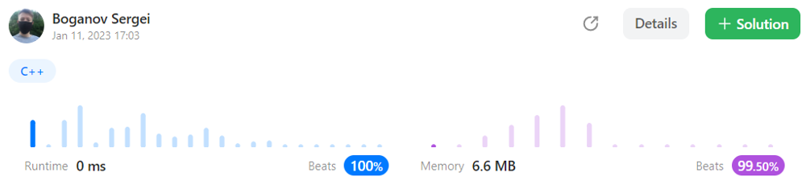

# 🔥 C++ || Beats 100% || O(n + m) time, O(1) space || Easy to understand 🔥

**Author:** frixinglife
**Votes:** 12
**Link:** [https://leetcode.com/problems/decode-the-message/solutions/3035893/](https://leetcode.com/problems/decode-the-message/solutions/3035893/)

---

# Proof beats


# Approach
- Create an array of alphabet size (**26 letters**), initialize it with **-1**.
- Now let's go through the characters of the key. If the character is a whitespace, or there is no -1 in the table for this character (**because we only want the first occurrence of each unique character**), then move on to the next key character.
- Otherwise, we will put a counter in the cell for a given character, and then increase it by one.
- As a result of these actions, **the table will contain offsets relative to the first letter of the alphabet**.
- Now it remains only to go through the characters of the message string and replace non-whitespace characters according to the offsets from the table. But you **must not forget to add offsets to the first letter of the alphabet**.

# Complexity
- Time complexity: $ O(n + m) $
- Space complexity: $ O(26) = O(1) $

# Code
```C++ []
class Solution {
public:
    string decodeMessage(string key, string message) {
        vector<int> table(26, -1);
        for (int i = 0, k = 0; i < key.size(); i++) {
            if (key[i] != ' ' && table[key[i]-'a'] == -1) {
                table[key[i]-'a'] = k++;
            }
        }
        for (int i = 0; i < message.size(); i++) {
            if (message[i] != ' ') {
                message[i] = table[message[i]-'a'] + 'a';
            }
        }  
        return message;
    }
};
```