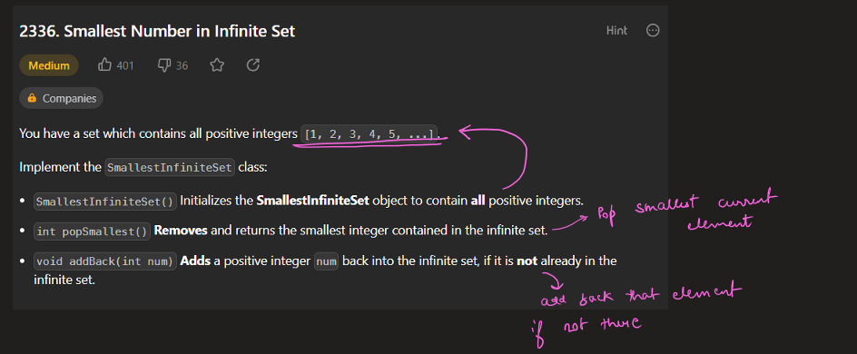
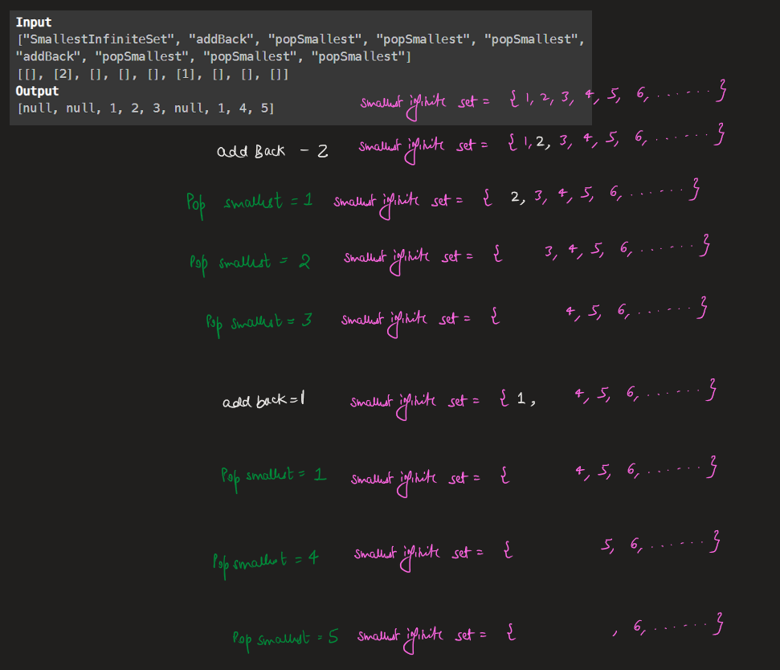
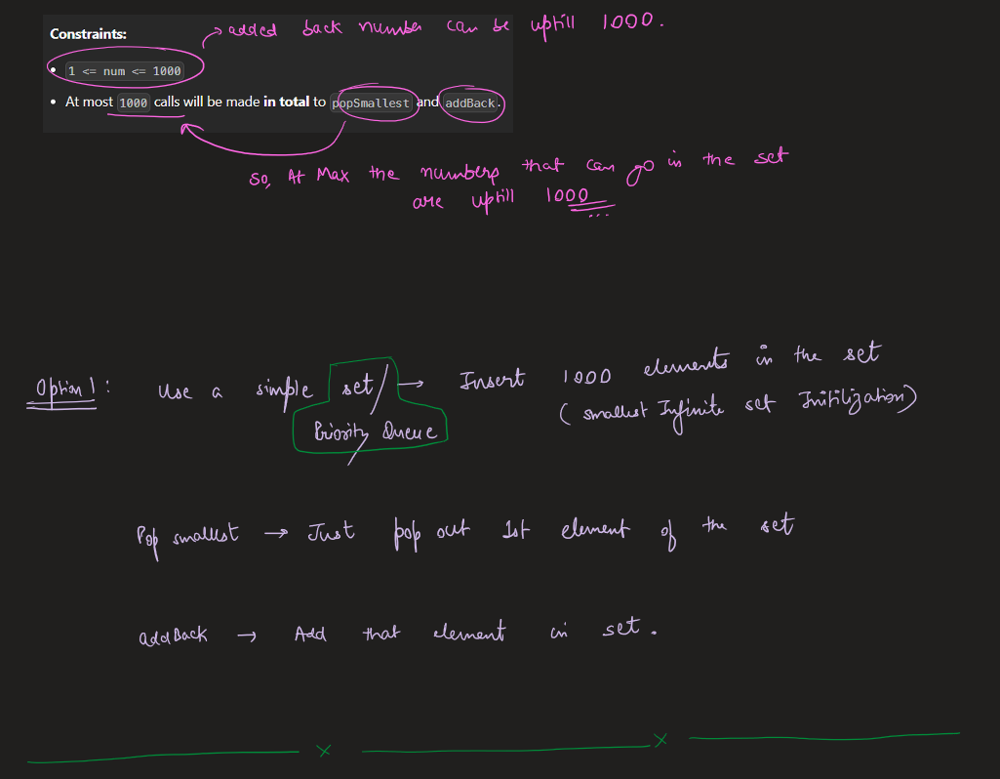
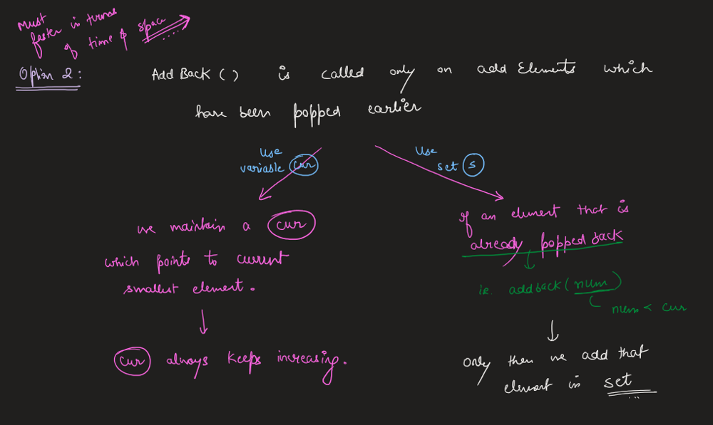
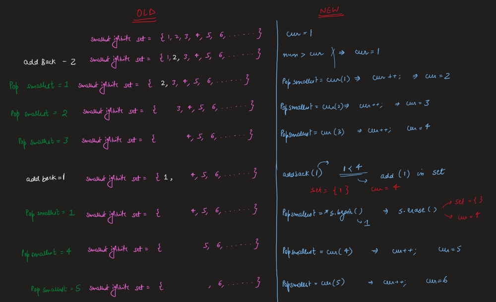
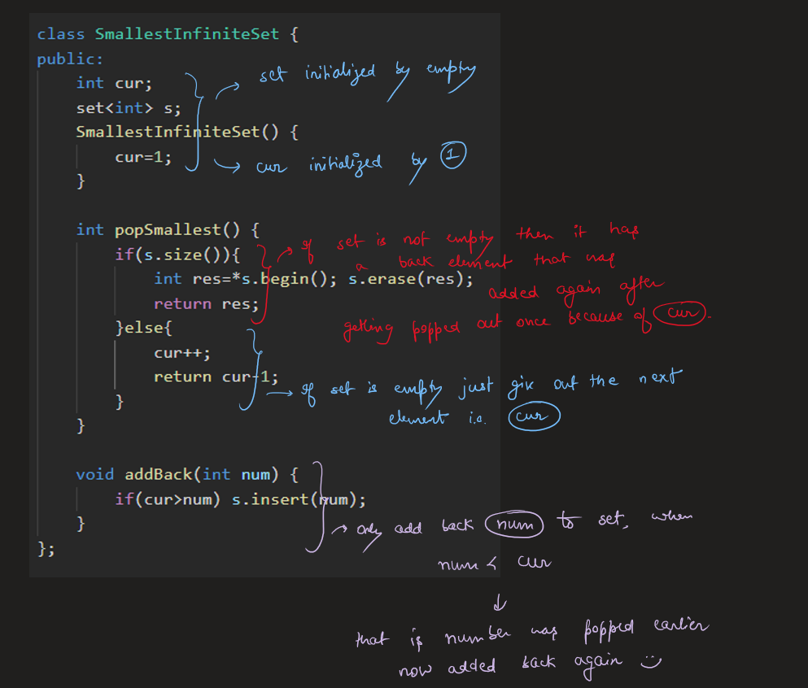
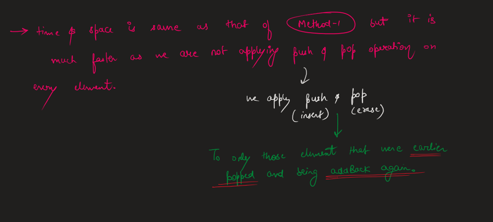

# Image Explanation🏆- [Fastest & Easiest - With Dry Run :) ] - C++/Java/Python

**Author:** aryan_0077
**Votes:** 75
**Link:** [https://leetcode.com/problems/smallest-number-in-infinite-set/solutions/3452136/](https://leetcode.com/problems/smallest-number-in-infinite-set/solutions/3452136/)

---

# Video Solution (`Aryan Mittal`) - Link in LeetCode Profile
`Smallest Number in Infinite Set` by `Aryan Mittal`


# Approach & Intution








# Code
```C++ []
class SmallestInfiniteSet {
public:
    int cur;
    set<int> s;
    SmallestInfiniteSet() {
        cur=1;
    }
    
    int popSmallest() {
        if(s.size()){
            int res=*s.begin(); s.erase(res);
            return res;
        }else{
            cur++;
            return cur-1;
        }
    }
    
    void addBack(int num) {
        if(cur>num) s.insert(num);
    }
};
```
```Java []
class SmallestInfiniteSet {
    int cur;
    Set<Integer> s;
    
    public SmallestInfiniteSet() {
        cur = 1;
        s = new HashSet<>();
    }
    
    public int popSmallest() {
        if (!s.isEmpty()) {
            int res = Collections.min(s);
            s.remove(res);
            return res;
        } else {
            cur++;
            return cur - 1;
        }
    }
    
    public void addBack(int num) {
        if (cur > num) {
            s.add(num);
        }
    }
}
```
```Python []
class SmallestInfiniteSet:
    def __init__(self):
        self.cur = 1
        self.s = set()

    def popSmallest(self):
        if self.s:
            res = min(self.s)
            self.s.remove(res)
            return res
        else:
            self.cur += 1
            return self.cur - 1

    def addBack(self, num):
        if self.cur > num:
            self.s.add(num) 
```
