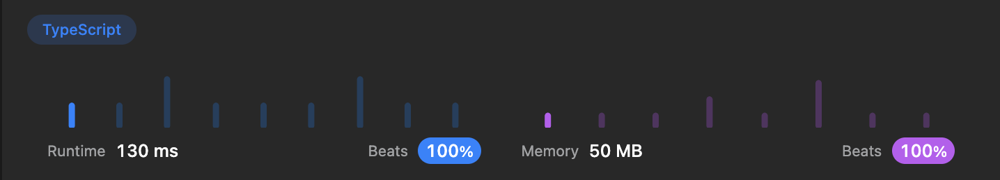

# Simple and fast solution TS/JS (с объяснением на русском)

**Author:** YereskoYerop
**Votes:** 6
**Link:** [https://leetcode.com/problems/smallest-number-in-infinite-set/solutions/3453137/](https://leetcode.com/problems/smallest-number-in-infinite-set/solutions/3453137/)

---

# Code
```typescript []
class SmallestInfiniteSet {
  currentSmall: number = 1
  addedList: number[] = []

  popSmallest(): number {
    // \u0435\u0441\u043B\u0438 \u0432 \u0441\u043F\u0438\u0441\u043A\u0435 \u0435\u0441\u0442\u044C \u044D\u043B\u0435\u043C\u0435\u043D\u0442 \u0431\u0435\u0440\u0435\u043C \u0435\u0433\u043E (\u0441\u0432\u043E\u0439\u0441\u0442\u0432\u0430\u043C\u0438 shift)
    if (this.addedList.length) {
      return this.addedList.shift()
    } else {
      // \u0438\u043D\u0430\u0447\u0435 \u0443\u0432\u0435\u043B\u0438\u0447\u0438\u0432\u0430\u0435\u043C \u0442\u0435\u043A\u0443\u0449\u0435\u0435 \u043C\u0435\u043D\u044C\u0448\u0435\u0435 \u0437\u043D\u0430\u0447\u0435\u043D\u0438\u0435
      this.currentSmall = this.currentSmall + 1
      return this.currentSmall - 1
    }
  }

  addBack(num: number): void {
    // \u043D\u0435\u0442 \u0441\u043C\u044B\u0441\u043B\u0430 \u0445\u0440\u0430\u043D\u0438\u0442\u044C \u0432\u0441\u0435 \u0447\u0442\u043E \u0431\u043E\u043B\u044C\u0448\u0435 \u0442\u0435\u043A\u0443\u0449\u0435\u0433\u043E \u043C\u0435\u043D\u044C\u0448\u0435\u0433\u043E \u0437\u043D\u0430\u0447\u0435\u043D\u0438\u044F
    if (num < this.currentSmall) {
      // \u043D\u0435 \u0437\u0430\u0431\u044B\u0432\u0430\u0435\u043C \u043F\u0440\u043E\u0432\u0435\u0440\u0438\u0442\u044C, \u0432\u043E\u0437\u043C\u043E\u0436\u043D\u043E \u0437\u043D\u0430\u0447\u0435\u043D\u0438\u0435 \u0443\u0436\u0435 \u0435\u0441\u0442\u044C
      if(!this.addedList.includes(num)) {
        this.addedList.push(num)
        // \u043F\u043E\u0441\u0442\u043E\u044F\u043D\u043D\u0430\u044F \u0441\u043E\u0440\u0442\u0438\u0440\u043E\u0432\u043A\u0430 \u043F\u043E\u0437\u0432\u043E\u043B\u044F\u0435\u0442 \u0443\u043F\u0440\u043E\u0441\u0442\u0438\u0442\u044C this.popSmallest
        // \u044D\u0442\u043E log(n) \u043D\u043E \u043F\u043E \u0444\u0430\u043A\u0442\u0443 \u043D\u0430\u0434\u043E \u043E\u0442\u0441\u043E\u0440\u0442\u0438\u0440\u043E\u0432\u0430\u0442\u044C \u0442\u043E\u043B\u044C\u043A\u043E \u043D\u043E\u0432\u044B\u0439 num
        // \u0442\u0430\u043A \u0447\u0442\u043E \u044D\u0442\u043E \u0431\u044B\u0441\u0442\u0440\u043E
        this.addedList = this.addedList.sort((a,b) => a - b)
      }
    }
  }
}
```
```javascript []
var SmallestInfiniteSet = function() {
  this.currentSmall = 1
  this.addedList = [] 
};

SmallestInfiniteSet.prototype.popSmallest = function() {
  // \u0435\u0441\u043B\u0438 \u0432 \u0441\u043F\u0438\u0441\u043A\u0435 \u0435\u0441\u0442\u044C \u044D\u043B\u0435\u043C\u0435\u043D\u0442 \u0431\u0435\u0440\u0435\u043C \u0435\u0433\u043E (\u0441\u0432\u043E\u0439\u0441\u0442\u0432\u0430\u043C\u0438 shift)
  if (this.addedList.length) {
    return this.addedList.shift()
  } else {
    // \u0438\u043D\u0430\u0447\u0435 \u0443\u0432\u0435\u043B\u0438\u0447\u0438\u0432\u0430\u0435\u043C \u0442\u0435\u043A\u0443\u0449\u0435\u0435 \u043C\u0435\u043D\u044C\u0448\u0435\u0435 \u0437\u043D\u0430\u0447\u0435\u043D\u0438\u0435
    this.currentSmall = this.currentSmall + 1
    return this.currentSmall - 1
  }
};

SmallestInfiniteSet.prototype.addBack = function(num) {
  // \u043D\u0435\u0442 \u0441\u043C\u044B\u0441\u043B\u0430 \u0445\u0440\u0430\u043D\u0438\u0442\u044C \u0432\u0441\u0435 \u0447\u0442\u043E \u0431\u043E\u043B\u044C\u0448\u0435 \u0442\u0435\u043A\u0443\u0449\u0435\u0433\u043E \u043C\u0435\u043D\u044C\u0448\u0435\u0433\u043E \u0437\u043D\u0430\u0447\u0435\u043D\u0438\u044F
  if (num < this.currentSmall) {
    // \u043D\u0435 \u0437\u0430\u0431\u044B\u0432\u0430\u0435\u043C \u043F\u0440\u043E\u0432\u0435\u0440\u0438\u0442\u044C, \u0432\u043E\u0437\u043C\u043E\u0436\u043D\u043E \u0437\u043D\u0430\u0447\u0435\u043D\u0438\u0435 \u0443\u0436\u0435 \u0435\u0441\u0442\u044C
    if(!this.addedList.includes(num)) {
      this.addedList.push(num)
      // \u043F\u043E\u0441\u0442\u043E\u044F\u043D\u043D\u0430\u044F \u0441\u043E\u0440\u0442\u0438\u0440\u043E\u0432\u043A\u0430 \u043F\u043E\u0437\u0432\u043E\u043B\u044F\u0435\u0442 \u0443\u043F\u0440\u043E\u0441\u0442\u0438\u0442\u044C this.popSmallest
      // \u044D\u0442\u043E log(n) \u043D\u043E \u043F\u043E \u0444\u0430\u043A\u0442\u0443 \u043D\u0430\u0434\u043E \u043E\u0442\u0441\u043E\u0440\u0442\u0438\u0440\u043E\u0432\u0430\u0442\u044C \u0442\u043E\u043B\u044C\u043A\u043E \u043D\u043E\u0432\u044B\u0439 num
      // \u0442\u0430\u043A \u0447\u0442\u043E \u044D\u0442\u043E \u0431\u044B\u0441\u0442\u0440\u043E
      this.addedList = this.addedList.sort((a,b) => a - b)
    }
  }
};
```


