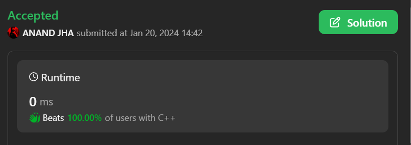

# ✅💯Beats 100.00% of users || Best solution in C++/C#/C || Beginner friendly👍🤝

**Author:** anand18402
**Votes:** 5
**Link:** [https://leetcode.com/problems/first-letter-to-appear-twice/solutions/4596818/](https://leetcode.com/problems/first-letter-to-appear-twice/solutions/4596818/)

---

# PLEASE DO UPVOTE


# Intuition
<!-- Describe your first thoughts on how to solve this problem. -->
The code finds the first repeated character in a given string by maintaining a count of each character using an unordered_map. It iterates through the string and returns the first character with a count of 2, indicating repetition.

# Approach
<!-- Describe your approach to solving the problem. -->
1. First, create a variable named ans to store the letter
2. Then Create an unordered map in which you will store the count of each letter until you find a letter that appears twice
3. Use a loop to iterate through each letter and increment the number of occurrences in the map
4. When you find the first letter to appear twice, store it in the variable ans and use the break function to stop the loop
5. Then return the ans

# Complexity
- Time complexity:O(n)
<!-- Add your time complexity here, e.g. $$O(n)$$ -->

- Space complexity:O(n)
<!-- Add your space complexity here, e.g. $$O(n)$$ -->

# Code
```C++ []
class Solution {
public:
    char repeatedCharacter(string s) {
        int n = s.size();
        char ans;
        unordered_map<char, int> count;
        for(int i=0; i<n; i++){
            count[s[i]]++;
            if(count[s[i]]==2){
                ans = s[i];
                break;
            }
        }
        return ans;
    }
};
```
```C# []
public class Solution {
    public char RepeatedCharacter(string s) {
        int n = s.Length;
        char ans = '\\0';
        Dictionary<char, int> count = new Dictionary<char, int>();

        for (int i = 0; i < n; i++) {
            if (!count.ContainsKey(s[i])) {
                count[s[i]] = 1;
            } else {
                ans = s[i];
                break;
            }
        }

        return ans;
    }
}
```
```C []
char repeatedCharacter(char *s) {
    int n = strlen(s);
    char ans = '\\0';

    int *count = (int *)malloc(256 * sizeof(int)); // Assuming ASCII characters

    for (int i = 0; i < 256; i++) {
        count[i] = 0;
    }

    for (int i = 0; i < n; i++) {
        count[(int)s[i]]++;
        if (count[(int)s[i]] == 2) {
            ans = s[i];
            break;
        }
    }

    free(count);

    return ans;
}
```