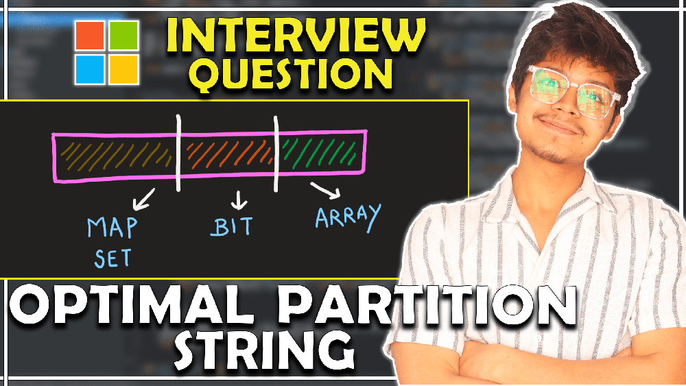
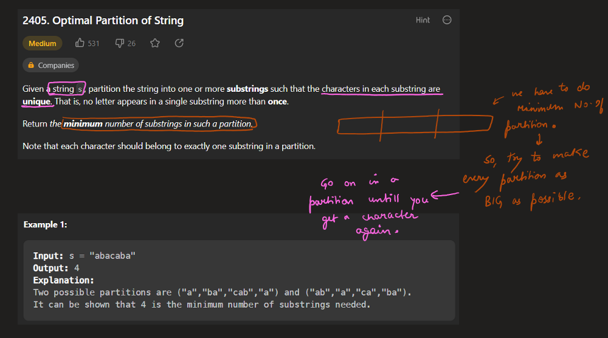
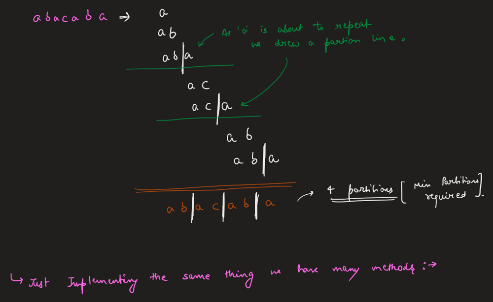
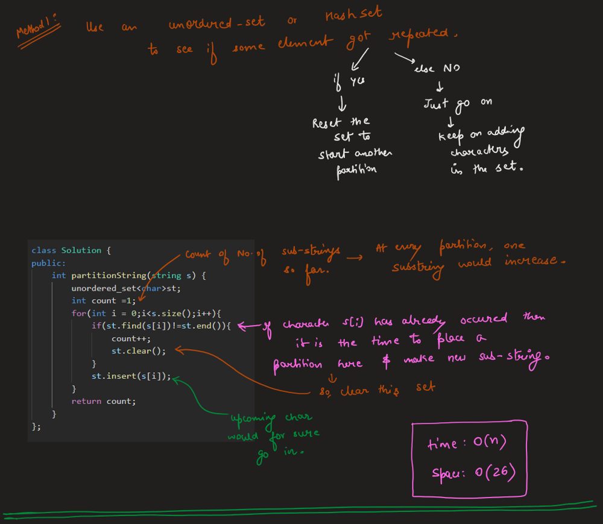
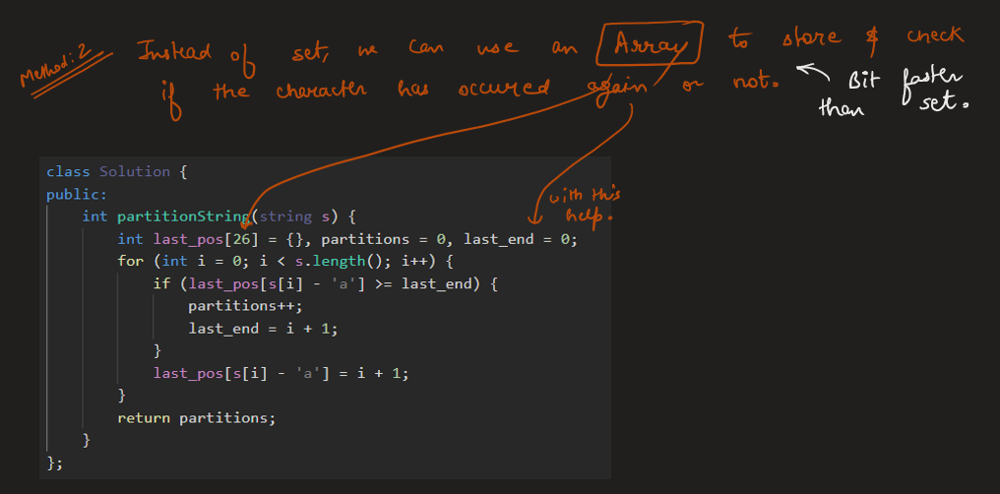
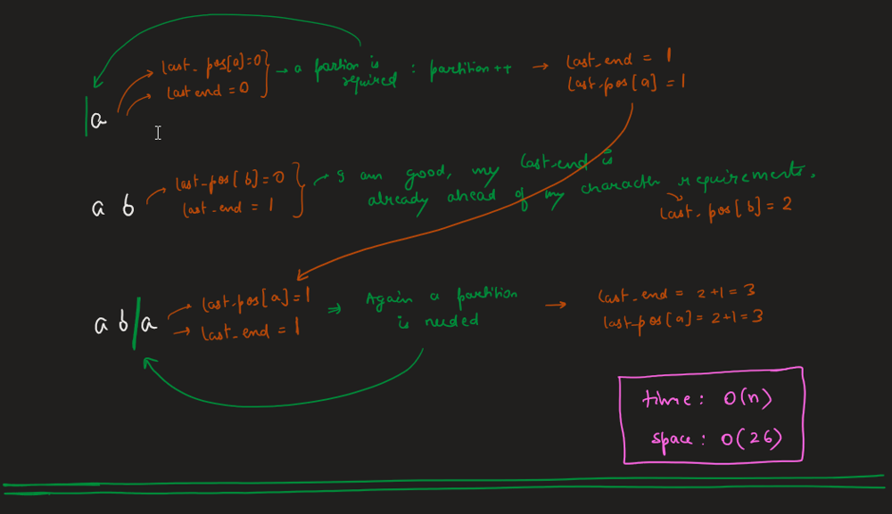
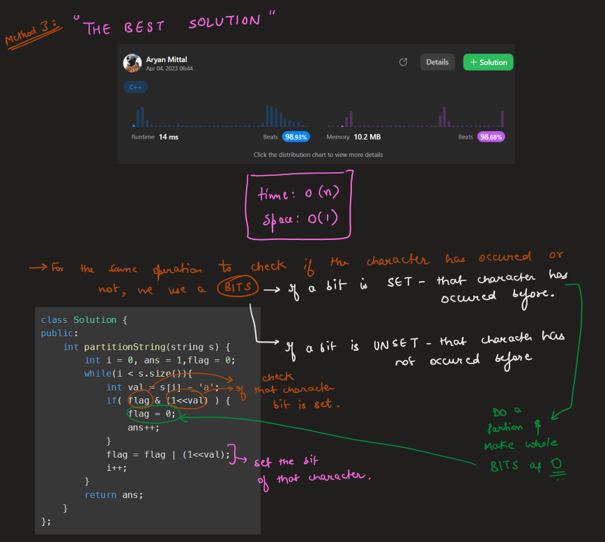

# Image Explanation🏆- [3 Approaches + O(1) Space] - C++/Java/Python

**Author:** aryan_0077
**Votes:** 228
**Link:** [https://leetcode.com/problems/optimal-partition-of-string/solutions/3376693/](https://leetcode.com/problems/optimal-partition-of-string/solutions/3376693/)

---

# Video Solution (`Aryan Mittal`) - Link in LeetCode Profile
`Optimal Partition of String` by `Aryan Mittal`



# Approach & Intution








# Code
```C++ []
class Solution {
public:
    int partitionString(string s) {
        int i = 0, ans = 1,flag = 0;
        while(i < s.size()){
            int val = s[i] - 'a';
            if( flag & (1<<val) ) {
                flag = 0;
                ans++;
            }
            flag = flag | (1<<val);
            i++;
        }
        return ans;
    }
};
```
```Java []
public class Solution {
    public int partitionString(String s) {
        int i = 0, ans = 1, flag = 0;
        while(i < s.length()) {
            int val = s.charAt(i) - 'a';
            if ((flag & (1 << val)) != 0) {
                flag = 0;
                ans++;
            }
            flag = flag | (1 << val);
            i++;
        }
        return ans;
    }
}
```
```Python []
class Solution:
    def partitionString(self, s: str) -> int:
        i, ans, flag = 0, 1, 0
        while i < len(s):
            val = ord(s[i]) - ord('a')
            if flag & (1 << val):
                flag = 0
                ans += 1
            flag |= 1 << val
            i += 1
        return ans
```
