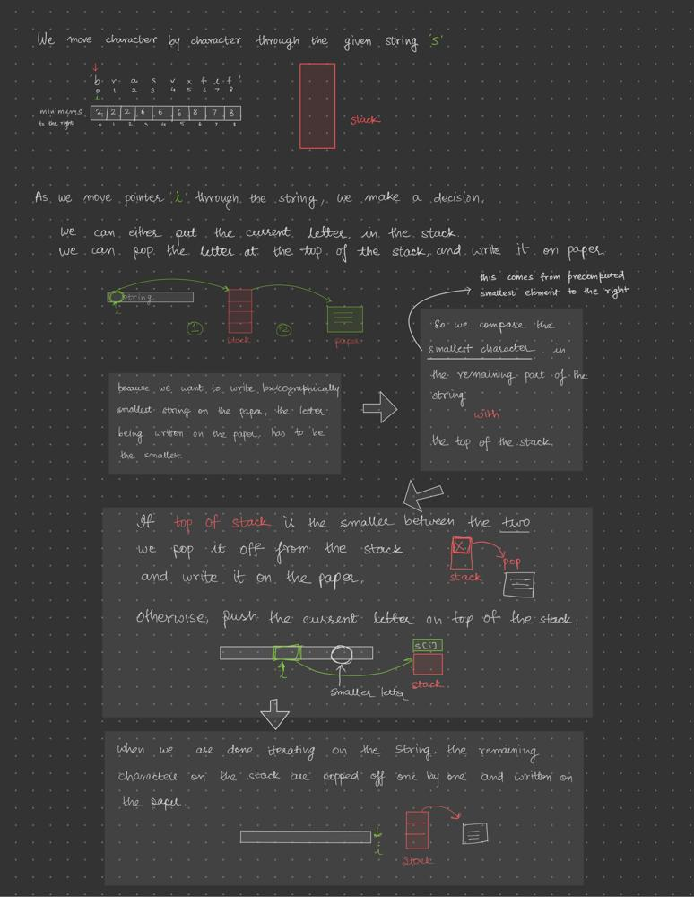

# Intuition and step by step detailed approach with pictures

**Author:** darkalarm
**Votes:** 9
**Link:** [https://leetcode.com/problems/using-a-robot-to-print-the-lexicographically-smallest-string/solutions/2683179/](https://leetcode.com/problems/using-a-robot-to-print-the-lexicographically-smallest-string/solutions/2683179/)

---

# Intuition
Simulate the process, as we would actually do it in the real world. The string `t` can be represented by a stack.

While writing things on paper, we can only pop it off from stack. We can either pop the top of the stack, or we can add a new item in the stack. We remove the top of the stack (and write it down) when it is smaller than (or equal to) the smallest available element in the string. Only the element to the right of the current position are available for writing at any point.

In case we have a smaller element available to the right of the current location in the string, we push the current element on top of the stack. And follow the same process again. 

For finding the smallest element toward the right, we preprocess the given string. We iterate from right to left, and make a note of the index of the minimum element found so far in another array called `minimums`.




# Approach

1. Create an array called `minimums` with length equal to the length of the string.
2. Iterate through the string starting from the last element to the first element. Make a note of the minimum element seen so far, and store its index in the corresponding position in `minimums` array.
3. Create a new `stack`, and another array `result`. `result` represents the letters writte on a paper.
3. Do the following for each index $i$ in the string `s`.
    * If the stack isn't empty, compare the top of the stack with `minimums[i]` element. Pop the top of the stack, and add it to the result until `minimums[i]` element is smaller than the stack top.
    * If `minimums[i]` is smaller, push it on top of the stack.
4. When the loop ends, pop all the elements from the stack, and add them to `answer` one by one.
5. Join all characters of `answer` to form a string and return it.

# Complexity

Let $n$ be the total number of characters in the given string:

* Time complexity: $O(n)$. We iterate through each character of `s` while building `minimums` array. Then as we build `answer` array, we iterate through `s` one more time. Each character is accessed two times, once when it is being pushed on top of the stack, and again when it is being popped from the stack. So the total time complexity remains $O(n)$.
* Space complexity: $O(n)$. We make use of two auxiliary data structures, one is the `minimums` array and the other one is `stack` which can be filled with all the characters in the worst case. So $O(n)$ is the maximum space we use here.


# Code
```javascript
/**
 * @param {string} s
 * @return {string}
 */
var robotWithString = function(s) {
  console.log(s);
  // compute minimum toward the right
  let minimums = new Array(s.length);
  let minimum = '{';
  let minIndex = -1;
  for (let i = s.length - 1; i >= 0; i--) {
    // if the minimum element is equal, we pick
    // the one with lower index
    if (s[i] <= minimum) {
      minimum = s[i];
      minIndex = i;
    }
    minimums[i] = minIndex;
  }
  let result = [];
  let stack = [];
  for (let i = 0; i < s.length; i++) {
    // compare s[minimums[i]] with top of stack
    while (stack.length && s[minimums[i]] >= stack.at(-1)) {
      result.push(stack.pop());
    }
    stack.push(s[i]);
  }

  // the remaining characters in the stack are also popped
  // and added to the answer
  while (stack.length) {
    result.push(stack.pop());
  }

  // return the string made after joining all the characters
  return result.join("");
};
```