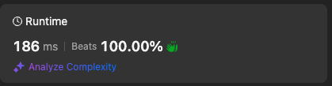

# Beats 100%, Simple solution using minChars array 💅🏻

**Author:** stazcp
**Votes:** 0
**Link:** [https://leetcode.com/problems/using-a-robot-to-print-the-lexicographically-smallest-string/solutions/5338284/](https://leetcode.com/problems/using-a-robot-to-print-the-lexicographically-smallest-string/solutions/5338284/)

---



# Intuition
<!-- Describe your first thoughts on how to solve this problem. -->
This feels like a easy problem at first but because of imposed limitations of operations it can be tricky. I am planning to use an additional Array as a comparison mechanism as I pass off chars to the robot.
This will enable me to know when to stop pushing chars to the p stack until all the smaller chars have been pushed fist this way we ensure a lexicographically smaller word.

# Approach
<!-- Describe your approach to solving the problem. -->
### Phase 1
1. Create an Array `minChars` of length s and fill it with empty strings for now
2. The last element of `minChars` should be the last element of `s` this allows us to have something to compare to as we build our `minChars` Array. We will not account this last index later on our phase 2
3. As we loop backwards from the second from last index we populate the `minChars` Array with the smallest char either the previous one or the current one from `s`.
### Phase 2
1. Now that we have our `minChars` Array ready we iterate over `s` and push the current char to `t`
2. While `t` has elements we compare the last element of `t` with the next element in `minChars` if it is less or equal we `pop` it and `push` into `p`, otherwise we move on pushing the remaining chars to `t`.
### Phase 3
1. If there are remaining elements in `t` the larger chars, we proceed by removing the last element and pushing it to `p`, essentially flipping them in order and placing them after the smaller chars achieving the lexicographically smallest word possible.
2. join `p` and return, this could potentially be optimized if `p` was a string we wouldn't have to join.

# Complexity
- Time complexity: O(n)
<!-- Add your time complexity here, e.g. $$O(n)$$ -->
The complexity is linear O(n) because even though we process each char 3 times this is it and O(3n) the 3 is dropped resulting to O(n).

- Space complexity: O(n)
<!-- Add your space complexity here, e.g. $$O(n)$$ -->
Space complexity is also O(n) because the sizes of `t`, `p`, and `minChars` are limited to the size of `s`.

# Code
```
function robotWithString(s: string): string {
    const t = []
    const p = []
    const minChars = new Array(s.length).fill("")

    minChars[s.length - 1] = s[s.length - 1]
    for (let i = s.length - 2; i >= 0; i--) {
        minChars[i] = s[i] < minChars[i + 1] ? s[i] : minChars[i + 1]
    }

    for(let i = 0; i < s.length; i++){
        t.push(s[i])

        while(t.length && t[t.length -1] <= minChars[i+1]){
            p.push(t.pop())
        }
    }

    while(t.length) p.push(t.pop())

    return p.join("")
};
```