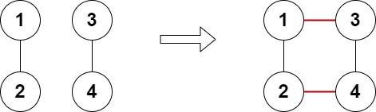
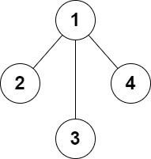

# [2508. Add Edges to Make Degrees of All Nodes Even](https://leetcode.com/problems/add-edges-to-make-degrees-of-all-nodes-even/)

| Category | Difficulty | Likes | Dislikes |
| :------: | :--------: | :---: | :------: |
| Algorithms | Hard | 355 | 59 |

**Tags:** [`hash-table`](https://leetcode.com/tag/hash-table), [`graph`](https://leetcode.com/tag/graph)

**Companies:** `uber`, `hrt`

## Description

There is an **undirected** graph consisting of `n` nodes numbered from `1` to `n`. You are given the integer `n` and a **2D** array `edges` where `edges[i] = [a_i, b_i]` indicates that there is an edge between nodes `a_i` and `b_i`. The graph can be disconnected.

You can add **at most** two additional edges (possibly none) to this graph so that there are no repeated edges and no self-loops.

Return `true`* if it is possible to make the degree of each node in the graph even, otherwise return *`false`*.*

The degree of a node is the number of edges connected to it.

 

**Example 1:**


```

Input: n = 5, edges = [[1,2],[2,3],[3,4],[4,2],[1,4],[2,5]]
Output: true
Explanation: The above diagram shows a valid way of adding an edge.
Every node in the resulting graph is connected to an even number of edges.

```

**Example 2:**


```

Input: n = 4, edges = [[1,2],[3,4]]
Output: true
Explanation: The above diagram shows a valid way of adding two edges.
```

**Example 3:**


```

Input: n = 4, edges = [[1,2],[1,3],[1,4]]
Output: false
Explanation: It is not possible to obtain a valid graph with adding at most 2 edges.
```

 

**Constraints:**

	- `3 <= n <= 10^5`

	- `2 <= edges.length <= 10^5`

	- `edges[i].length == 2`

	- `1 <= a_i, b_i <= n`

	- `a_i != b_i`

	- There are no repeated edges.

---

**Links:** [Submissions](https://leetcode.com/problems/add-edges-to-make-degrees-of-all-nodes-even/) | [Solutions](https://leetcode.com/problems/add-edges-to-make-degrees-of-all-nodes-even/)
