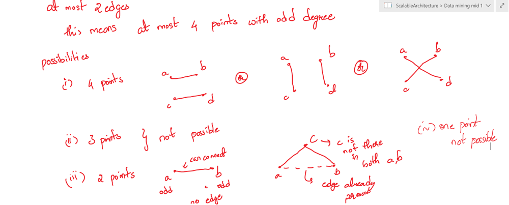

# Easy idea with picture || adjacency list with hashset || c++

**Author:** dinesh55
**Votes:** 29
**Link:** [https://leetcode.com/problems/add-edges-to-make-degrees-of-all-nodes-even/solutions/2923490/](https://leetcode.com/problems/add-edges-to-make-degrees-of-all-nodes-even/solutions/2923490/)

---

##### Please upvote if you like the post \uD83D\uDE0A

The idea is very simple we have to add atmost 2 edges so the question should have atmost 4 points with odd degrees if it is more we can directly return false;

* if the number of points with odd degree is odd then also we can never reach the answer as some of the other edge will become odd 
* hence the points with odd degrees should be even that gives two cases and they would be 



hence the code would be :- 

short version :- 

```c++
class Solution {
public:
    bool isPossible(int n, vector<vector<int>>& edges) {
        vector<unordered_set<int>> adj(n + 1);
        for(vector<int>& e : edges){
            adj[e[0]].insert(e[1]);
            adj[e[1]].insert(e[0]);
        }
        vector<int> odds;
        for(int i = 0; i <= n ; i++){
            if(adj[i].size() & 1){
                odds.push_back(i);
            } 
        }
        if(odds.size() == 0) return true;
        if(odds.size() > 4 or odds.size() % 2 != 0) return false;
        if(odds.size() == 4){
            int a = odds[0] , b = odds[1] , c = odds[2] , d = odds[3];
            return (adj[a].find(d) == adj[a].end() and f2= adj[b].find(c) == adj[b].end()) or  (adj[a].find(b) == adj[a].end() and f4= adj[c].find(d) == adj[c].end()) or (f3 = adj[a].find(c) == adj[a].end() and f4= adj[b].find(d) == adj[b].end())
        }else{
            int a = odds[0] , b = odds[1]; 
            bool flag = adj[a].find(b) == adj[a].end();
            if(flag) return true;
            for(int i = 1; i <= n ;i++){
                if(a != i and b != i and adj[a].find(i) == adj[a].end() and adj[b].find(i) == adj[b].end()) return true;
            }
            return false;
        }
    }
};
```

`Time complexity : O(n)`
`Space complexity: O(n2) [for full connected graph adjaceny matrix would go n2]`

Explained code :- 

```c++
class Solution {
public:
    bool isPossible(int n, vector<vector<int>>& edges) {
        vector<unordered_set<int>> adj(n + 1);
        for(vector<int>& e : edges){
            adj[e[0]].insert(e[1]);
            adj[e[1]].insert(e[0]);
        }
        vector<int> odds;
        for(int i = 0; i <= n ; i++){
            if(adj[i].size() & 1){
                odds.push_back(i);
            } 
        }
        // if no odd edges return true
        if(odds.size() == 0) return true;
        // if odd edges are grteater than 4 or not 2 or 4 it will be always be impossible to make 
        if(odds.size() > 4 or odds.size() % 2 != 0) return false;
        // case 1 : if size is 4
        if(odds.size() == 4){
            // check for a --- d and c -- b if both are not present we can join them
            int a = odds[0] , b = odds[1] , c = odds[2] , d = odds[3];
            bool f1 = adj[a].find(d) == adj[a].end() , f2= adj[b].find(c) == adj[b].end();
            if(f1 and f2) return true;
            // similar check for a -- b and c -- d
            bool f3 = adj[a].find(b) == adj[a].end() , f4= adj[c].find(d) == adj[c].end();
            if(f3 and f4) return true;
            // check for a -- c  and b -- d
             f3 = adj[a].find(c) == adj[a].end() , f4= adj[b].find(d) == adj[b].end();
            if(f3 and f4) return true;
            // if not possible return 
            return false;
        }else{
            int a = odds[0] , b = odds[1]; 
            // if there is no edge between them we cann add so return true
            bool flag = adj[a].find(b) == adj[a].end();
            if(flag) return true;
            // else wee will find a node for which bith a  , b are not neighbours if such thing
            // exists we can make a path through that node 
            for(int i = 1; i <= n ;i++){
                if(a != i and b != i and adj[a].find(i) == adj[a].end() and adj[b].find(i) == adj[b].end()) return true;
            }
            return false;
        }
    }
};
```