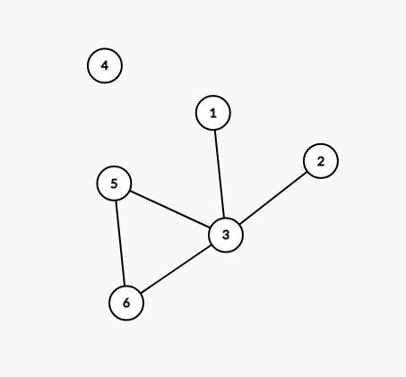
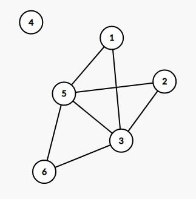

# using list of hashsets and different cases analysis

**Author:** flyRoko123
**Votes:** 14
**Link:** [https://leetcode.com/problems/add-edges-to-make-degrees-of-all-nodes-even/solutions/2932216/](https://leetcode.com/problems/add-edges-to-make-degrees-of-all-nodes-even/solutions/2932216/)

---

**Here we can get 3 conditions as at most 2 nodes is mentioned in the question**
1. if all even degree nodes are present **count(odd degree nodes)=0**
2. if **count(odd degree nodes)=2** *as we can add 1 or 2 edges*
3. if **count(odd degree nodes)=4** *we can add 2 edges*

  Let us suppose **count(odd degree nodes)=2** we can have *2 conditions*
1.  ***if odd degree nodes are not indivually connected with one edge we can connect it*** 
2.  ***if odd degree nodes are individually connected then we will find one common node from where both nodes are not connected which will collectively make all degree of nodes as even***

here in the above graph *we can see nodes(1,2) are not connected with (4,5,6) so we can connect two nodes with any of the (4,5,6)nodes to increase the degree count by 2 which will result in adding two edges and overall degree count of all nodes will remain even*
**this can be one of the result**


Let us suppose **count(odd degree nodes)=4** we can have *3 conditions*
**!(a,b)** *means in a's set b is not present and b's set a is not present*
1. **!(1,2) & !(3,4)** should hold true, we can draw an edge btween 1-2 & 3-4
2. **!(1,3) & !(2,4)** should hold true, we can draw an edge btween 1-3 & 2-4
3. **!(1,4) & !(2,3)** should hold true, we can draw an edge btween 1-4 & 2-3

##### *Below is the implemented code*
```
class Solution {
    public boolean isPossible(int n, List<List<Integer>> edges) {
        //storing adj list in list of hashsets
        List<Set<Integer>> l=new ArrayList<>();
        int degree[]=new int[n+1];
        for(int i=0;i<n+1;i++){
            l.add(new HashSet<>());
        }
        //storing the adj list and counting the degree
        for(List<Integer> x:edges){
            l.get(x.get(0)).add(x.get(1));
            l.get(x.get(1)).add(x.get(0));
            degree[x.get(0)]++;
            degree[x.get(1)]++;
        }
        //for storing odd degrees nodes
        List<Integer> odd=new ArrayList<>();
        for(int i=1;i<n+1;i++){
            if(degree[i]%2==1){
                odd.add(i);
            }
        }
     // if allnodes degrees are even
        if(odd.size()==0)return true;
     // if number of odd degree nodes are 2 then we arise 2 cond  
        if(odd.size()==2){
            Set<Integer> s1=l.get(odd.get(0));
            Set<Integer> s2=l.get(odd.get(1));
            //if two nodes individually not connected
             if(!s1.contains(odd.get(1))){
                 return true;
             }
            //if two nodes are individually connected but can connect with some other even nodes and make all even degree
            else{
                for(int i=1;i<n+1;i++){
                    if(!s1.contains(i) && !s2.contains(i)){
                        return true;
                    }
                }
            }
            
        }
        //if degree of odd nodes are 4 then we can get 4 cond and manually check it
        if(odd.size()==4){
            Set<Integer> s1=l.get(odd.get(0));//1
            Set<Integer> s2=l.get(odd.get(1));//2
            Set<Integer> s3=l.get(odd.get(2));//3
            Set<Integer> s4=l.get(odd.get(3));//4
            
            //first cond !(1,2) && !(3,4)
            if(!s1.contains(odd.get(1)) && !s2.contains(odd.get(0)) && !s3.contains(odd.get(3)) && !s4.contains(odd.get(2))){
                return true;
            }
            //second cond !(1,3) && !(2,4)
            else if(!s1.contains(odd.get(2)) && !s3.contains(odd.get(0)) && !s2.contains(odd.get(3)) && !s4.contains(odd.get(1))){
                return true;
            }
            //third cond second cond !(1,4) && !(2,3)
            else if(!s1.contains(odd.get(3)) && !s4.contains(odd.get(0)) && !s3.contains(odd.get(1)) && !s2.contains(odd.get(2))){
                return true;
            }
        }
        return false;
    }
}

```
*TC~ O(E+V)*
*SC~O(V)*
#####  please upvote if u like my solution