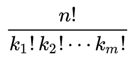
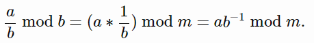
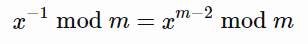

# Beats 100% in time and memory, the fastest solution

**Author:** andigntv
**Votes:** 1
**Link:** [https://leetcode.com/problems/count-anagrams/solutions/4717755/](https://leetcode.com/problems/count-anagrams/solutions/4717755/)

---

# Approach
To get the number of anagrams of the entire string, we need to calculate the number of anagrams of each word and multiply them.
To calculate the number of anagrams of one particular word, we can use the multinomial coefficient:

where $$n$$ - length of the word and $$k_i$$ - number of times the i-th letter has occurred in a word.
Calculating this value directly in Go is quite difficult (as in many other languages).
Knowing that we need to give an answer modulo $$10^9+7$$ we can make some optimizations:
We can use this

and this

where $$m$$ is a prime number, to translate the problem of multiplying large numbers to the problem of exponentiation, because $$10^9+7$$ is a prime number. 
And in order to quickly raise a number to a large power, we can use binary exponentiation

<!-- Describe your approach to solving the problem. -->

# Complexity
- Time complexity: $$O(n + w * log(10^9+7))$$, where $$w$$ - amount of words
As $$log(10^9+7)$$ is a constant and $$w < n$$, we can say that time complexity is $$O(n)$$
<!-- Add your time complexity here, e.g. $$O(n)$$ -->

- Space complexity: $$O(n)$$
<!-- Add your space complexity here, e.g. $$O(n)$$ -->

# Code
```
func countAnagrams(s string) int {
	var mod int64 = 1e9 + 7
	factorials := make([]int64, len(s) + 1)
	factorials[0] = 1
	for i := 1; i <= len(s); i++ {
		factorials[i] = (factorials[i-1] * int64(i)) % mod
	}
	var pow func(val, p int64) int64
	pow = func(val, p int64) int64 {
		if p == 1 {
			return val
		}
		if p%2 == 0 {
			temp := pow(val, p/2)
			return (temp * temp) % mod
		} else {
			return (pow(val, p-1) * val) % mod
		}
	}
	countAnagramsForWord := func(word string) int64 {
		count := [26]int{}
		for _, c := range word {
			count[c-'a']++
		}
		n := len(word)
		result := factorials[n]
		for _, c := range count {
			result = (result * pow(factorials[c], mod-2)) % mod
		}
		return result
	}
	var result int64 = 1
	words := strings.Fields(s)
	for _, word := range words {
		result = (result * countAnagramsForWord(word)) % mod
	}
	return int(result)
}
```