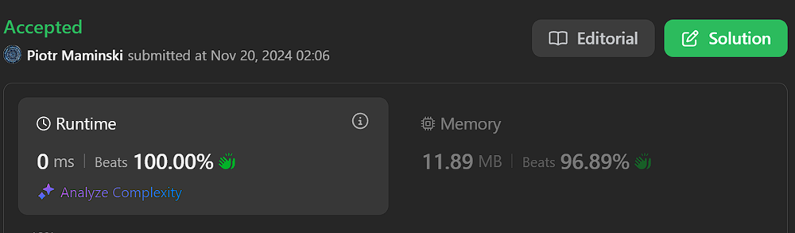
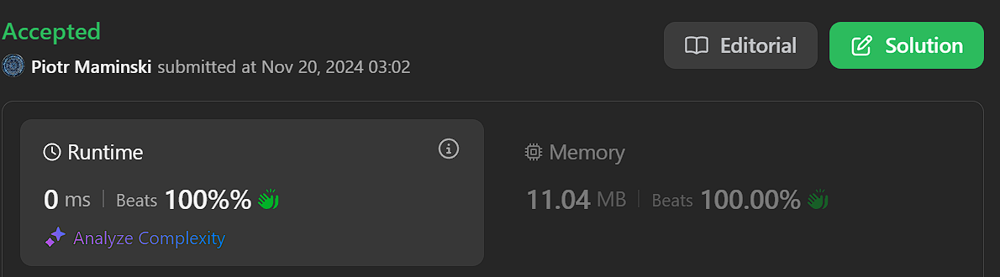
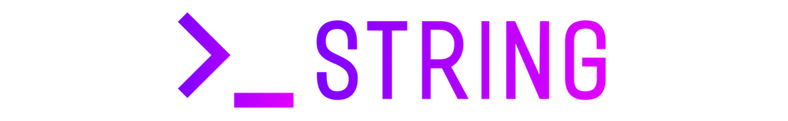

# ✅Beats 100% | Video Full Explain. | List Most Common String Interview Problems✅

**Author:** Piotr_Maminski
**Votes:** 101
**Link:** [https://leetcode.com/problems/take-k-of-each-character-from-left-and-right/solutions/6063845/](https://leetcode.com/problems/take-k-of-each-character-from-left-and-right/solutions/6063845/)

---


https://youtu.be/QzcxeJZByNM?si=W_BZb-qiZhJQUsh7

# #1 Sliding Window -  Simplest

- Go,JS,TS,Ruby,Rust beats 100%, Py,Java,C++,C# - 40-60%
```python3 []
class Solution:
    def takeCharacters(self, s: str, k: int) -> int:
        # Total counts
        count = [0, 0, 0]
        for c in s:
            count[ord(c) - ord('a')] += 1

        if min(count) < k:
            return -1

        # Sliding Window
        res = float("inf")
        l = 0
        for r in range(len(s)):
            count[ord(s[r]) - ord('a')] -= 1

            while min(count) < k:
                count[ord(s[l]) - ord('a')] += 1
                l += 1
            res = min(res, len(s) - (r - l + 1))
        return res
```
```cpp []
class Solution {
public:
    int takeCharacters(string s, int k) {
        // Total counts
        vector<int> count(3, 0);
        for (char c : s) {
            count[c - 'a']++;
        }
        
        if (*min_element(count.begin(), count.end()) < k) {
            return -1;
        }
        
        // Sliding Window
        int res = INT_MAX;
        int l = 0;
        for (int r = 0; r < s.length(); r++) {
            count[s[r] - 'a']--;
            
            while (*min_element(count.begin(), count.end()) < k) {
                count[s[l] - 'a']++;
                l++;
            }
            res = min(res, static_cast<int>(s.length()) - (r - l + 1));
        }
        return res;
    }
};
```
```java []
class Solution {
    public int takeCharacters(String s, int k) {
        // Total counts
        int[] count = new int[3];
        for (char c : s.toCharArray()) {
            count[c - 'a']++;
        }
        
        if (Math.min(Math.min(count[0], count[1]), count[2]) < k) {
            return -1;
        }
        
        // Sliding Window
        int res = Integer.MAX_VALUE;
        int l = 0;
        for (int r = 0; r < s.length(); r++) {
            count[s.charAt(r) - 'a']--;
            
            while (Math.min(Math.min(count[0], count[1]), count[2]) < k) {
                count[s.charAt(l) - 'a']++;
                l++;
            }
            res = Math.min(res, s.length() - (r - l + 1));
        }
        return res;
    }
}
```
```csharp []
public class Solution {
    public int TakeCharacters(string s, int k) {
        // Total counts
        int[] count = new int[3];
        foreach (char c in s) {
            count[c - 'a']++;
        }
        
        if (Math.Min(Math.Min(count[0], count[1]), count[2]) < k) {
            return -1;
        }
        
        // Sliding Window
        int res = int.MaxValue;
        int l = 0;
        for (int r = 0; r < s.Length; r++) {
            count[s[r] - 'a']--;
            
            while (Math.Min(Math.Min(count[0], count[1]), count[2]) < k) {
                count[s[l] - 'a']++;
                l++;
            }
            res = Math.Min(res, s.Length - (r - l + 1));
        }
        return res;
    }
}
```
```golang []
func takeCharacters(s string, k int) int {
    // Total counts
    count := make([]int, 3)
    for _, c := range s {
        count[c-'a']++
    }
    
    if min(count[0], min(count[1], count[2])) < k {
        return -1
    }
    
    // Sliding Window
    res := len(s) + 1
    l := 0
    for r := 0; r < len(s); r++ {
        count[s[r]-'a']--
        
        for min(count[0], min(count[1], count[2])) < k {
            count[s[l]-'a']++
            l++
        }
        res = min(res, len(s)-(r-l+1))
    }
    return res
}

func min(a, b int) int {
    if a < b {
        return a
    }
    return b
}
```
```swift []
class Solution {
    func takeCharacters(_ s: String, _ k: Int) -> Int {
        // Total counts
        var count = [0, 0, 0]
        let chars = Array(s)
        for c in chars {
            count[Int(c.asciiValue! - Character("a").asciiValue!)] += 1
        }
        
        if count.min()! < k {
            return -1
        }
        
        // Sliding Window
        var res = Int.max
        var l = 0
        for r in 0..<chars.count {
            count[Int(chars[r].asciiValue! - Character("a").asciiValue!)] -= 1
            
            while count.min()! < k {
                count[Int(chars[l].asciiValue! - Character("a").asciiValue!)] += 1
                l += 1
            }
            res = min(res, chars.count - (r - l + 1))
        }
        return res
    }
}
```
```javascript [JS]
// JavaScript

var takeCharacters = function(s, k) {
    // Total counts
    const count = [0, 0, 0];
    for (let c of s) {
        count[c.charCodeAt(0) - 'a'.charCodeAt(0)]++;
    }
    
    if (Math.min(...count) < k) {
        return -1;
    }
    
    // Sliding Window
    let res = Infinity;
    let l = 0;
    for (let r = 0; r < s.length; r++) {
        count[s.charCodeAt(r) - 'a'.charCodeAt(0)]--;
        
        while (Math.min(...count) < k) {
            count[s.charCodeAt(l) - 'a'.charCodeAt(0)]++;
            l++;
        }
        res = Math.min(res, s.length - (r - l + 1));
    }
    return res;
};
```
```typescript [TS]
// TypeScript

function takeCharacters(s: string, k: number): number {
    // Total counts
    const count: number[] = [0, 0, 0];
    for (const c of s) {
        count[c.charCodeAt(0) - 'a'.charCodeAt(0)]++;
    }
    
    if (Math.min(...count) < k) {
        return -1;
    }
    
    // Sliding Window
    let res = Infinity;
    let l = 0;
    for (let r = 0; r < s.length; r++) {
        count[s.charCodeAt(r) - 'a'.charCodeAt(0)]--;
        
        while (Math.min(...count) < k) {
            count[s.charCodeAt(l) - 'a'.charCodeAt(0)]++;
            l++;
        }
        res = Math.min(res, s.length - (r - l + 1));
    }
    return res;
}
```
```rust []
impl Solution {
    pub fn take_characters(s: String, k: i32) -> i32 {
        // Total counts
        let mut count = vec![0; 3];
        for c in s.chars() {
            count[(c as u8 - b'a') as usize] += 1;
        }
        
        if count.iter().min().unwrap() < &k {
            return -1;
        }
        
        // Sliding Window
        let s_bytes = s.as_bytes();
        let mut res = i32::MAX;
        let mut l = 0;
        for r in 0..s_bytes.len() {
            count[(s_bytes[r] - b'a') as usize] -= 1;
            
            while count.iter().min().unwrap() < &k {
                count[(s_bytes[l] - b'a') as usize] += 1;
                l += 1;
            }
            res = res.min(s_bytes.len() as i32 - (r as i32 - l as i32 + 1));
        }
        res
    }
}


```
```ruby []
def take_characters(s, k)
    # Total counts
    count = [0, 0, 0]
    s.each_char do |c|
        count[c.ord - 'a'.ord] += 1
    end
    
    return -1 if count.min < k
    
    # Sliding Window
    res = Float::INFINITY
    l = 0
    s.length.times do |r|
        count[s[r].ord - 'a'.ord] -= 1
        
        while count.min < k
            count[s[l].ord - 'a'.ord] += 1
            l += 1
        end
        res = [res, s.length - (r - l + 1)].min
    end
    res
end
```

- Complexity: Time O(n) & Space O(1)

---


# #2 Sliding Window (beats mostly 95-100%)
```python3 []
class Solution:
    def takeCharacters(self, text: str, req: int) -> int:
        freq = [0] * 3
        size = len(text)
        
        for char in text:
            freq[ord(char) - ord('a')] += 1
        
        left = 0
        right = 0
        
        if freq[0] < req or freq[1] < req or freq[2] < req:
            return -1
        
        for right in range(size):
            freq[ord(text[right]) - ord('a')] -= 1
            
            if freq[0] < req or freq[1] < req or freq[2] < req:
                freq[ord(text[left]) - ord('a')] += 1
                left += 1
        
        return size - (right - left + 1)
```
```cpp []
class Solution {
public:
    int takeCharacters(string s, int k) {
        vector<int> freq(3, 0);
        int n = s.length();
        
        for (char c : s) {
            freq[c - 'a']++;
        }
        
        if (freq[0] < k || freq[1] < k || freq[2] < k) {
            return -1;
        }
        
        vector<int> curr(3, 0);
        int maxLen = 0;
        int left = 0;
        
        for (int right = 0; right < n; right++) {
            curr[s[right] - 'a']++;
            
            while (left <= right && (curr[0] > freq[0] - k || 
                   curr[1] > freq[1] - k || 
                   curr[2] > freq[2] - k)) {
                curr[s[left] - 'a']--;
                left++;
            }
            
            maxLen = max(maxLen, right - left + 1);
        }
        
        return n - maxLen;
    }
};
```
```java []
class Solution {
    public int takeCharacters(String s, int k) {
        int[] charCount = new int[3];
        char[] chars = s.toCharArray();
        int length = chars.length;
        
        int left;
        for (left = 0; left < length; left++) {
            charCount[chars[left] - 'a']++;
            if (isValidCount(charCount, k)) {
                break;
            }
        }
        
        if (left == length) {
            return -1;
        }
        
        int currentCount = left + 1;
        int minCount = currentCount;
        int right = length - 1;
        
        while (left >= 0) {
            int currentChar = chars[left] - 'a';
            
            if (charCount[currentChar] == k) {
                while (chars[left] != chars[right]) {
                    charCount[chars[right] - 'a']++;
                    right--;
                    currentCount++;
                }
                right--;
            } else {
                charCount[currentChar]--;
                currentCount--;
                minCount = Math.min(currentCount, minCount);
            }
            left--;
        }
        
        return minCount;
    }
    
    private boolean isValidCount(int[] count, int k) {
        return count[0] >= k && count[1] >= k && count[2] >= k;
    }
}


/* Simplest alternative 

class Solution {
    public int takeCharacters(String s, int k) {
        int[] freq = new int[3];
        int n = s.length();
        
        for (char c : s.toCharArray()) {
            freq[c - 'a']++;
        }
        
        if (freq[0] < k || freq[1] < k || freq[2] < k) {
            return -1;
        }
        
        int[] curr = new int[3];
        int maxLen = 0;
        int left = 0;
        
        for (int right = 0; right < n; right++) {
            curr[s.charAt(right) - 'a']++;
            
            while (left <= right && (curr[0] > freq[0] - k || 
                   curr[1] > freq[1] - k || 
                   curr[2] > freq[2] - k)) {
                curr[s.charAt(left) - 'a']--;
                left++;
            }
            
            maxLen = Math.max(maxLen, right - left + 1);
        }
        
        return n - maxLen;
    }
}
*/
```
```csharp []
public class Solution {
    public int TakeCharacters(string s, int k) {
        int[] freq = new int[3];
        int n = s.Length;
        
        foreach (char c in s) {
            freq[c - 'a']++;
        }
        
        if (freq[0] < k || freq[1] < k || freq[2] < k) {
            return -1;
        }
        
        int[] curr = new int[3];
        int maxLen = 0;
        int left = 0;
        
        for (int right = 0; right < n; right++) {
            curr[s[right] - 'a']++;
            
            while (left <= right && (curr[0] > freq[0] - k || 
                   curr[1] > freq[1] - k || 
                   curr[2] > freq[2] - k)) {
                curr[s[left] - 'a']--;
                left++;
            }
            
            maxLen = Math.Max(maxLen, right - left + 1);
        }
        
        return n - maxLen;
    }
}
```
```golang []
func takeCharacters(s string, k int) int {
    freq := make([]int, 3)
    n := len(s)
    
    for _, c := range s {
        freq[c-'a']++
    }
    
    if freq[0] < k || freq[1] < k || freq[2] < k {
        return -1
    }
    
    curr := make([]int, 3)
    maxLen := 0
    left := 0
    
    for right := 0; right < n; right++ {
        curr[s[right]-'a']++
        
        for left <= right && (curr[0] > freq[0]-k || 
            curr[1] > freq[1]-k || 
            curr[2] > freq[2]-k) {
            curr[s[left]-'a']--
            left++
        }
        
        if right-left+1 > maxLen {
            maxLen = right-left+1
        }
    }
    
    return n - maxLen
}
```
```swift []
class Solution {
    func takeCharacters(_ s: String, _ k: Int) -> Int {
        var freq = [0, 0, 0]
        let chars = Array(s)
        let n = chars.count
        
        for c in chars {
            freq[Int(c.asciiValue! - Character("a").asciiValue!)] += 1
        }
        
        if freq[0] < k || freq[1] < k || freq[2] < k {
            return -1
        }
        
        var curr = [0, 0, 0]
        var maxLen = 0
        var left = 0
        
        for right in 0..<n {
            curr[Int(chars[right].asciiValue! - Character("a").asciiValue!)] += 1
            
            while left <= right && (curr[0] > freq[0] - k ||
                   curr[1] > freq[1] - k ||
                   curr[2] > freq[2] - k) {
                curr[Int(chars[left].asciiValue! - Character("a").asciiValue!)] -= 1
                left += 1
            }
            
            maxLen = max(maxLen, right - left + 1)
        }
        
        return n - maxLen
    }
}
```
```javascript [JS]
// JavaScript

var takeCharacters = function(s, k) {
    const freq = [0, 0, 0];
    const n = s.length;
    
    for (const c of s) {
        freq[c.charCodeAt(0) - 'a'.charCodeAt(0)]++;
    }
    
    if (freq[0] < k || freq[1] < k || freq[2] < k) {
        return -1;
    }
    
    const curr = [0, 0, 0];
    let maxLen = 0;
    let left = 0;
    
    for (let right = 0; right < n; right++) {
        curr[s.charCodeAt(right) - 'a'.charCodeAt(0)]++;
        
        while (left <= right && (curr[0] > freq[0] - k ||
               curr[1] > freq[1] - k ||
               curr[2] > freq[2] - k)) {
            curr[s.charCodeAt(left) - 'a'.charCodeAt(0)]--;
            left++;
        }
        
        maxLen = Math.max(maxLen, right - left + 1);
    }
    
    return n - maxLen;
};
```
```typescript [TS]
// TypeScript

function takeCharacters(s: string, k: number): number {
    const freq: number[] = [0, 0, 0];
    const n: number = s.length;
    
    for (const c of s) {
        freq[c.charCodeAt(0) - 'a'.charCodeAt(0)]++;
    }
    
    if (freq[0] < k || freq[1] < k || freq[2] < k) {
        return -1;
    }
    
    const curr: number[] = [0, 0, 0];
    let maxLen: number = 0;
    let left: number = 0;
    
    for (let right = 0; right < n; right++) {
        curr[s.charCodeAt(right) - 'a'.charCodeAt(0)]++;
        
        while (left <= right && (curr[0] > freq[0] - k ||
               curr[1] > freq[1] - k ||
               curr[2] > freq[2] - k)) {
            curr[s.charCodeAt(left) - 'a'.charCodeAt(0)]--;
            left++;
        }
        
        maxLen = Math.max(maxLen, right - left + 1);
    }
    
    return n - maxLen;
}
```
```rust []
impl Solution {
    pub fn take_characters(s: String, k: i32) -> i32 {
        let mut freq = vec![0; 3];
        let n = s.len();
        let s_bytes = s.as_bytes();
        
        for &c in s_bytes {
            freq[(c - b'a') as usize] += 1;
        }
        
        if freq[0] < k || freq[1] < k || freq[2] < k {
            return -1;
        }
        
        let mut curr = vec![0; 3];
        let mut max_len = 0;
        let mut left = 0;
        
        for right in 0..n {
            curr[(s_bytes[right] - b'a') as usize] += 1;
            
            while left <= right && (curr[0] > freq[0] - k ||
                   curr[1] > freq[1] - k ||
                   curr[2] > freq[2] - k) {
                curr[(s_bytes[left] - b'a') as usize] -= 1;
                left += 1;
            }
            
            max_len = max_len.max(right - left + 1);
        }
        
        (n - max_len) as i32
    }
}
```
```ruby []
def take_characters(s, k)
    freq = [0, 0, 0]
    n = s.length
    
    s.each_char do |c|
        freq[c.ord - 'a'.ord] += 1
    end
    
    return -1 if freq[0] < k || freq[1] < k || freq[2] < k
    
    curr = [0, 0, 0]
    max_len = 0
    left = 0
    
    (0...n).each do |right|
        curr[s[right].ord - 'a'.ord] += 1
        
        while left <= right && (curr[0] > freq[0] - k ||
               curr[1] > freq[1] - k ||
               curr[2] > freq[2] - k)
            curr[s[left].ord - 'a'.ord] -= 1
            left += 1
        end
        
        max_len = [max_len, right - left + 1].max
    end
    
    n - max_len
end
```
- Complexity: Time O(n) & Space O(1)


---


# #3 Sliding Window + Dictionary - Shorter version (Beats Py 94% C++ 100%)

```python3 []
class Solution:
    def takeCharacters(self,s,k):
        d={c:s.count(c)-k for c in'abc'}
        if min(d.values())<0:return-1
        h,m,l={c:0 for c in'abc'},0,0
        for r,c in enumerate(s):
            h[c]+=1
            while h[c]>d[c]:h[s[l]]-=1;l+=1
            m=max(m,r-l+1)
        return len(s)-m
```
```cpp []
class Solution {
public:
    int takeCharacters(string s, int k) {
        vector<int> d(3), h(3);
        for (char c : s) d[c-'a']++;
        for (int i = 0; i < 3; i++) if ((d[i] -= k) < 0) return -1;
        
        int m = 0, l = 0;
        for (int r = 0; r < s.length(); r++) {
            h[s[r]-'a']++;
            while (l <= r && h[s[r]-'a'] > d[s[r]-'a']) h[s[l++]-'a']--;
            m = max(m, r - l + 1);
        }
        return s.length() - m;
    }
};
```
```java []
class Solution {
    public int takeCharacters(String s, int k) {
        int[] d = new int[3], h = new int[3];
        for (char c : s.toCharArray()) d[c - 'a']++;
        for (int i = 0; i < 3; i++) if ((d[i] -= k) < 0) return -1;
        
        int m = 0, l = 0;
        for (int r = 0; r < s.length(); r++) {
            h[s.charAt(r) - 'a']++;
            while (l <= r && h[s.charAt(r) - 'a'] > d[s.charAt(r) - 'a']) h[s.charAt(l++) - 'a']--;
            m = Math.max(m, r - l + 1);
        }
        return s.length() - m;
    }
}
```



- Complexity: Time O(n) & Space O(1)


---


# #4 Overkill (Beats CPU:100% RAM:100%)
- Edit:  [Sergei better version](https://leetcode.com/problems/take-k-of-each-character-from-left-and-right/submissions/1458010801)
```cpp []
#define NO_SAN __attribute__((no_sanitize("undefined", "address", "coverage", "thread")))
#define INL __attribute__((always_inline))
#define HOT __attribute__((hot))

class Solution {
private:
    static constexpr uint MAXV = 100'000;
    static uint16_t freqs[3];

    static bool checkFreqs(const int k) INL NO_SAN HOT {
        return freqs[0] >= k && freqs[1] >= k && freqs[2] >= k;
    }

public:
    static int takeCharacters(string& s, const int k) NO_SAN HOT {
        const int n = s.length();
        fill(freqs, freqs + 3, 0);
        
        for (char c : s) {
            freqs[c - 'a']++;
        }
        
        if (!checkFreqs(k)) {
            return -1;
        }

        int result = n;
        int left = 0;
        uint16_t window[3] = {0, 0, 0};

        for (int right = 0; right < n; right++) {
            window[s[right] - 'a']++;
            
            while (freqs[0] - window[0] < k || 
                   freqs[1] - window[1] < k || 
                   freqs[2] - window[2] < k) {
                window[s[left] - 'a']--;
                left++;
            }
            
            result = min(result, n - (right - left + 1));
        }
        
        return result;
    }
};

uint16_t Solution::freqs[3];

static auto init = []() NO_SAN HOT {
    ios::sync_with_stdio(false);
    cin.tie(nullptr);
    cout.tie(nullptr);
    return 'c';
}();
```




---





# Most common String Interview Problems
List based on my research (interviews, reddit, github) Probably not 100% accurate but very close to my recruitments. Leetcode Premium is probably more accurate [I don't have]


**Easy:** [[20. Valid Parentheses]](https://leetcode.com/problems/valid-parentheses/solutions/6013115/solution) [[28. Find the Index of the First Occurrence in a String]](https://leetcode.com/problems/find-the-index-of-the-first-occurrence-in-a-string) [[13. Roman to Integer]](https://leetcode.com/problems/roman-to-integer/solutions/6021029/beats-100-explained-step-by-step-list-most-common-string-interview-problems/) [[125. Valid Palindrome]](https://leetcode.com/problems/valid-palindrome) [[680. Valid Palindrome II]](https://leetcode.com/problems/valid-palindrome-ii) [[67. Add Binary]](https://leetcode.com/problems/add-binary)


**Medium/Hard:** [[8. String to Integer (atoi)]](https://leetcode.com/problems/string-to-integer-atoi/solutions/6013112/solution/) [[3. Longest Substring Without Repeating Characters]](https://leetcode.com/problems/longest-substring-without-repeating-characters/solutions/6013106/solutions/) [[5. Longest Palindromic Substring]](https://leetcode.com/problems/longest-palindromic-substring/solutions/6013111/solution/) [[937. Reorder Data in Log Files]](https://leetcode.com/problems/reorder-data-in-log-files) [[68. Text Justification]](https://leetcode.com/problems/text-justification) [[32. Longest Valid Parentheses]](https://leetcode.com/problems/longest-valid-parentheses) [[12. Integer to Roman]](https://leetcode.com/problems/integer-to-roman/solutions/6023402/solutions) [[22. Generate Parentheses]](https://leetcode.com/problems/generate-parentheses) [[65. Valid Number]](https://leetcode.com/problems/valid-number) [[49. Group Anagrams]](https://leetcode.com/problems/group-anagrams)


####  [Interview Questions and Answers Repository](https://github.com/RooTinfinite/Interview-questions-and-answers)


