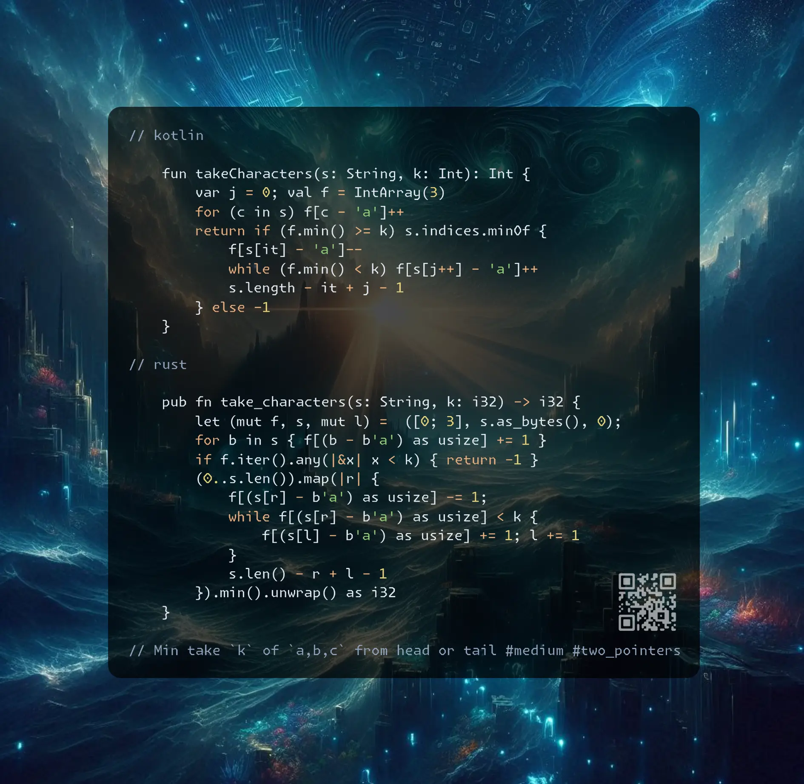

# Kotlin | Rust

**Author:** SamoylenkoDmitry
**Votes:** 2
**Link:** [https://leetcode.com/problems/take-k-of-each-character-from-left-and-right/solutions/6064919/](https://leetcode.com/problems/take-k-of-each-character-from-left-and-right/solutions/6064919/)

---



https://youtu.be/A_EirfT5MP4

#### Join me on Telegram

https://t.me/leetcode_daily_unstoppable/806

#### Problem TLDR

Min take `k` of `a,b,c` from head or tail #medium #two_pointers

#### Intuition

There are 3 possible ways: take from the head, take from the tail and take both. We can calculate prefix sums and use them with a sliding window of the middle part (always expand, shrink until we good):

```j

    // 0123456789010
    // aabaaaacaabc    k=2     2a 2b 2c
    //   j-> i-> 
    //   baaaa         a = abc[a].last() - abc[a][i] + abc[a][j]    
    // aab   acaabc

```

There is a more concise solution if we think from another angle:
start by taking all elements, then move the same sliding window, but check only frequencies instead of calculating range sums.

#### Approach

* the skill of writing the short code is ortogonal to the problem solving
* my battlefield solution was long and containing too many of-by-ones
* jump from prefix sums to frequencies is not trivial
* it is hard to quickly switch the mind flow from one approach to another

#### Complexity

- Time complexity:
$$O(n)$$

- Space complexity:
$$O(1)$$

#### Code

```kotlin []

    fun takeCharacters(s: String, k: Int): Int {
        var j = 0; val f = IntArray(3)
        for (c in s) f[c - 'a']++
        return if (f.min() >= k) s.indices.minOf {
            f[s[it] - 'a']--
            while (f.min() < k) f[s[j++] - 'a']++
            s.length - it + j - 1
        } else -1
    }

```
```rust []

    pub fn take_characters(s: String, k: i32) -> i32 {
        let (mut f, s, mut l) =  ([0; 3], s.as_bytes(), 0);
        for b in s { f[(b - b'a') as usize] += 1 }
        if f.iter().any(|&x| x < k) { return -1 }
        (0..s.len()).map(|r| {
            f[(s[r] - b'a') as usize] -= 1;
            while f[(s[r] - b'a') as usize] < k {
                f[(s[l] - b'a') as usize] += 1; l += 1
            }
            s.len() - r + l - 1
        }).min().unwrap() as i32
    }

```
```c++ []

    int takeCharacters(string s, int k) {
        int f[3] = {}, l = 0, r = 0, res = s.size();
        for (auto c : s) f[c - 'a']++;
        if (min({f[0], f[1], f[2]}) < k) return -1;
        for (;r < s.size(); res = min(res, (int) s.size() - r + l))
            if (--f[s[r++] - 'a'] < k)
                for (;f[s[r - 1] - 'a'] < k; ++f[s[l++] - 'a']);
        return res;
    }

```
```kotlin []

    fun takeCharacters(s: String, k: Int): Int {
        val abc = Array(3) { IntArray(s.length + 1) }
        for ((i, c) in s.withIndex()) {
            for (j in 0..2) abc[j][i + 1] = abc[j][i]
            abc[c.code - 'a'.code][i + 1]++
        }
        var j = 0; var res = s.length + 1
        for (i in s.indices) {
            if ((0..2).all { abc[it][i + 1] >= k }) res = min(res, i + 1)
            if ((0..2).all { abc[it].last() - abc[it][i + 1] >= k }) 
                res = min(res, s.length - i - 1)
            while (j < i && (0..2)
                .any { abc[it].last() - abc[it][i] + abc[it][j] < k }) j++
            if (j < i) res = min(res, s.length - (i - j))
        }
        return if (res > s.length) -1 else res
    }

```