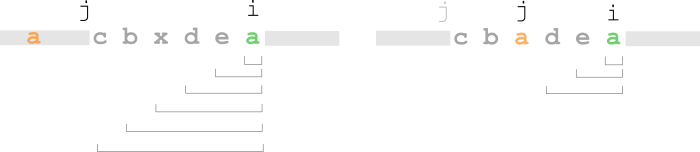

# two pointers ^^

**Author:** andrii_khlevniuk
**Votes:** 4
**Link:** [https://leetcode.com/problems/count-substrings-without-repeating-character/solutions/3667357/](https://leetcode.com/problems/count-substrings-without-repeating-character/solutions/3667357/)

---

**time: `O(N)`; space: `O(1)`**

**Idea:**
Every substring has to end somewhere... 
I successively add the number of *substrings of uniques* that end at each of the indices `0...size(s)-1`.


**c++:**
```
int numberOfSpecialSubstrings(string s) 
{
	vector d(256, -1);
	int out{};
	for(int i{}, j{-1}; i<size(s); ++i)
	{
		j = max(j, d[s[i]]);
		d[s[i]] = i;
		out += i-j;
	}
	return out;
}
```
**python:**
```
def numberOfSpecialSubstrings(self, s):
	d, out, j = 256*[-1], 0, -1
	for i, c in enumerate(s):
		j = max(j, d[ord(c)])
		d[ord(c)] = i
		out += i-j
	return out
```
**Notation:**
`i` - current index.
`j` - index that is **one less** (so that length could be calculated as `i-j`) of the left end of the current *substring of uniques*. This is like the `end` pointer in `vector`.
`d[c]` registers the last index at which the character `c` was encountered before.


