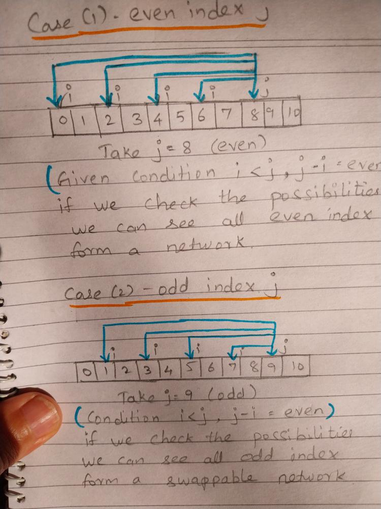

# hand written notes  |  O(n) time & space  |  just counter at odd and even indexes

**Author:** nkrishk
**Votes:** 22
**Link:** [https://leetcode.com/problems/check-if-strings-can-be-made-equal-with-operations-ii/solutions/3993165/](https://leetcode.com/problems/check-if-strings-can-be-made-equal-with-operations-ii/solutions/3993165/)

---

# Intuition
<!-- Describe your first thoughts on how to solve this problem. -->


<!-- Describe your approach to solving the problem. -->

This is the key condition in problem statment 
```Choose any two indices i and j such that i < j and the difference j - i is even, then swap the two characters at those indices in the string.```

```even``` index forms a swappable network
```odd``` index forms a swappable network

Explanation below,


# Approach
In each swappable network (odd and even) if the character count are same for both strings s1 ans s2. 
Then ```return True``` else ```return False```


# Complexity
- Time complexity: $$O(n)$$
<!-- Add your time complexity here, e.g. $$O(n)$$ -->

- Space complexity: $$O(n)$$
<!-- Add your space complexity here, e.g. $$O(n)$$ -->

# Code

<iframe src="https://leetcode.com/playground/khdAMz49/shared" frameBorder="0" width="1000" height="400"></iframe>

# Python3
```
class Solution:
    def checkStrings(self, s1: str, s2: str) -> bool:
        d1_e = defaultdict(int)
        d1_o = defaultdict(int)

        d2_e = defaultdict(int)
        d2_o = defaultdict(int)
        
        for i in range(len(s1)):
            if i % 2 == 0:
                d1_e[s1[i]] += 1
                d2_e[s2[i]] += 1
            else:
                d1_o[s1[i]] += 1
                d2_o[s2[i]] += 1    
        if d1_e == d2_e and  d1_o == d2_o:
            return True
        else:
            return False        
```

# C++
```
class Solution {
public:
    bool checkStrings(string s1, string s2)  {
        unordered_map<char, int> d1_e, d1_o;
        unordered_map<char, int> d2_e, d2_o;

        for (int i = 0; i < s1.length(); i++) {
            if (i % 2 == 0) {
                d1_e[s1[i]]++;
                d2_e[s2[i]]++;
            } else {
                d1_o[s1[i]]++;
                d2_o[s2[i]]++;
            }
        }
        return d1_e == d2_e && d1_o == d2_o;
    }
};
```
# java
```
class Solution {
    public boolean canBeEqual(String s1, String s2) {
        Map<Character, Integer> d1_e = new HashMap<>();
        Map<Character, Integer> d1_o = new HashMap<>();

        Map<Character, Integer> d2_e = new HashMap<>();
        Map<Character, Integer> d2_o = new HashMap<>();

        for (int i = 0; i < s1.length(); i++) {
            char ch1 = s1.charAt(i);
            char ch2 = s2.charAt(i);
            if (i % 2 == 0) {
                d1_e.put(ch1, d1_e.getOrDefault(ch1, 0) + 1);
                d2_e.put(ch2, d2_e.getOrDefault(ch2, 0) + 1);
            } else {
                d1_o.put(ch1, d1_o.getOrDefault(ch1, 0) + 1);
                d2_o.put(ch2, d2_o.getOrDefault(ch2, 0) + 1);
            }
        }
        return d1_e.equals(d2_e) && d1_o.equals(d2_o);
    }
}
```
# PHP
```php
class Solution {

    /**
     * @param String $s1
     * @param String $s2
     * @return Boolean
     */
    function checkStrings($s1, $s2) {
        $d1_o = array();
        $d1_e = array();

        $d2_o = array();
        $d2_e = array();

        for ($i = 0; $i<strlen($s1); $i+=1) {
            $char1 = $s1[$i];
            $char2 = $s2[$i];
            if ($i%2 == 0) {
                $d1_e[$char1] = $d1_e[$char1] + 1;
                $d2_e[$char2] = $d2_e[$char2] + 1;
            } else {
                $d1_o[$char1] = $d1_o[$char1] + 1;
                $d2_o[$char2] = $d2_o[$char2] + 1;
            }
        }
        return $d1_e == $d2_e && $d1_o == $d2_o;
    }
}
```
# golang
```
func checkStrings(s1 string, s2 string) bool {
    d1_e := make(map[byte]int)
    d2_e := make(map[byte]int)

    d1_o := make(map[byte]int)
    d2_o := make(map[byte]int)

    for i:=0;i<len(s1); i++ {
        c1 := s1[i];
        c2 := s2[i];
        if i%2 == 0 {
            d1_e[c1] = d1_e[c1]+1;
            d2_e[c2] = d2_e[c2]+1;
        } else {
            d1_o[c1] = d1_o[c1]+1;
            d2_o[c2] = d2_o[c2]+1;
        }
    }
    return reflect.DeepEqual(d1_e, d2_e) && reflect.DeepEqual(d1_o, d2_o); 
}
```
# javascript
```
function compareMaps(map1, map2) {
    let testVal;
    if (map1.size !== map2.size) {
        return false;
    }
    for (let [key, val] of map1) {
        testVal = map2.get(key);
        if (testVal !== val || (testVal === undefined && !map2.has(key))) {
            return false;
        }
    }
    return true;
}
var checkStrings = function(s1, s2) {
  const d1_e = new Map();
  const d2_e = new Map();

  const d1_o = new Map();
  const d2_o = new Map();

  for (let i = 0; i < s1.length; i++) {
    ch1 = s1[i];
    ch2 = s2[i];
    if (i % 2 == 0) {
      d1_e.set(ch1, (d1_e.get(ch1) ?? 0) + 1);
      d2_e.set(ch2, (d2_e.get(ch2) ?? 0) + 1);
    } else {
      d1_o.set(ch1, (d1_o.get(ch1) ?? 0) + 1);
      d2_o.set(ch2, (d2_o.get(ch2) ?? 0) + 1);
    }
  }
  return (compareMaps(d1_e, d2_e) && compareMaps(d1_o, d2_o));
};
```

