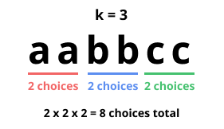
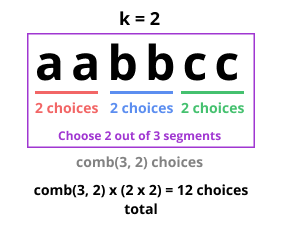

# [Pictures] Greedy + Math: Easy to Understand, Guaranteed.

**Author:** jmyanxiang
**Votes:** 134
**Link:** [https://leetcode.com/problems/count-k-subsequences-of-a-string-with-maximum-beauty/solutions/3993253/](https://leetcode.com/problems/count-k-subsequences-of-a-string-with-maximum-beauty/solutions/3993253/)

---

# Intuition

There are two scenarios to understand before the solution becomes obvious (trust me, I'll make sure you understand them).

**Scenario 1:** Suppose `k = 3`. For a string containing 2 `a`s, 2 `b`s, and 2 `c`s, How many "k-subsequence" of length `k` can we form?



Answer: We have 3 slots to fill and 3 different characters. We can choose one of the two `a`s, one of the two `b`s, and one of the two `c`s and put them into our answer. There are $2 \	imes 2 \	imes 2 = 8$ ways that we can form a "k-subsequence".

Also, since we are looking for a subsequence of `s` containing unique characters, the order of characters in `s` does not matter.

**Scenario 2:** Let's consider the same case, but this time with `k = 2`:


Answer: Since we only have 2 slots left in our k-subsequence, and `f(c)` for each character is equally good, we choose **2 characters** (the number of remaining slots we have) out of **3** (the number of candicates we have). Then, the problem reduces to _Scenario 1_, but with only two different characters.

Notation: Here, we use `comb(n, r)` to denote $nCr = \\frac{n!}{r!(n - r)!}$. Python has this function exported from the `math` package, so we can straight up using it.

# Algorithm

Since the **beauty** of a k-subsequence is entirely dependent on the count of each character we choose, it makes sense to start from the character with the highest count.

```python
counter = Counter(s)
if len(counter) < k: return 0
freq = Counter(counter.values())
pairs = list(sorted(freq.items(), reverse=True))
```
The code isn't important. The idea is that we constructed an array `pairs`, which contains elements of the form `(f(c), # of characters with f(c))`.

If the number of unique characters in `s` is less than `k`, there is no way to form a k-subsequence, so return 0. We also conveniently sorted `pairs` from the highest `f(c)` to the lowest.

We will pick characters from the highest `f(c)` to the lowest `f(c)`. If we have enough slots (i.e., `k` is greater than or equal to the number of characters with that `f(c)`), then we can pick them all. If we don't have enough slots, then we choose `k` characters out of our available options.

```python
res = 1
for fc, occ in pairs:
    if occ <= k:  # we have enough slots
        res = (res * pow(fc, occ, mod)) % mod
        k -= occ
    else:  # otherwise, use comb(occ, k) to choose k segments
        res = (res * comb(occ, k) * pow(fc, k, mod)) % mod
        break
return res % mod
```

Note: `pow(fc, occ, mod)` is the same as multiplying the `fc` value `occ` times, while keeping in mind that we need to perform modulo operation. This way, we do not get very large values that could cause TLE.

# Code
```python
def countKSubsequencesWithMaxBeauty(self, s: str, k: int) -> int:
    mod = 10**9 + 7
    counter = Counter(s)
    if len(counter) < k: return 0
    freq = Counter(counter.values())
    pairs = list(sorted(freq.items(), reverse=True))
    res = 1
    for fc, occ in pairs:
        if occ <= k:
            res = (res * pow(fc, occ, mod)) % mod
            k -= occ
        else:
            res = (res * comb(occ, k) * pow(fc, k, mod)) % mod
            break
    return res % mod
```

# Final Words

I want to make sure that, (1) **YOU** get the most out of this problem, and (2) **YOU** have an easy time reading this post. Please post any questions or follow-ups you have, and I'll try my best to help!


Please **upvote** for more content to come! Your support is my motivation -- to me, **every upvote counts**. Thanks for your support!