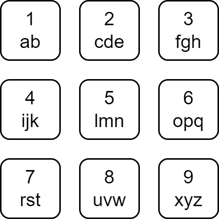

# [2950. Number of Divisible Substrings](https://leetcode.com/problems/number-of-divisible-substrings/)

| Category | Difficulty | Likes | Dislikes |
| :------: | :--------: | :---: | :------: |
| Algorithms | Medium | 31 | 6 |

**Tags:** [`hash-table`](https://leetcode.com/tag/hash-table), [`string`](https://leetcode.com/tag/string), [`counting`](https://leetcode.com/tag/counting), [`prefix-sum`](https://leetcode.com/tag/prefix-sum)

**Companies:** `wayfair`, `ibm`, `amdocs`

## Description

Each character of the English alphabet has been mapped to a digit as shown below.



A string is **divisible** if the sum of the mapped values of its characters is divisible by its length.

Given a string `s`, return *the number of **divisible substrings** of* `s`.

A **substring** is a contiguous non-empty sequence of characters within a string.

 

**Example 1:**

	
		
			Substring
			Mapped
			Sum
			Length
			Divisible?
		
		
			a
			1
			1
			1
			Yes
		
		
			s
			7
			7
			1
			Yes
		
		
			d
			2
			2
			1
			Yes
		
		
			f
			3
			3
			1
			Yes
		
		
			as
			1, 7
			8
			2
			Yes
		
		
			sd
			7, 2
			9
			2
			No
		
		
			df
			2, 3
			5
			2
			No
		
		
			asd
			1, 7, 2
			10
			3
			No
		
		
			sdf
			7, 2, 3
			12
			3
			Yes
		
		
			asdf
			1, 7, 2, 3
			13
			4
			No
		
	

```

Input: word = &quot;asdf&quot;
Output: 6
Explanation: The table above contains the details about every substring of word, and we can see that 6 of them are divisible.

```

**Example 2:**

```

Input: word = &quot;bdh&quot;
Output: 4
Explanation: The 4 divisible substrings are: &quot;b&quot;, &quot;d&quot;, &quot;h&quot;, &quot;bdh&quot;.
It can be shown that there are no other substrings of word that are divisible.

```

**Example 3:**

```

Input: word = &quot;abcd&quot;
Output: 6
Explanation: The 6 divisible substrings are: &quot;a&quot;, &quot;b&quot;, &quot;c&quot;, &quot;d&quot;, &quot;ab&quot;, &quot;cd&quot;.
It can be shown that there are no other substrings of word that are divisible.

```

 

**Constraints:**

	- `1 <= word.length <= 2000`

	- `word` consists only of lowercase English letters.

---

**Links:** [Submissions](https://leetcode.com/problems/number-of-divisible-substrings/) | [Solutions](https://leetcode.com/problems/number-of-divisible-substrings/)
