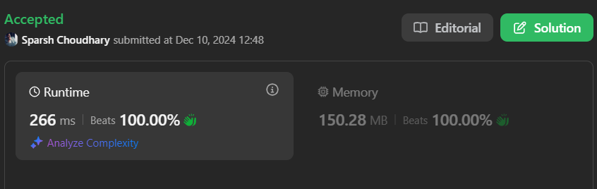
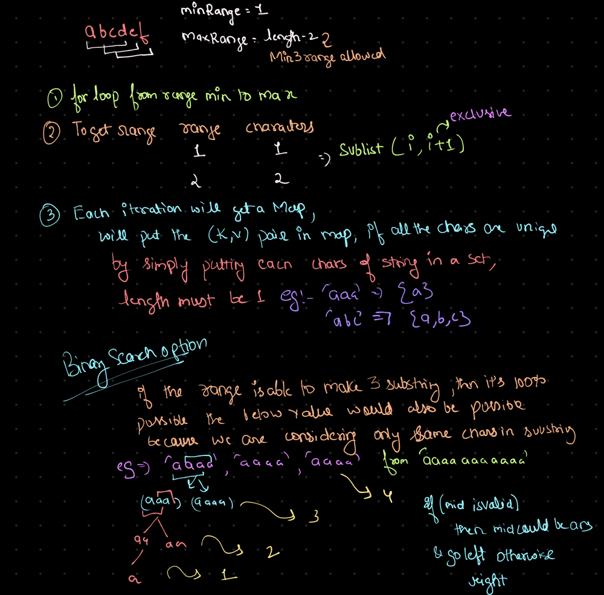

# 🔥BEATS 💯 % 🎯 |✨SUPER EASY BEGINNERS 👏

**Author:** CodeWithSparsh
**Votes:** 9
**Link:** [https://leetcode.com/problems/find-longest-special-substring-that-occurs-thrice-i/solutions/6131706/](https://leetcode.com/problems/find-longest-special-substring-that-occurs-thrice-i/solutions/6131706/)

---




---



---

# Intuition
To solve the problem:
1. We need to find the longest substring of the input string `s` that appears at least three times.
2. Brute force is an intuitive approach: check all possible substrings of length `1` to `n-2` and count their occurrences.
3. Use a `Map` or `HashMap` to store the counts of substrings and track the maximum length of substrings that meet the condition.

---

# Approach
1. Iterate over all possible substring lengths, starting from `1` up to `n-2` (since a substring must appear at least three times).
2. For each substring length, extract all possible substrings of that length using a sliding window approach.
3. Use a hash table to count occurrences of each substring.
4. If any substring has a count of `3` or more, update the maximum length.
5. Return the maximum length found.

---

# Complexity
- **Time Complexity**:  
  $$O(n^3)$$ (worst-case scenario, iterating over all substrings of varying lengths).
- **Space Complexity**:  
  $$O(n^2)$$ for storing substrings in the hash map.

---


```dart []
class Solution {
  int maximumLength(String s) {
    int minRange = 1;
    int maxRange = s.length - 2;
    int length = -1;

    for (int i = minRange; i <= maxRange; i++) {
      Map<String, int> record = {};
      for (int j = 0; j <= s.length - i; j++) {
        String sub = s.substring(j, j + i);
        record[sub] = (record[sub] ?? 0) + 1;
      }
      record.forEach((key, value) {
        if (value >= 3) length = i;
      });
    }

    return length;
  }
}
```


```python []
class Solution:
    def maximumLength(self, s: str) -> int:
        min_range = 1
        max_range = len(s) - 2
        length = -1

        for i in range(min_range, max_range + 1):
            record = {}
            for j in range(len(s) - i + 1):
                sub = s[j:j + i]
                record[sub] = record.get(sub, 0) + 1
            for key, value in record.items():
                if value >= 3:
                    length = i

        return length
```


```cpp []
#include <string>
#include <unordered_map>
#include <set>
using namespace std;

class Solution {
public:
    int maximumLength(string s) {
        int minRange = 1, maxRange = s.size() - 2, length = -1;

        for (int i = minRange; i <= maxRange; i++) {
            unordered_map<string, int> record;

            for (int j = 0; j <= s.size() - i; j++) {
                string sub = s.substr(j, i);
                record[sub]++;
            }

            for (auto &entry : record) {
                if (entry.second >= 3) length = i;
            }
        }

        return length;
    }
};
```


```java []
import java.util.HashMap;

class Solution {
    public int maximumLength(String s) {
        int minRange = 1;
        int maxRange = s.length() - 2;
        int length = -1;

        for (int i = minRange; i <= maxRange; i++) {
            HashMap<String, Integer> record = new HashMap<>();
            for (int j = 0; j <= s.length() - i; j++) {
                String sub = s.substring(j, j + i);
                record.put(sub, record.getOrDefault(sub, 0) + 1);
            }
            for (String key : record.keySet()) {
                if (record.get(key) >= 3) length = i;
            }
        }

        return length;
    }
}
```


```javascript []
var maximumLength = function(s) {
    let minRange = 1, maxRange = s.length - 2, length = -1;

    for (let i = minRange; i <= maxRange; i++) {
        let record = {};
        for (let j = 0; j <= s.length - i; j++) {
            let sub = s.substring(j, j + i);
            record[sub] = (record[sub] || 0) + 1;
        }
        for (let key in record) {
            if (record[key] >= 3) length = i;
        }
    }

    return length;
};
```


```go []
package main

func maximumLength(s string) int {
    minRange, maxRange := 1, len(s)-2
    length := -1

    for i := minRange; i <= maxRange; i++ {
        record := make(map[string]int)
        for j := 0; j <= len(s)-i; j++ {
            sub := s[j : j+i]
            record[sub]++
        }
        for _, value := range record {
            if value >= 3 {
                length = i
            }
        }
    }

    return length
}
```

---

 {:style='width:250px'}