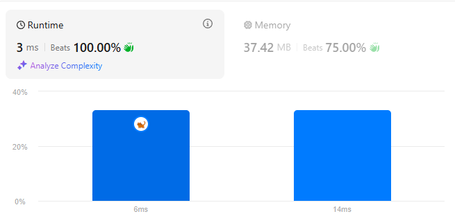

# sliding window saving freq ✅3ms 37.42MB

**Author:** yunhao_liu
**Votes:** 1
**Link:** [https://leetcode.com/problems/find-longest-special-substring-that-occurs-thrice-i/solutions/6132155/](https://leetcode.com/problems/find-longest-special-substring-that-occurs-thrice-i/solutions/6132155/)

---




# Intuition
Imagine a special string `aaaa`, it can break into:
```
"aaaa" * 1
"aaa" * 2
"aa" * 3
"a" * 4
```
Whenever we meet a special string, all these sub special strings's  frequencies can be increased correspondingly.

So we just need to use two pointers to find each longest special string, increase all substring's freq, update result.

# Approach
There are 26 lower case English letters, max length of each letter would be the length of `s`, so we can use 2d array to store freqencies:
```
        val occurs = Array(26) { IntArray(s.length + 1) }
```
Initialize two pointers and result variable:
```
        var start = 0
        var end = 0
        var longest = -1
```
When reaching the end of `s`, or two pointers pointed at different letter, we need to perform actions.
```
        while (end <= s.length) {
            if (end == s.length || s[start] != s[end]) {
```
As we analyzed above, `"aaaa"` will have `"aaaa"x1, "aaa"x2, "aa"x3, "a"x4`. we increase freq correspondingly.
```
                val length = end - start
                for (i in 1 .. length) {
                    val charIndex = s[start] - 'a'
                    occurs[charIndex][i] += length - i + 1
```
Update result if current times equals or larger than 3:
```
                    if (occurs[charIndex][i] >= 3) {
                        longest = maxOf(longest, i)
                    }
```
then move `start` to `end`. And keep moving `end`.
```
                start = end
            }
            end++
```
After reaching end, we find the max length.
```
        return longest
```

# Complexity
- Time complexity:
$$O(n)$$

- Space complexity:
$$O(n)$$ `26 * n`

# Code
```kotlin []
class Solution {
    fun maximumLength(s: String): Int {
        val occurs = Array(26) { IntArray(s.length + 1) }
        var start = 0
        var end = 0
        var longest = -1
        while (end <= s.length) {
            if (end == s.length || s[start] != s[end]) {
                // "aaaa"x1, "aaa"x2, "aa"x3, "a"x4
                val length = end - start
                for (i in 1 .. length) {
                    val charIndex = s[start] - 'a'
                    occurs[charIndex][i] += length - i + 1

                    if (occurs[charIndex][i] >= 3) {
                        longest = maxOf(longest, i)
                    }
                }
                start = end
            }
            end++
        }
        return longest
    }
}
```