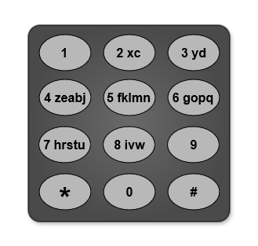

# [3016. Minimum Number of Pushes to Type Word II](https://leetcode.com/problems/minimum-number-of-pushes-to-type-word-ii/)

| Category | Difficulty | Likes | Dislikes |
| :------: | :--------: | :---: | :------: |
| Algorithms | Medium | 769 | 79 |

**Tags:** [`hash-table`](https://leetcode.com/tag/hash-table), [`string`](https://leetcode.com/tag/string), [`greedy`](https://leetcode.com/tag/greedy), [`sorting`](https://leetcode.com/tag/sorting), [`counting`](https://leetcode.com/tag/counting)

**Companies:** `amazon`, `de-shaw`

## Description

You are given a string `word` containing lowercase English letters.

Telephone keypads have keys mapped with **distinct** collections of lowercase English letters, which can be used to form words by pushing them. For example, the key `2` is mapped with `["a","b","c"]`, we need to push the key one time to type `"a"`, two times to type `"b"`, and three times to type `"c"` *.*

It is allowed to remap the keys numbered `2` to `9` to **distinct** collections of letters. The keys can be remapped to **any** amount of letters, but each letter **must** be mapped to **exactly** one key. You need to find the **minimum** number of times the keys will be pushed to type the string `word`.

Return *the **minimum** number of pushes needed to type *`word` *after remapping the keys*.

An example mapping of letters to keys on a telephone keypad is given below. Note that `1`, `*`, `#`, and `0` do **not** map to any letters.


 

**Example 1:**


```

Input: word = &quot;abcde&quot;
Output: 5
Explanation: The remapped keypad given in the image provides the minimum cost.
&quot;a&quot; -&gt; one push on key 2
&quot;b&quot; -&gt; one push on key 3
&quot;c&quot; -&gt; one push on key 4
&quot;d&quot; -&gt; one push on key 5
&quot;e&quot; -&gt; one push on key 6
Total cost is 1 + 1 + 1 + 1 + 1 = 5.
It can be shown that no other mapping can provide a lower cost.

```

**Example 2:**


```

Input: word = &quot;xyzxyzxyzxyz&quot;
Output: 12
Explanation: The remapped keypad given in the image provides the minimum cost.
&quot;x&quot; -&gt; one push on key 2
&quot;y&quot; -&gt; one push on key 3
&quot;z&quot; -&gt; one push on key 4
Total cost is 1 * 4 + 1 * 4 + 1 * 4 = 12
It can be shown that no other mapping can provide a lower cost.
Note that the key 9 is not mapped to any letter: it is not necessary to map letters to every key, but to map all the letters.

```

**Example 3:**


```

Input: word = &quot;aabbccddeeffgghhiiiiii&quot;
Output: 24
Explanation: The remapped keypad given in the image provides the minimum cost.
&quot;a&quot; -&gt; one push on key 2
&quot;b&quot; -&gt; one push on key 3
&quot;c&quot; -&gt; one push on key 4
&quot;d&quot; -&gt; one push on key 5
&quot;e&quot; -&gt; one push on key 6
&quot;f&quot; -&gt; one push on key 7
&quot;g&quot; -&gt; one push on key 8
&quot;h&quot; -&gt; two pushes on key 9
&quot;i&quot; -&gt; one push on key 9
Total cost is 1 * 2 + 1 * 2 + 1 * 2 + 1 * 2 + 1 * 2 + 1 * 2 + 1 * 2 + 2 * 2 + 6 * 1 = 24.
It can be shown that no other mapping can provide a lower cost.

```

 

**Constraints:**

	- `1 <= word.length <= 10^5`

	- `word` consists of lowercase English letters.

---

**Links:** [Submissions](https://leetcode.com/problems/minimum-number-of-pushes-to-type-word-ii/) | [Solutions](https://leetcode.com/problems/minimum-number-of-pushes-to-type-word-ii/)
