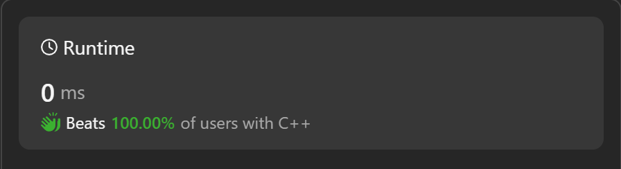

# ✅THE BEST EXPLANATION||Beats 100% Users

**Author:** harshal2024
**Votes:** 12
**Link:** [https://leetcode.com/problems/minimum-number-of-pushes-to-type-word-ii/solutions/4601009/](https://leetcode.com/problems/minimum-number-of-pushes-to-type-word-ii/solutions/4601009/)

---

---
# PLEASE UPVOTE IF YOU LIKE IT \u2705
---


---
# Intuition
<!-- Describe your first thoughts on how to solve this problem. -->
The code starts by counting the occurrences of each letter in the input string because we want to minimize the number of pushes for the most frequent letters.
By sorting the counts in descending order, we ensure that the most frequent letters come first in the vector.
The code then iterates through the sorted counts, assigning rows on a keypad to distribute the pushes efficiently.
It calculates the minimum number of pushes by multiplying the count of each letter by the current row number.
The total minimum pushes are accumulated, and the final result is returned.

---
# Approach
<!-- Describe your approach to solving the problem. -->
First, the code counts the frequency of each letter in the input string word using an unordered map (um).
Then, it extracts the counts from the map and stores them in a vector (count).
The counts in the vector are sorted in descending order to prioritize the most frequent letters.
The code iterates through the sorted counts and calculates the minimum number of pushes required to type each letter, considering the rows on a telephone keypad.

---

# Complexity
- Time complexity: O(nlogn) 
<!-- Add your time complexity here, e.g. $$O(n)$$ -->
 

- Space complexity: O(n)
<!-- Add your space complexity here, e.g. $$O(n)$$ -->

---


---

# Code
C++
```
class Solution {
public:
    // Function to calculate the minimum number of pushes required to type the given word
    int minimumPushes(string word) {
        // Create an unordered map to store the frequency of each letter in the word
        unordered_map<char, int> um;

        // Count the occurrences of each letter in the word and store in the unordered map
        for (char c : word) {
            um[c]++;
        }

        // Create a vector to store the counts of each letter from the unordered map
        vector<int> count;
        
        // Extract the counts from the unordered map and store in the vector
        for (auto x : um) {
            count.push_back(x.second);
        }

        // Sort the counts in descending order to prioritize the most frequent letters
        sort(count.begin(), count.end(), greater<int>());

        // Initialize variables to keep track of the total pushes and the current row
        int ans = 0, row = 1;

        // Iterate through the sorted counts and calculate the minimum pushes
        for (int i = 0; i < count.size(); i++) {
            // Check if more than 8 elements have been processed and if it's a multiple of 8
            // If true, increment the row number to move to the next row on the keypad
            if (i > 7 && i % 8 == 0) {
                row++;
            }

            // Add the minimum pushes for the current letter to the total pushes
            ans += row * count[i];
        }

        // Return the total minimum pushes required to type the word
        return ans;
    }
};

```

---
Python3
```
class Solution:
    def minimumPushes(self, word: str) -> int:
        # Create a dictionary to store the frequency of each letter in the word
        letter_counts = {}
        
        # Count the occurrences of each letter in the word and store in the dictionary
        for c in word:
            letter_counts[c] = letter_counts.get(c, 0) + 1
        
        # Create a list to store the counts of each letter from the dictionary
        counts = list(letter_counts.values())
        
        # Sort the counts in descending order to prioritize the most frequent letters
        counts.sort(reverse=True)
        
        # Initialize variables to keep track of the total pushes and the current row
        ans, row = 0, 1
        
        # Iterate through the sorted counts and calculate the minimum pushes
        for i in range(len(counts)):
            # Check if more than 8 elements have been processed and if it's a multiple of 8
            # If true, increment the row number to move to the next row on the keypad
            if i > 7 and i % 8 == 0:
                row += 1
            
            # Add the minimum pushes for the current letter to the total pushes
            ans += row * counts[i]
        
        # Return the total minimum pushes required to type the word
        return ans

```

---
Java
```
public class Solution {
    public int minimumPushes(String word) {
        // Create a map to store the frequency of each letter in the word
        Map<Character, Integer> letterCounts = new HashMap<>();
        
        // Count the occurrences of each letter in the word and store in the map
        for (char c : word.toCharArray()) {
            letterCounts.put(c, letterCounts.getOrDefault(c, 0) + 1);
        }
        
        // Create a list to store the counts of each letter from the map
        List<Integer> counts = new ArrayList<>(letterCounts.values());
        
        // Sort the counts in descending order to prioritize the most frequent letters
        Collections.sort(counts, Collections.reverseOrder());
        
        // Initialize variables to keep track of the total pushes and the current row
        int ans = 0, row = 1;
        
        // Iterate through the sorted counts and calculate the minimum pushes
        for (int i = 0; i < counts.size(); i++) {
            // Check if more than 8 elements have been processed and if it's a multiple of 8
            // If true, increment the row number to move to the next row on the keypad
            if (i > 7 && i % 8 == 0) {
                row++;
            }
            
            // Add the minimum pushes for the current letter to the total pushes
            ans += row * counts.get(i);
        }
        
        // Return the total minimum pushes required to type the word
        return ans;
    }
}
```
