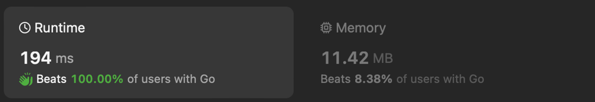

# Beats 100%

**Author:** efk
**Votes:** 0
**Link:** [https://leetcode.com/problems/linked-list-frequency/solutions/4899227/](https://leetcode.com/problems/linked-list-frequency/solutions/4899227/)

---

# Code
```
package main

// https://leetcode.com/problems/linked-list-frequency/?envType=weekly-question&envId=2024-03-08
func frequenciesOfElements(head *ListNode) *ListNode {
	var prev, cur *ListNode = nil, head
	var freqs = map[int]int{}
	for cur != nil {
		freqs[cur.Val]++
		cur = cur.Next
	}

	// reuse input list for output
	cur = head
	for _, c := range freqs {
		cur.Val, prev, cur = c, cur, cur.Next
	}
	prev.Next = nil

	return head
}

```
image.png
