# Solution Through Observation and Pictorial Representation

**Author:** piyushjaiswal380
**Votes:** 2
**Link:** [https://leetcode.com/problems/replace-question-marks-in-string-to-minimize-its-value/solutions/4885329/](https://leetcode.com/problems/replace-question-marks-in-string-to-minimize-its-value/solutions/4885329/)

---

# Observation 1 : 

**Just Observe the cost of each index in given string:**

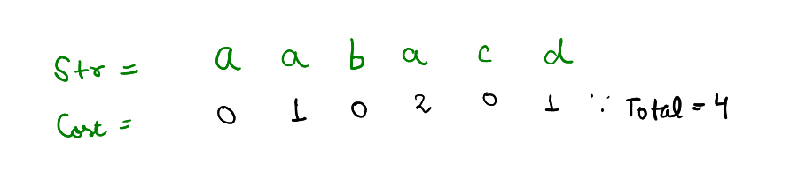

**What If I put a Question Mark**

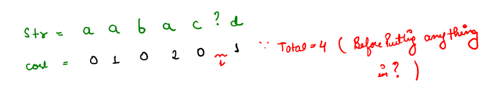

**What If I put a letter 'a' in place of Question Mark**

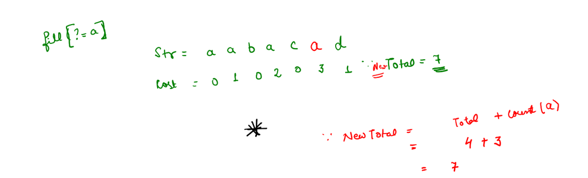

Here Observation 1 Completed: 

**New Cost = Prev Cost + count ( Letter you are putting)**


# **Obesrvation 2:**

***Take this example***

Cost before putting anything in the **?**

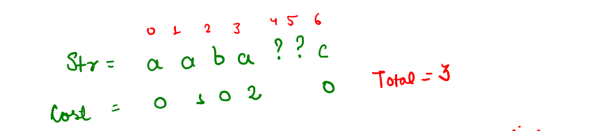

**What if I put 'a' in index 4 then 'b' in index 5**
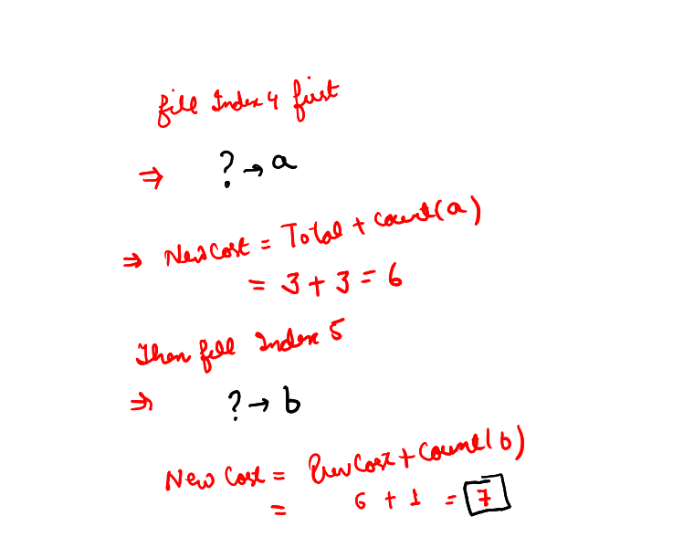

**OR What If I put 'b' in index 5 first then 'a' in index 4**

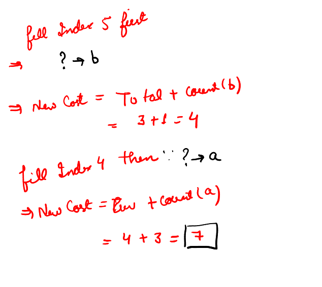

***Observation 2: You can fill any question mark in any order***
# Solution

*Suppose String is*

```
str = abcdefghijklmnopqrstuvw ? ? ? ?
```

**Now we will create a frequency array : **

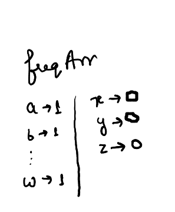

**Try to fill index 23:**


**We Will go greedly and fill 'x' there because it's freq is 0**
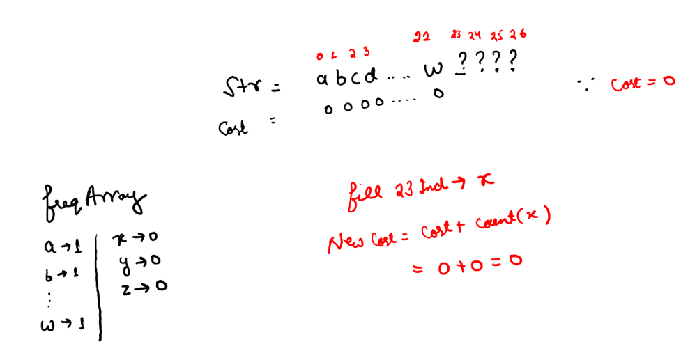


**Try to fill index 24, fill by 'y' because it's freq is 0:**
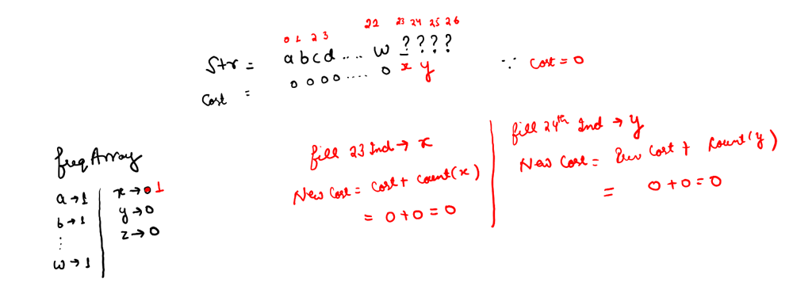

**Try to fill index 25, fill by 'z' because it's freq is 0:**
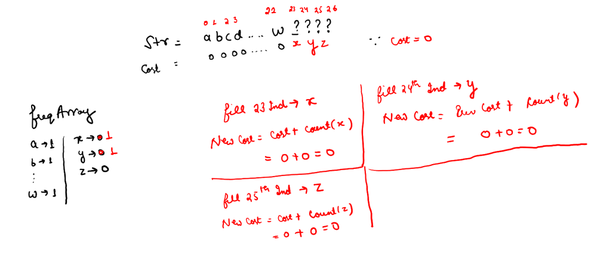

**What to do in index 26 ?, all char freq is 1, now we will go for smallest char and it is 'a'**
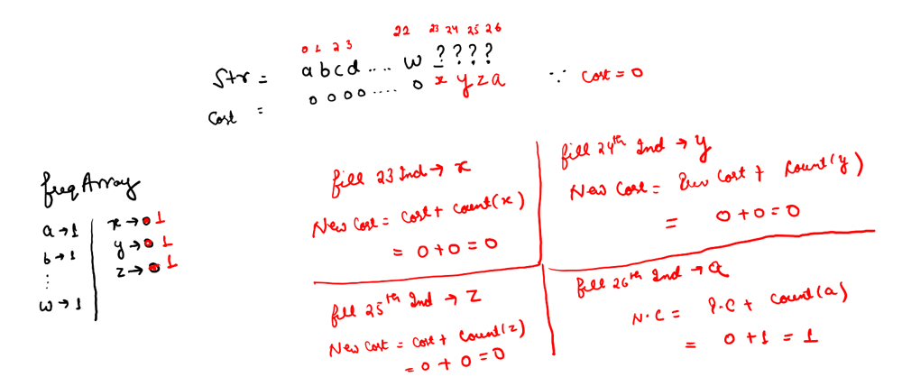


**But But But.. Our answer is  not**

`abcdefghijklmnopqrstuvwxyza`

**Our answer is **

`abcdefghijklmnopqrstuvwaxyz`

**Because of Observation 2: We can fill any ? in any order**


**Simply sort character that you filled in each ?**


```
class Solution {
public:
    

    string minimizeStringValue(string s) {
        
        int n = s.size();
        vector<pair<int,int>> st;
        int arr[26] = {0};
        
        for(char a  : s) if(a != '?') arr[a-'a']++;
        
        for(char a = 'a';a<='z';a++) {
            st.push_back({arr[a-'a'],a});
        }
        
        sort(st.begin(),st.end());
        
        vector<char> v;
        
        for(int i = 0; i < n;i++){
            if(s[i] == '?'){
                v.push_back(st[0].second);
                st[0].first++;
                sort(st.begin(),st.end());
            }
        }
        
        sort(v.begin(),v.end());
        
        for(int i = 0,j=0;i <n;i++){
            if(s[i] == '?'){
                s[i] = v[j++];
            }
        }
        
        return s;
        
        
    }
};
```


