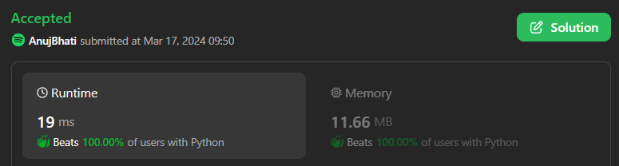
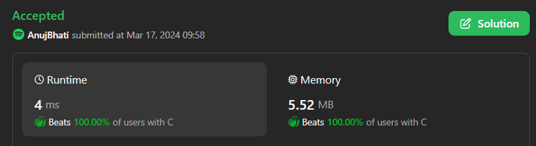

# ☠💀💯 Faster✅💯 Lesser🧠 🎯 C++✅Python3✅Java✅C✅Python✅💥🔥💫Explained☠💥🔥 Beats 💯Contest 17-3-2024

**Author:** Edwards310
**Votes:** 2
**Link:** [https://leetcode.com/problems/existence-of-a-substring-in-a-string-and-its-reverse/solutions/4886489/](https://leetcode.com/problems/existence-of-a-substring-in-a-string-and-its-reverse/solutions/4886489/)

---

# Intuition




```C++ []
class Solution {
public:
    bool isSubstringPresent(string s) {
        int n = s.size();
        string t = s;
        reverse(t.begin(), t.end());
        map<string, int> mp;
        for (int i = 0; i + 1 < n; i++) {
            mp[s.substr(i, 2)] |= 1;
            mp[t.substr(i, 2)] |= 2;
        }
        for (auto& [k, v] : mp)
            if (v == 3)
                return true;
        return false;
    }
};
```
```python3 []
class Solution:
    def isSubstringPresent(self, s: str) -> bool:
        for i in range(len(s) - 1):
            if s[i: i+2] in s[:: -1]:
                return True
        return False
```
```C []
bool isSubstringPresent(char* s) {
    int n = strlen(s);
    for (int i = 0; i < n - 1; ++i) {
        char a = s[i], b = s[i + 1];
        for (int j = 0; j < n - 1; ++j)
            if (s[j] == b && s[j + 1] == a)
                return true;
    }
    return false;
}
```
```Java []
class Solution {
    public boolean isSubstringPresent(String s) {
        int n = s.length();
        for (int i = 0; i < n - 1; i++) {
            char a = s.charAt(i);
            char b = s.charAt(i + 1);
            for (int j = 0; j < n - 1; j++) {
                if (s.charAt(j) == b && s.charAt(j + 1) == a)
                    return true;
            }
        }
        return false;
    }
}
```
```python []
class Solution(object):
    def isSubstringPresent(self, s):
        """
        :type s: str
        :rtype: bool
        """
        for i in range(len(s) - 1):
            if s[i : i + 2] in s[::-1]:
                return True
        return False
```

<!-- Describe your first thoughts on how to solve this problem. -->

# Approach
<!-- Describe your approach to solving the problem. -->

# Complexity
- Time complexity:
<!-- Add your time complexity here, e.g. $$O(n)$$ -->
    O(n)
- Space complexity:
<!-- Add your space complexity here, e.g. $$O(n)$$ -->
    O(1)
# Code
```
bool isSubstringPresent(char* s) {
    int n = strlen(s);
    for (int i = 0; i < n - 1; ++i) {
        char a = s[i], b = s[i + 1];
        for (int j = 0; j < n - 1; ++j)
            if (s[j] == b && s[j + 1] == a)
                return true;
    }
    return false;
}
```
# Please show your support by upvoting my solution . This will motivates me to do better.Thanks

