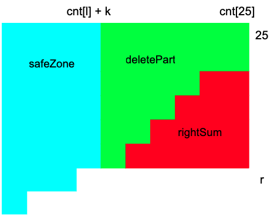

# [C++ / Go] Sliding Window - O(n) time / O(26) space solution

**Author:** mikazuki4712
**Votes:** 1
**Link:** [https://leetcode.com/problems/minimum-deletions-to-make-string-k-special/solutions/4897864/](https://leetcode.com/problems/minimum-deletions-to-make-string-k-special/solutions/4897864/)

---

# Approach
- Count the number of occurrences of each character and then sort them in ascending order.
- Iterate `l` through the counting array `cnt`:
    - Maintain a sliding window with 2 ends `l` and `r`, where `cnt[r] - cnt[l] <= k` and `r` is maximum.
    - Here we perform deletions to ensure that all occurrences of each character are either reduced to `0` or remain within the range from `cnt[l]` to `cnt[l] + k`.
        - The part from `0` to `l - 1`, all characters will be deleted all to 0.
        - The part from `r + 1` to `25`, all characters will be deleted down to `cnt[l] + k` occurences.
            - 

# Code
```C++ []
class Solution {
public:
    int minimumDeletions(string word, int k) {
        vector<int> cnt(26, 0);
        for (char c : word)
            cnt[c - 'a']++;

        sort(cnt.begin(), cnt.end());
        
        int res = INT_MAX;

        int leftSum = 0;
        int rightSum = 0;

        int r = 25;
        while (cnt[r] > cnt[0] + k) {
            rightSum += cnt[25] - cnt[r];
            r--;
        }

        for (int l = 0; l < 26; l++) {
            if (l > 0)
                leftSum += cnt[l - 1];

            int m = cnt[l] + k;
            while (r < 25 && cnt[r + 1] <= m) {
                r++; 
                rightSum -= cnt[25] - cnt[r];
            }
            
            res = min(res, leftSum + (25 - r) * (cnt[25] - m) - rightSum);
        }
        
        return res;
    }
};
```
```Go []
func minimumDeletions(word string, k int) int {
    cnt := make([]int, 26)
	for _, c := range word {
		cnt[c - 'a']++
	}

	sort.Ints(cnt)

	res := len(word)

	leftSum := 0
	rightSum := 0

	r := 25
	for ; cnt[r] > cnt[0] + k; r-- {
		rightSum += cnt[25] - cnt[r]
	}

	for l := 0; l < 26; l++ {
		if l > 0 {
			leftSum += cnt[l - 1]
		}

		m := cnt[l] + k
		for r < 25 && cnt[r + 1] <= m {
			r++
			rightSum -= cnt[25] - cnt[r]
		}

        tmp := leftSum + (25 - r) * (cnt[25] - m) - rightSum
        if (res > tmp) {
            res = tmp
        }
	}

	return res
}
```

# Complexity
- Time complexity: $O(n)$
- Space complexity: $O(26)$