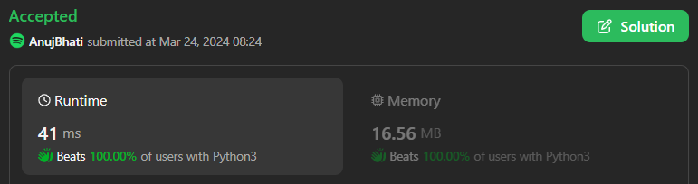
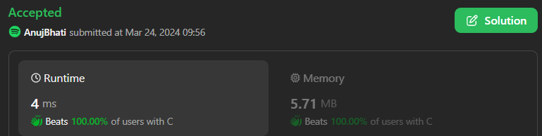

# Easiest Classic Sliding window in C++ / Python3 / Java / C / Python / C#

**Author:** Edwards310
**Votes:** 2
**Link:** [https://leetcode.com/problems/maximum-length-substring-with-two-occurrences/solutions/4917141/](https://leetcode.com/problems/maximum-length-substring-with-two-occurrences/solutions/4917141/)

---

# Intuition



<!-- Describe your first thoughts on how to solve this problem. -->

```C++ []
class Solution {
public:
    int maximumLengthSubstring(string s) {
        vector<int> c(26);
        const int n = s.length();
        int r = 0;
        for (int i = 0, j = 0; i < n; ++i) {
            for (; j < n && ++c[s[j] - 'a'] <= 2; ++j);
            r = max(r, j - i);
            if (j < n) {
                --c[s[j] - 'a'];
            }
            --c[s[i] - 'a'];
        }
        return r;
    }
};
```
```C++ []
class Solution {
public:
    int maximumLengthSubstring(string s) {
        int ret = 0;
		int n = s.size();
		for (int i = 0; i < n; i++) {
			vector<int> cnt(26);
			for (int j = i; j < n; j++) {
				cnt[s[j] - 'a']++;
				if (*max_element(cnt.begin(), cnt.end()) <= 2)
					ret = max(ret, j - i + 1);
			}
		}
		return ret;
    }
};
```
```python3 []
class Solution:
    def maximumLengthSubstring(self, s: str) -> int:
        cnt = {}
        res = 0
        l = 0
        for i in range(len(s)):
            cnt[s[i]] = 1 + cnt.get(s[i], 0)
            if max(cnt.values()) > 2:
                cnt[s[l]] -= 1
                l += 1
            res = max(res, i - l + 1)
        return res
```
```C# []
public class Solution {
    public int MaximumLengthSubstring(string s) {
        int p = 0, ans = 0;
        int[] cnt = new int[26];
        for (int i = 0; i < s.Length; i++) {
            int x = s[i] - 'a';
            cnt[x]++;
            while (cnt[x] > 2)
                cnt[s[p++] - 'a']--;
            ans = Math.Max(ans, i - p + 1);
        }
        return ans;
    }
}
```
```java []
class Solution {
    public int maximumLengthSubstring(String s) {
        int p = 0, ans = 0;
        int[] cnt = new int[26];
        for (int i = 0; i < s.length(); i++) {
            int x = s.charAt(i) - 'a';
            cnt[x]++;
            while (cnt[x] > 2)
                cnt[s.charAt(p++) - 'a']--;
            ans = Math.max(ans, i - p + 1);
        }
        return ans;
    }
}
```
```python []
class Solution(object):
    def maximumLengthSubstring(self, s):
        """
        :type s: str
        :rtype: int
        """
        cnt  = {}
        res = 0
        l = 0
        for i in range(len(s)):
            cnt[s[i]] = 1 + cnt.get(s[i] , 0)
            if max(cnt.values()) > 2:
                cnt[s[l]] -= 1
                l += 1
            res = max(res , i - l + 1)
        return res
```
```C []
int maximumLengthSubstring(char* s) {
    int p = 0, ans = 0;
    int cnt[26] = {};
    for (int i = 0; s[i] != '\\0'; ++i) {
        int x = s[i] - 'a';
        cnt[x]++;
        while (cnt[x] > 2)
            cnt[s[p++] - 'a']--;
        ans = fmax(ans, i - p + 1);
    }
    return ans;
}
```

# Approach
<!-- Describe your approach to solving the problem. -->

# Complexity
- Time complexity:
<!-- Add your time complexity here, e.g. $$O(n)$$ -->
     O(n) -- Sliding window Approach
- Space complexity:
<!-- Add your space complexity here, e.g. $$O(n)$$ -->
     O(1)
# Code
```
class Solution:
    def maximumLengthSubstring(self, s: str) -> int:
        cnt  = {}
        res = 0
        l = 0
        for i in range(len(s)):
            cnt[s[i]] = 1 + cnt.get(s[i] , 0)
            if max(cnt.values()) > 2:
                cnt[s[l]] -= 1
                l += 1
            res = max(res , i - l + 1)
        return res
```
# 
# If you find my solution helpful than make sure to upvote my solution soo that i can improve myself and post as many helpful solutions for you
