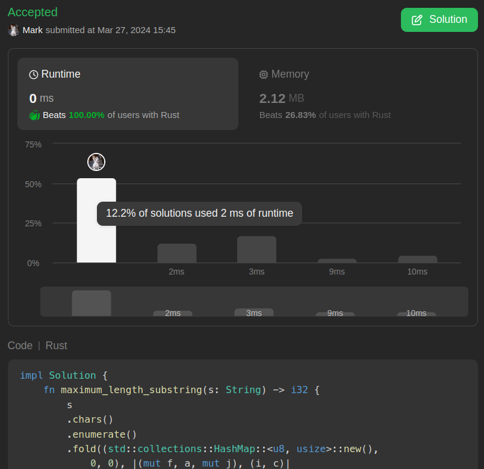

# 0ms one liner beats 100% runtimes(the fastest in the entire world btw)oh my god this's a one liner?!

**Author:** marktyrkba
**Votes:** 1
**Link:** [https://leetcode.com/problems/maximum-length-substring-with-two-occurrences/solutions/4919093/](https://leetcode.com/problems/maximum-length-substring-with-two-occurrences/solutions/4919093/)

---

$$O(n)$$

# Code
```
impl Solution {       
    fn maximum_length_substring(s: String) -> i32 {
        s
        .chars()
        .enumerate()
        .fold((std::collections::HashMap::<u8, usize>::new(),
            0, 0), |(mut f, a, mut j), (i, c)|
        {
            *f.entry(c as u8).or_insert(0) += 1;
            while j < i && f[&(c as u8)] > 2 {
                if let Some(cnt) = f.get_mut(&s.as_bytes()[j]) {
                    *cnt -= 1;
                } j += 1;
            }
            (f, a.max(i - j + 1), j)
        }).1 as i32
    }
}
```

