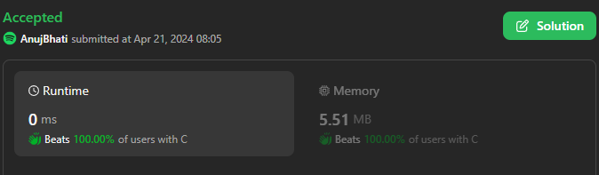
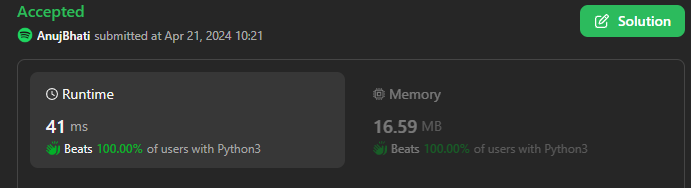
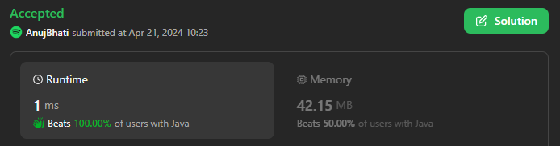
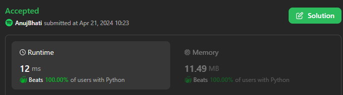
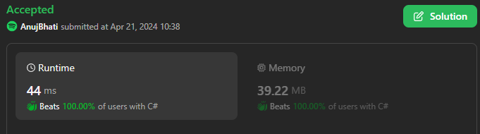

# 🔥💥☠️ Easiest C++✅ Python3✅C#✅Java✅ Python🐍✅C✅🎯☑️🔥Beats💯Simplified version☠️👾💀

**Author:** Edwards310
**Votes:** 3
**Link:** [https://leetcode.com/problems/count-the-number-of-special-characters-i/solutions/5052632/](https://leetcode.com/problems/count-the-number-of-special-characters-i/solutions/5052632/)

---

# Intuition






https://leetcode.com/problems/greatest-english-letter-in-upper-and-lower-case/solutions/4745279/faster-lesser-c-python3-java-c-python-c-explained-with-pics-beats
**This is a similar question to this one with good explanation see that as well.**
```C++ []
class Solution {
public:
    int numberOfSpecialChars(string word) {
        bool l[26] = {false};
        bool u[26] = {false};
        for(auto& x : word){
            if(islower(x))
                l[x - 'a'] = true;
            if(isupper(x))
                u[x - 'A'] = true;
        }
        int cnt = 0;
        for(int i = 0; i < 26; i++)
            if(l[i] && u[i])
                cnt++;
        return cnt;
    }
};
```
```python3 []
class Solution:
    def numberOfSpecialChars(self, word: str) -> int:
        s = set()
        for c in word:
            if c.upper() in word and c.lower() in word:
                s.add(c.lower())
        return len(s)
```
```C []
int numberOfSpecialChars(char* word) {
    bool isLower[26] = {false};
    bool isUpper[26] = {false};
    for(int i = 0; word[i] != '\\0'; i++){
        if(word[i] >= 'a' && word[i] <= 'z')
            isLower[word[i] - 'a'] = true;
        else if(word[i] >= 'A' && word[i] <= 'Z')
            isUpper[word[i] - 'A'] = true;
    }
    int res = 0;
    for(int i = 0; i < 26; i++){
        if(isLower[i] && isUpper[i])
            res++;
    }
     return res;
}
```
```Java []
class Solution {
    public int numberOfSpecialChars(String word) {
        int n = word.length();
        int[] count = new int[26];
        int[] count2 = new int[26];

        for (int i = 0; i < n; i++) {
            int c = word.charAt(i);
            if (c >= 'a' && c <= 'z') {
                count[c - 'a']++;
            } else {
                count2[c - 'A']++;
            }
        }
        int ans = 0;
        for (int i = 0; i < 26; i++) {
            if (count[i] > 0 && count2[i] > 0) {
                ans++;
            }
        }
        return ans;
    }
}
```
```python []
class Solution(object):
    def numberOfSpecialChars(self, word):
        """
        :type word: str
        :rtype: int
        """
        ans = 0
        
        for c in ascii_lowercase:
            if c in word and c.upper() in word:
                ans += 1
        return ans
```
```C# []
public class Solution {
    public int NumberOfSpecialChars(string word) {
        int n = word.Length;
        int[] count = new int[26];
        int[] count2 = new int[26];

        for (int i = 0; i < n; i++) {
            int c = word[i];
            if (c >= 'a' && c <= 'z') {
                count[c - 'a']++;
            } else {
                count2[c - 'A']++;
            }
        }
        int ans = 0;
        for (int i = 0; i < 26; i++) {
            if (count[i] > 0 && count2[i] > 0) {
                ans++;
            }
        }
        return ans;
    }
}
```

<!-- Describe your first thoughts on how to solve this problem. -->

# Approach
<!-- Describe your approach to solving the problem. -->

# Complexity
- Time complexity:
<!-- Add your time complexity here, e.g. $$O(n)$$ -->
     O(n)
- Space complexity:
<!-- Add your space complexity here, e.g. $$O(n)$$ -->
     O(26)
# Code
```
int numberOfSpecialChars(char* word) {
    bool isLower[26] = {false};
    bool isUpper[26] = {false};
    for(int i = 0; word[i] != '\\0'; i++){
        if(word[i] >= 'a' && word[i] <= 'z')
            isLower[word[i] - 'a'] = true;
        else if(word[i] >= 'A' && word[i] <= 'Z')
            isUpper[word[i] - 'A'] = true;
    }
    int res = 0;
    for(int i = 0; i < 26; i++){
        if(isLower[i] && isUpper[i])
            res++;
    }
     return res;
}
```
# Please upvote if it's useful

