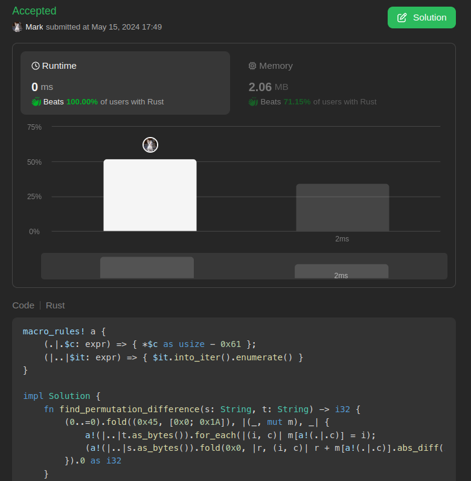

# 0ms One liner beats 100% wtf is that code

**Author:** marktyrkba
**Votes:** 2
**Link:** [https://leetcode.com/problems/permutation-difference-between-two-strings/solutions/5147905/](https://leetcode.com/problems/permutation-difference-between-two-strings/solutions/5147905/)

---

# Code
```
macro_rules! a {
    (.|.$c: expr) => { *$c as usize - 0x61 };
    (|..|$it: expr) => { $it.into_iter().enumerate() }
}

impl Solution {
    fn find_permutation_difference(s: String, t: String) -> i32 {
        (0..=0).fold((0x45, [0x0; 0x1A]), |(_, mut m), _| {
            a!(|..|t.as_bytes()).for_each(|(i, c)| m[a!(.|.c)] = i);
            (a!(|..|s.as_bytes()).fold(0x0, |r, (i, c)| r + m[a!(.|.c)].abs_diff(i)), m)
        }).0 as i32
    }
}
```



