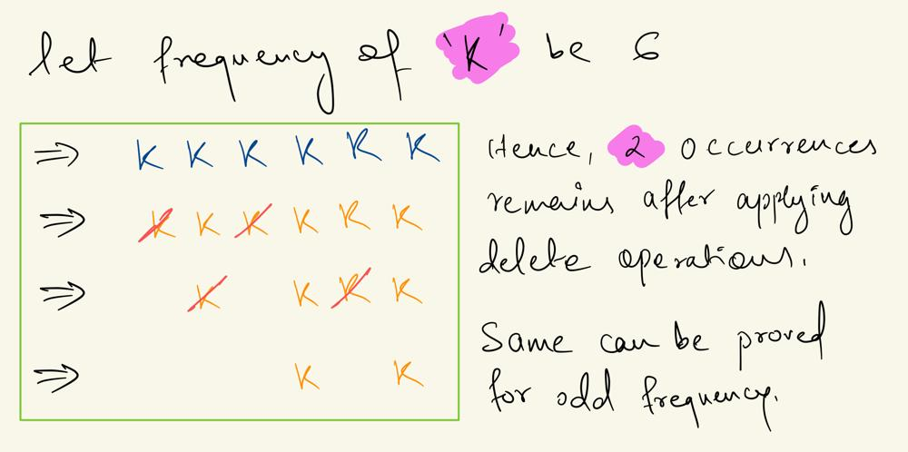

# Count frequency of each character

**Author:** fahad_Mubeen
**Votes:** 22
**Link:** [https://leetcode.com/problems/minimum-length-of-string-after-operations/solutions/5506872/](https://leetcode.com/problems/minimum-length-of-string-after-operations/solutions/5506872/)

---

# Intution
    - For each character in the string, count how many times it appears.

- For a character that occurs f times:
    -    
    1. If f is odd: You can delete `f - 1` characters. This is because after removing `f - 1` characters, one character will remain.
    2. If f is even: You can delete `f - 2` characters. This is because after removing `f - 2`characters, two characters will remain.
    3. Example:




# Complexity
- Time complexity: $$O(n)$$

- Space complexity: $$O(1)$$

# Code
```C++ []
class Solution {
public:
    int minimumLength(string s) {
        int n = s.length(), del = 0;
        unordered_map<char, int> mp;
        // Count the frequency of each character
        for(int i = 0; i < n; i++){
            mp[s[i]]++;
        }
        // Calculate the number of characters to be removed
        for(auto ele : mp){
            int freq = ele.second;
            del += (freq%2) ? freq - 1 : freq - 2;
        }
        return n - del;
    }
};
```
```Java []
class Solution {
    public int minimumLength(String s) {
        int n = s.length(), del = 0;
        Map<Character, Integer> mp = new HashMap<>();

        // Count the frequency of each character
        for (int i = 0; i < n; i++) {
            mp.put(s.charAt(i), mp.getOrDefault(s.charAt(i), 0) + 1);
        }

        // Calculate the number of characters to be removed
        for (Map.Entry<Character, Integer> entry : mp.entrySet()) {
            int f = entry.getValue();
            del += (f % 2 == 1) ? f - 1 : f - 2;
        }

        return n - del;
    }
}
```
```Python3 []
class Solution:
class Solution:
    def minimumLength(self, s: str) -> int:
        n = len(s)
        x = 0
        mp = {}

        # Count the frequency of each character
        for char in s:
            mp[char] = mp.get(char, 0) + 1

        # Calculate the number of characters to be removed
        for f in mp.values():
            x += (f - 1) if (f % 2 == 1) else (f - 2)

        return n - x

```