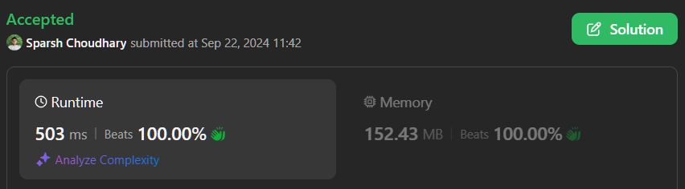

# 🔥BEATS 💯 % 🎯 |✨SUPER EASY BEGINNERS 👏

**Author:** CodeWithSparsh
**Votes:** 2
**Link:** [https://leetcode.com/problems/count-substrings-that-can-be-rearranged-to-contain-a-string-i/solutions/5818925/](https://leetcode.com/problems/count-substrings-that-can-be-rearranged-to-contain-a-string-i/solutions/5818925/)

---



---

# Intuition
To solve the problem of counting valid substrings of `word1` that contain all characters of `word2`, we can leverage the sliding window technique. The idea is to maintain a window that counts characters from `word1` and check if it matches the character frequency in `word2`. If a valid window is found, we can count how many valid substrings can be formed from that window.

# Approach
1. **Frequency Counting**: Create frequency arrays for characters in `word2` and a sliding window in `word1`.
2. **Sliding Window**: Use two pointers (left and right) to expand and contract the window in `word1`.
   - Expand the right pointer to include characters in the window.
   - Check if the current window satisfies the character frequency condition.
   - If valid, count all possible substrings ending at the right pointer and start shrinking the window from the left to see if it still remains valid.
3. **Count Valid Substrings**: For each valid position of the right pointer, all characters from the left pointer to the end of `word1` form valid substrings.

# Complexity
- **Time complexity**:  
  The overall time complexity is **O(n + m)**, where \\(n\\) is the length of `word1` and \\(m\\) is the length of `word2`. We iterate through `word1` once and update frequencies in constant time.
  
- **Space complexity**:  
  The space complexity is **O(1)**, as we use fixed-size arrays for character frequency (26 for lowercase letters).

---

# Code Implementations


```dart []
class Solution {
  // Function to calculate the count of valid substrings
  int validSubstringCount(String word1, String word2) {
    // Frequency array for characters in word2
    List<int> targetFreq = List.filled(26, 0);
    for (var ch in word2.runes) {
      targetFreq[ch - 'a'.runes.first]++;
    }

    // Frequency array for the sliding window in word1
    List<int> windowFreq = List.filled(26, 0);
    int result = 0;
    int left = 0, matchCount = 0;

    // Iterate through word1 using a sliding window
    for (int right = 0; right < word1.length; right++) {
      int charIndex = word1.codeUnitAt(right) - 'a'.codeUnitAt(0);
      windowFreq[charIndex]++;

      // If the current character's frequency matches that in word2
      if (windowFreq[charIndex] == targetFreq[charIndex]) {
        matchCount++;
      }

      // Shrink window when all required characters are satisfied
      while (matchCount == targetFreq.where((count) => count > 0).length) {
        result += word1.length - right;

        int leftCharIndex = word1.codeUnitAt(left) - 'a'.codeUnitAt(0);
        if (windowFreq[leftCharIndex] == targetFreq[leftCharIndex]) {
          matchCount--;
        }
        windowFreq[leftCharIndex]--;
        left++;
      }
    }

    return result;
  }
}
```


```java []
class Solution {
    public int validSubstringCount(String word1, String word2) {
        int[] targetFreq = new int[26];
        for (char ch : word2.toCharArray()) {
            targetFreq[ch - 'a']++;
        }

        int[] windowFreq = new int[26];
        int result = 0;
        int left = 0, matchCount = 0;

        for (int right = 0; right < word1.length(); right++) {
            int charIndex = word1.charAt(right) - 'a';
            windowFreq[charIndex]++;

            if (windowFreq[charIndex] == targetFreq[charIndex]) {
                matchCount++;
            }

            while (matchCount == getNonZeroCount(targetFreq)) {
                result += word1.length() - right;

                int leftCharIndex = word1.charAt(left) - 'a';
                if (windowFreq[leftCharIndex] == targetFreq[leftCharIndex]) {
                    matchCount--;
                }
                windowFreq[leftCharIndex]--;
                left++;
            }
        }
        return result;
    }

    private int getNonZeroCount(int[] freq) {
        int count = 0;
        for (int f : freq) {
            if (f > 0) count++;
        }
        return count;
    }
}
```


```javascript []
function validSubstringCount(word1, word2) {
    const targetFreq = Array(26).fill(0);
    for (let ch of word2) {
        targetFreq[ch.charCodeAt(0) - 'a'.charCodeAt(0)]++;
    }

    const windowFreq = Array(26).fill(0);
    let result = 0;
    let left = 0;
    let matchCount = 0;

    for (let right = 0; right < word1.length; right++) {
        const charIndex = word1.charCodeAt(right) - 'a'.charCodeAt(0);
        windowFreq[charIndex]++;

        if (windowFreq[charIndex] === targetFreq[charIndex]) {
            matchCount++;
        }

        while (matchCount === getNonZeroCount(targetFreq)) {
            result += word1.length - right;

            const leftCharIndex = word1.charCodeAt(left) - 'a'.charCodeAt(0);
            if (windowFreq[leftCharIndex] === targetFreq[leftCharIndex]) {
                matchCount--;
            }
            windowFreq[leftCharIndex]--;
            left++;
        }
    }
    return result;
}

function getNonZeroCount(freq) {
    return freq.filter(f => f > 0).length;
}
```


```python []
class Solution:
    def validSubstringCount(self, word1: str, word2: str) -> int:
        targetFreq = [0] * 26
        for ch in word2:
            targetFreq[ord(ch) - ord('a')] += 1

        windowFreq = [0] * 26
        result = 0
        left = 0
        matchCount = 0

        for right in range(len(word1)):
            charIndex = ord(word1[right]) - ord('a')
            windowFreq[charIndex] += 1

            if windowFreq[charIndex] == targetFreq[charIndex]:
                matchCount += 1

            while matchCount == sum(1 for count in targetFreq if count > 0):
                result += len(word1) - right

                leftCharIndex = ord(word1[left]) - ord('a')
                if windowFreq[leftCharIndex] == targetFreq[leftCharIndex]:
                    matchCount -= 1
                windowFreq[leftCharIndex] -= 1
                left += 1

        return result
```


```cpp []
#include <vector>
#include <string>

class Solution {
public:
    int validSubstringCount(std::string word1, std::string word2) {
        std::vector<int> targetFreq(26, 0);
        for (char ch : word2) {
            targetFreq[ch - 'a']++;
        }

        std::vector<int> windowFreq(26, 0);
        int result = 0;
        int left = 0, matchCount = 0;

        for (int right = 0; right < word1.length(); right++) {
            int charIndex = word1[right] - 'a';
            windowFreq[charIndex]++;

            if (windowFreq[charIndex] == targetFreq[charIndex]) {
                matchCount++;
            }

            while (matchCount == getNonZeroCount(targetFreq)) {
                result += word1.length() - right;

                int leftCharIndex = word1[left] - 'a';
                if (windowFreq[leftCharIndex] == targetFreq[leftCharIndex]) {
                    matchCount--;
                }
                windowFreq[leftCharIndex]--;
                left++;
            }
        }
        return result;
    }

private:
    int getNonZeroCount(const std::vector<int>& freq) {
        int count = 0;
        for (int f : freq) {
            if (f > 0) count++;
        }
        return count;
    }
};
```


```go []
package main

func validSubstringCount(word1 string, word2 string) int {
    targetFreq := make([]int, 26)
    for _, ch := range word2 {
        targetFreq[ch-'a']++
    }

    windowFreq := make([]int, 26)
    result := 0
    left, matchCount := 0, 0

    for right := 0; right < len(word1); right++ {
        charIndex := word1[right] - 'a'
        windowFreq[charIndex]++

        if windowFreq[charIndex] == targetFreq[charIndex] {
            matchCount++
        }

        for matchCount == getNonZeroCount(targetFreq) {
            result += len(word1) - right

            leftCharIndex := word1[left] - 'a'
            if windowFreq[leftCharIndex] == targetFreq[leftCharIndex] {
                matchCount--
            }
            windowFreq[leftCharIndex]--
            left++
        }
    }
    return result
}

func getNonZeroCount

(freq []int) int {
    count := 0
    for _, f := range freq {
        if f > 0 {
            count++
        }
    }
    return count
}
```


```typescript []
function validSubstringCount(word1: string, word2: string): number {
    const targetFreq = Array(26).fill(0);
    for (let ch of word2) {
        targetFreq[ch.charCodeAt(0) - 'a'.charCodeAt(0)]++;
    }

    const windowFreq = Array(26).fill(0);
    let result = 0;
    let left = 0;
    let matchCount = 0;

    for (let right = 0; right < word1.length; right++) {
        const charIndex = word1.charCodeAt(right) - 'a'.charCodeAt(0);
        windowFreq[charIndex]++;

        if (windowFreq[charIndex] === targetFreq[charIndex]) {
            matchCount++;
        }

        while (matchCount === getNonZeroCount(targetFreq)) {
            result += word1.length - right;

            const leftCharIndex = word1.charCodeAt(left) - 'a'.charCodeAt(0);
            if (windowFreq[leftCharIndex] === targetFreq[leftCharIndex]) {
                matchCount--;
            }
            windowFreq[leftCharIndex]--;
            left++;
        }
    }
    return result;
}

function getNonZeroCount(freq: number[]): number {
    return freq.filter(f => f > 0).length;
}
```

---

 {:style='width:250px'}