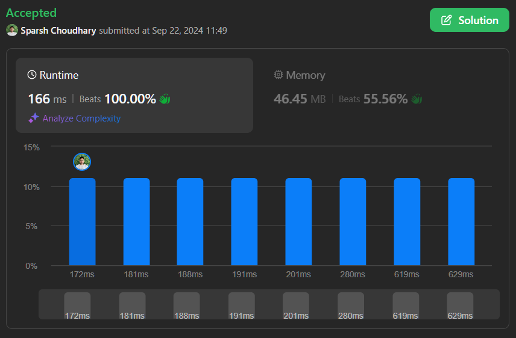

# 🔥BEATS 💯 % 🎯 |✨SUPER EASY BEGINNERS 👏

**Author:** CodeWithSparsh
**Votes:** 1
**Link:** [https://leetcode.com/problems/count-substrings-that-can-be-rearranged-to-contain-a-string-ii/solutions/5818952/](https://leetcode.com/problems/count-substrings-that-can-be-rearranged-to-contain-a-string-ii/solutions/5818952/)

---




---

# Intuition
To find the number of valid substrings in `word1` that contain all characters from `word2`, we can utilize the sliding window technique. The goal is to keep track of the frequency of characters from `word2` and adjust the window in `word1` to maintain all necessary characters.

# Approach
1. **Character Frequency Counting**: Create a frequency array to count occurrences of characters in `word2`. This will help us identify when all required characters are present in the current substring of `word1`.
  
2. **Sliding Window**: Use two pointers, `i` and `j`, to represent the window in `word1`. The outer loop (using `i`) expands the window by including new characters, while the inner loop (using `j`) shrinks the window when all required characters are found.
   - Decrement the frequency of the current character and check if it contributes to a valid substring.
   - If a valid substring is identified (i.e., `cnt` reaches zero), count all possible substrings ending at `i` and increment `j` to shrink the window.
   
3. **Count Valid Substrings**: For each position of `i`, when the substring is valid, calculate how many substrings can be formed and add them to the answer.

# Complexity
- **Time complexity**:  
  The time complexity is **O(n + m)**, where \\(n\\) is the length of `word1` and \\(m\\) is the length of `word2`. Each character is processed a limited number of times.

- **Space complexity**:  
  The space complexity is **O(1)**, since the frequency array has a fixed size of 26 (for lowercase letters).

---

# Code Implementations


```cpp []
class Solution {
public:
    long long validSubstringCount(string word1, string word2) {
        vector<int> freq(26, 0);
        int cnt = 0;
        for (char ch : word2) {
            if (freq[ch - 'a'] == 0) {
                cnt++;
            }
            freq[ch - 'a']++;
        }
        long long j = 0, ans = 0;
        for (long long i = 0; i < word1.size(); i++) {
            if (--freq[word1[i] - 'a'] == 0) {
                cnt--;
            }
            while (cnt == 0) {
                ans += (word1.size() - i);
                if (++freq[word1[j] - 'a'] == 1) {
                    cnt++;
                }
                j++;
            }
        }
        return ans;
    }
};
```


```dart []
class Solution {
  int validSubstringCount(String word1, String word2) {
    List<int> freq = List.filled(26, 0);
    int cnt = 0;
    
    for (var ch in word2.runes) {
      if (freq[ch - 'a'.runes.first] == 0) {
        cnt++;
      }
      freq[ch - 'a'.runes.first]++;
    }
    
    int j = 0, ans = 0;
    for (int i = 0; i < word1.length; i++) {
      if (--freq[word1.codeUnitAt(i) - 'a'.codeUnitAt(0)] == 0) {
        cnt--;
      }
      
      while (cnt == 0) {
        ans += (word1.length - i);
        if (++freq[word1.codeUnitAt(j) - 'a'.codeUnitAt(0)] == 1) {
          cnt++;
        }
        j++;
      }
    }
    return ans;
  }
}
```


```java []
class Solution {
    public long validSubstringCount(String word1, String word2) {
        int[] freq = new int[26];
        int cnt = 0;

        for (char ch : word2.toCharArray()) {
            if (freq[ch - 'a'] == 0) {
                cnt++;
            }
            freq[ch - 'a']++;
        }

        long j = 0, ans = 0;
        for (long i = 0; i < word1.length(); i++) {
            if (--freq[word1.charAt((int)i) - 'a'] == 0) {
                cnt--;
            }

            while (cnt == 0) {
                ans += (word1.length() - i);
                if (++freq[word1.charAt((int)j) - 'a'] == 1) {
                    cnt++;
                }
                j++;
            }
        }
        return ans;
    }
}
```


```javascript []
function validSubstringCount(word1, word2) {
    const freq = Array(26).fill(0);
    let cnt = 0;

    for (let ch of word2) {
        if (freq[ch.charCodeAt(0) - 'a'.charCodeAt(0)] === 0) {
            cnt++;
        }
        freq[ch.charCodeAt(0) - 'a'.charCodeAt(0)]++;
    }

    let j = 0, ans = 0;
    for (let i = 0; i < word1.length; i++) {
        if (--freq[word1.charCodeAt(i) - 'a'.charCodeAt(0)] === 0) {
            cnt--;
        }

        while (cnt === 0) {
            ans += (word1.length - i);
            if (++freq[word1.charCodeAt(j) - 'a'.charCodeAt(0)] === 1) {
                cnt++;
            }
            j++;
        }
    }
    return ans;
}
```


```python []
class Solution:
    def validSubstringCount(self, word1: str, word2: str) -> int:
        freq = [0] * 26
        cnt = 0
        
        for ch in word2:
            if freq[ord(ch) - ord('a')] == 0:
                cnt += 1
            freq[ord(ch) - ord('a')] += 1
        
        j, ans = 0, 0
        for i in range(len(word1)):
            if freq[ord(word1[i]) - ord('a')] == 1:
                cnt -= 1
            freq[ord(word1[i]) - ord('a')] -= 1
            
            while cnt == 0:
                ans += len(word1) - i
                if freq[ord(word1[j]) - ord('a')] == 0:
                    cnt += 1
                freq[ord(word1[j]) - ord('a')] += 1
                j += 1
                
        return ans
```


```go []
package main

func validSubstringCount(word1 string, word2 string) int64 {
    freq := make([]int, 26)
    cnt := 0
    
    for _, ch := range word2 {
        if freq[ch-'a'] == 0 {
            cnt++
        }
        freq[ch-'a']++
    }
    
    j, ans := 0, int64(0)
    for i := 0; i < len(word1); i++ {
        if freq[word1[i]-'a'] == 1 {
            cnt--
        }
        freq[word1[i]-'a']--

        for cnt == 0 {
            ans += int64(len(word1) - i)
            if freq[word1[j]-'a'] == 0 {
                cnt++
            }
            freq[word1[j]-'a']++
            j++
        }
    }
    return ans
}
```


```typescript []
function validSubstringCount(word1: string, word2: string): number {
    const freq = Array(26).fill(0);
    let cnt = 0;

    for (const ch of word2) {
        if (freq[ch.charCodeAt(0) - 'a'.charCodeAt(0)] === 0) {
            cnt++;
        }
        freq[ch.charCodeAt(0) - 'a'.charCodeAt(0)]++;
    }

    let j = 0, ans = 0;
    for (let i = 0; i < word1.length; i++) {
        if (--freq[word1.charCodeAt(i) - 'a'.charCodeAt(0)] === 0) {
            cnt--;
        }

        while (cnt === 0) {
            ans += (word1.length - i);
            if (++freq[word1.charCodeAt(j) - 'a'.charCodeAt(0)] === 1) {
                cnt++;
            }
            j++;
        }
    }
    return ans;
}
```

---
 {:style='width:250px'}