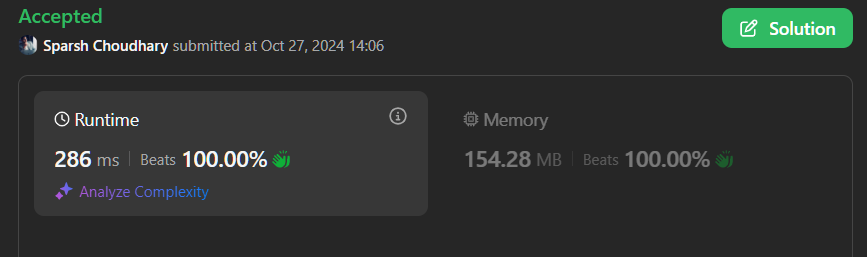

# 🔥BEATS 💯 % 🎯 |✨SUPER EASY BEGINNERS 👏

**Author:** CodeWithSparsh
**Votes:** 3
**Link:** [https://leetcode.com/problems/total-characters-in-string-after-transformations-i/solutions/5973887/](https://leetcode.com/problems/total-characters-in-string-after-transformations-i/solutions/5973887/)

---




---

# Intuition
The problem requires simulating transformations on character counts in a string over a specified number of steps. Each transformation redistributes character counts according to the rules, and by iterating `t` times, we calculate the final count. The modulo operation ensures we avoid overflow due to the potentially large counts.

# Approach
1. Initialize an array `cnt` to store the frequency of each character in the string.
2. For each transformation, use a temporary array `tmp` to apply the rules:
   - For characters `a` to `y`, increment the next character's position.
   - For `z`, increment both `a` and `b`.
3. Update `cnt` with `tmp` values after each transformation.
4. Sum all values in `cnt` to get the final length after transformations.

# Complexity
- **Time Complexity**: \\(O(t \	imes 26)\\) since we process each transformation across all 26 alphabet positions.
- **Space Complexity**: \\(O(26)\\), as we only store counts for each letter.

---

# Code


```dart []
class Solution {
  int lengthAfterTransformations(String s, int t) {
    const int MOD = 1000000007;
    List<int> cnt = List.filled(26, 0);

    // Count occurrences of each character in the string
    for (int i = 0; i < s.length; i++) {
      cnt[s.codeUnitAt(i) - 'a'.codeUnitAt(0)]++;
    }

    // Perform transformations
    for (int j = 0; j < t; j++) {
      List<int> tmp = List.filled(26, 0);
      for (int i = 0; i < 26; i++) {
        if (i == 25) {
          tmp[0] = (tmp[0] + cnt[i]) % MOD;
          tmp[1] = (tmp[1] + cnt[i]) % MOD;
        } else {
          tmp[i + 1] = (tmp[i + 1] + cnt[i]) % MOD;
        }
      }
      cnt = tmp;
    }

    // Calculate final length
    int len = 0;
    for (int c in cnt) {
      len = (len + c) % MOD;
    }

    return len;
  }
}
```


```java []
class Solution {
    public int lengthAfterTransformations(String s, int t) {
        final int MOD = 1000000007;
        int[] cnt = new int[26];
        
        for (char c : s.toCharArray()) {
            cnt[c - 'a']++;
        }

        for (int j = 0; j < t; j++) {
            int[] tmp = new int[26];
            for (int i = 0; i < 26; i++) {
                if (i == 25) {
                    tmp[0] = (tmp[0] + cnt[i]) % MOD;
                    tmp[1] = (tmp[1] + cnt[i]) % MOD;
                } else {
                    tmp[i + 1] = (tmp[i + 1] + cnt[i]) % MOD;
                }
            }
            cnt = tmp;
        }

        int len = 0;
        for (int c : cnt) {
            len = (len + c) % MOD;
        }

        return len;
    }
}
```


```javascript []
var lengthAfterTransformations = function(s, t) {
    const MOD = 1000000007;
    let cnt = Array(26).fill(0);
    
    for (let char of s) {
        cnt[char.charCodeAt(0) - 'a'.charCodeAt(0)]++;
    }

    for (let j = 0; j < t; j++) {
        let tmp = Array(26).fill(0);
        for (let i = 0; i < 26; i++) {
            if (i === 25) {
                tmp[0] = (tmp[0] + cnt[i]) % MOD;
                tmp[1] = (tmp[1] + cnt[i]) % MOD;
            } else {
                tmp[i + 1] = (tmp[i + 1] + cnt[i]) % MOD;
            }
        }
        cnt = tmp;
    }

    return cnt.reduce((sum, val) => (sum + val) % MOD, 0);
};
```


```python []
class Solution:
    def lengthAfterTransformations(self, s: str, t: int) -> int:
        MOD = 1000000007
        cnt = [0] * 26
        
        for char in s:
            cnt[ord(char) - ord('a')] += 1

        for _ in range(t):
            tmp = [0] * 26
            for i in range(26):
                if i == 25:
                    tmp[0] = (tmp[0] + cnt[i]) % MOD
                    tmp[1] = (tmp[1] + cnt[i]) % MOD
                else:
                    tmp[i + 1] = (tmp[i + 1] + cnt[i]) % MOD
            cnt = tmp

        return sum(cnt) % MOD
```


```cpp []
#include <vector>
#include <string>

class Solution {
public:
    int lengthAfterTransformations(std::string s, int t) {
        const int MOD = 1000000007;
        std::vector<int> cnt(26, 0);

        for (char c : s) {
            cnt[c - 'a']++;
        }

        for (int j = 0; j < t; j++) {
            std::vector<int> tmp(26, 0);
            for (int i = 0; i < 26; i++) {
                if (i == 25) {
                    tmp[0] = (tmp[0] + cnt[i]) % MOD;
                    tmp[1] = (tmp[1] + cnt[i]) % MOD;
                } else {
                    tmp[i + 1] = (tmp[i + 1] + cnt[i]) % MOD;
                }
            }
            cnt = tmp;
        }

        int len = 0;
        for (int c : cnt) {
            len = (len + c) % MOD;
        }

        return len;
    }
};
```


```go []
package main

const MOD int = 1000000007

func lengthAfterTransformations(s string, t int) int {
    cnt := make([]int, 26)

    for _, char := range s {
        cnt[char-'a']++
    }

    for j := 0; j < t; j++ {
        tmp := make([]int, 26)
        for i := 0; i < 26; i++ {
            if i == 25 {
                tmp[0] = (tmp[0] + cnt[i]) % MOD
                tmp[1] = (tmp[1] + cnt[i]) % MOD
            } else {
                tmp[i+1] = (tmp[i+1] + cnt[i]) % MOD
            }
        }
        cnt = tmp
    }

    len := 0
    for _, c := range cnt {
        len = (len + c) % MOD
    }

    return len
}
```

These solutions simulate the character transformations step-by-step and compute the total character length after `t` transformations. Each implementation efficiently handles large counts using modular arithmetic.

---

 {:style='width:250px'}

