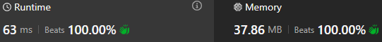
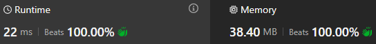

# (30ms)Frequencies and cycle of condition fulfillment.

**Author:** sav20011962
**Votes:** 0
**Link:** [https://leetcode.com/problems/total-characters-in-string-after-transformations-i/solutions/5975680/](https://leetcode.com/problems/total-characters-in-string-after-transformations-i/solutions/5975680/)

---

# Approach
The idea is here:
https://leetcode.com/problems/total-characters-in-string-after-transformations-i/solutions/5972951/simple-and-clean-java-solution-o-26-t
# Complexity

# Code
```kotlin []
class Solution {
    fun lengthAfterTransformations(s: String, t: Int): Int {
        val alpha = IntArray(26)
        for (ch in s) alpha[ch - 'a']++
        repeat(t) {
            val tmp = alpha[25]
            for (j in 25 downTo 1) alpha[j] = alpha[j-1]
            alpha[0] = tmp
            alpha[1] = (alpha[1] + tmp) % mod
        }

        var len = 0
        for (a in alpha) len = (len + a) % mod
        return len
    }
    companion object {
        val mod = 1_000_000_007
    }    
}

```
# OR

```
class Solution {
    fun lengthAfterTransformations(s: String, t: Int): Int {
        val alphaA = IntArray(26)
        val alpha = LinkedList<Int>()

        for (ch in s) alphaA[ch - 'a']++
        for (N in alphaA) alpha.add(N)

        repeat(t) {
            val tmp = alpha.pollLast()
            val tmp1 = alpha.pollFirst()
            
            alpha.addFirst((tmp1 + tmp) % mod) 
            alpha.addFirst(tmp) 
        }

        var len = 0
        for (a in alpha) len = (len + a) % mod
        return len
    }
    companion object {
        val mod = 1_000_000_007
    }    
}
```
# Or even so:

```
class Solution {
    fun lengthAfterTransformations(s: String, t: Int): Int {
        var start = 100_000
        for (i in start until start+26) alpha[i]=0
        for (ch in s) alpha[ch - 'a' + start]++
        repeat(t) {
            start--
            val temp = alpha[start+26]
            alpha[start+1] = (alpha[start+1] + temp) % mod
            alpha[start] = temp
        }
        var len = 0L
        for (i in start until start+26) len += alpha[i]
        return (len % mod).toInt()
    }
    companion object {
        val mod = 1_000_000_007
        val alpha = IntArray(100_026)
    }

}
```