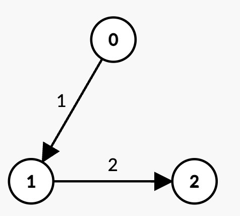

# [3543. Maximum Weighted K-Edge Path](https://leetcode.com/problems/maximum-weighted-k-edge-path/)

| Category | Difficulty | Likes | Dislikes |
| :------: | :--------: | :---: | :------: |
| Algorithms | Medium | 80 | 10 |

**Tags:** [`hash-table`](https://leetcode.com/tag/hash-table), [`dynamic-programming`](https://leetcode.com/tag/dynamic-programming), [`graph`](https://leetcode.com/tag/graph)

## Description

You are given an integer `n` and a **Directed Acyclic Graph (DAG)** with `n` nodes labeled from 0 to `n - 1`. This is represented by a 2D array `edges`, where `edges[i] = [u_i, v_i, w_i]` indicates a directed edge from node `u_i` to `v_i` with weight `w_i`.

You are also given two integers, `k` and `t`.

Your task is to determine the **maximum** possible sum of edge weights for any path in the graph such that:

	- The path contains **exactly** `k` edges.

	- The total sum of edge weights in the path is **strictly** less than `t`.

Return the **maximum** possible sum of weights for such a path. If no such path exists, return `-1`.

 

**Example 1:**

**Input:** n = 3, edges = [[0,1,1],[1,2,2]], k = 2, t = 4

**Output:** 3

**Explanation:**

	- The only path with `k = 2` edges is `0 -> 1 -> 2` with weight `1 + 2 = 3 `0 -> 1` with weight `2  2` with weight `3 = t`, which is not strictly less than `t`.

	
	
	- Thus, the maximum possible sum of weights less than `t` is 2.

**Example 3:**

**Input:** n = 3, edges = [[0,1,6],[1,2,8]], k = 1, t = 6

**Output:** -1

**Explanation:**

	- There are two paths with k = 1 edge:
	
		`0 -> 1` with weight `6 = t`, which is not strictly less than `t`.

		- `1 -> 2` with weight `8 > t`, which is not strictly less than `t`.

	
	
	- Since there is no path with sum of weights strictly less than `t`, the answer is -1.

 

**Constraints:**

	- `1 <= n <= 300`

	- `0 <= edges.length <= 300`

	- `edges[i] = [u_i, v_i, w_i]`

	- `0 <= u_i, v_i < n`

	- `u_i != v_i`

	- `1 <= w_i <= 10`

	- `0 <= k <= 300`

	- `1 <= t <= 600`

	- The input graph is **guaranteed** to be a **DAG**.

	- There are no duplicate edges.

---

**Links:** [Submissions](https://leetcode.com/problems/maximum-weighted-k-edge-path/) | [Solutions](https://leetcode.com/problems/maximum-weighted-k-edge-path/)
