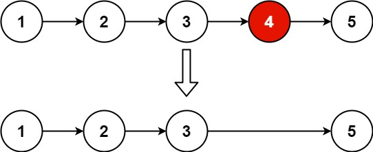

# [19. Remove Nth Node From End of List](https://leetcode.com/problems/remove-nth-node-from-end-of-list/)

| Category | Difficulty | Likes | Dislikes |
| :------: | :--------: | :---: | :------: |
| Algorithms | Medium | 20832 | 882 |

**Tags:** [`linked-list`](https://leetcode.com/tag/linked-list), [`two-pointers`](https://leetcode.com/tag/two-pointers)

**Companies:** `facebook`, `google`, `amazon`, `microsoft`, `bloomberg`, `apple`, `josh-technology`, `tinkoff`, `yandex`, `tcs`, `accenture`, `oracle`, `tiktok`, `adobe`, `goldman-sachs`

## Description

Given the `head` of a linked list, remove the `n^th` node from the end of the list and return its head.

 

**Example 1:**


```

Input: head = [1,2,3,4,5], n = 2
Output: [1,2,3,5]

```

**Example 2:**

```

Input: head = [1], n = 1
Output: []

```

**Example 3:**

```

Input: head = [1,2], n = 1
Output: [1]

```

 

**Constraints:**

	- The number of nodes in the list is `sz`.

	- `1 <= sz <= 30`

	- `0 <= Node.val <= 100`

	- `1 <= n <= sz`

 

**Follow up:** Could you do this in one pass?

---

**Links:** [Submissions](https://leetcode.com/problems/remove-nth-node-from-end-of-list/) | [Solutions](https://leetcode.com/problems/remove-nth-node-from-end-of-list/)
