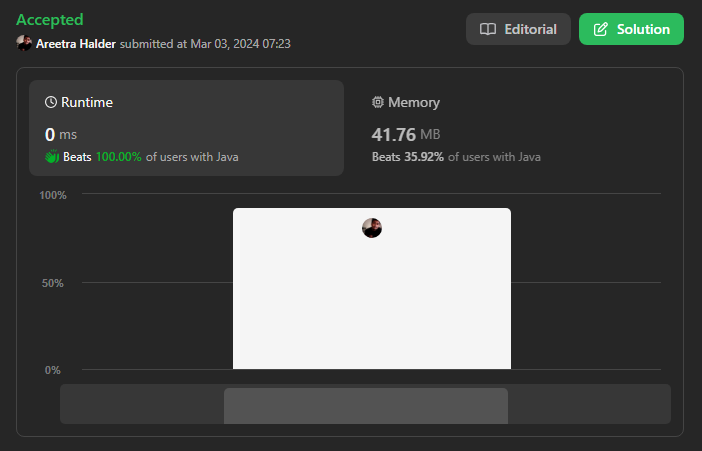
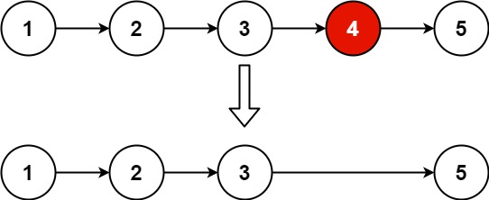

# 🔥✅✅ Beats 100% with Proof | Very Easy to Understand ✅✅🔥

**Author:** areetrahalder
**Votes:** 91
**Link:** [https://leetcode.com/problems/remove-nth-node-from-end-of-list/solutions/4813477/](https://leetcode.com/problems/remove-nth-node-from-end-of-list/solutions/4813477/)

---

# Proof - Upvote if you watching the proof



# Intuition
<!-- Describe your first thoughts on how to solve this problem. -->
Given the head of a linked list, remove the nth node from the end of the list and return its head.



# Approach
<!-- Describe your approach to solving the problem. -->
1) Calculate the size of the Single Linked List. We need to travel to the prev node of the node to be removed thus we perform reduce size by n
2) If the node to be removed is the first node (size == 0) then we can simply return the next node of head since it will be null if the list has only one node.
3) Traverse till the prev node using a loop again
4) Skip the next node by linking the prev node to the next of next node. If not present, assign null. 
5. Finally return the head. 

# Complexity
- Time complexity: O(N) 
<!-- Add your time complexity here, e.g. $$O(n)$$ -->

- Space complexity: O(1)
<!-- Add your space complexity here, e.g. $$O(n)$$ -->

# Code
```Java []
/**
 * Definition for singly-linked list.
 * public class ListNode {
 *     int val;
 *     ListNode next;
 *     ListNode() {}
 *     ListNode(int val) { this.val = val; }
 *     ListNode(int val, ListNode next) { this.val = val; this.next = next; }
 * }
 */
class Solution {
    public ListNode removeNthFromEnd(ListNode head, int n) {
        int length = findLength(head);
        int i = 0, traverseTill = length - n - 1;
        if(traverseTill == -1) return head.next;
        ListNode curr = head;
        while(i < traverseTill){
            curr = curr.next;
            i++;
        }
        curr.next = curr.next.next;
        return head;
    }
    public int findLength(ListNode head){
        int count = 0;
        if(head == null) return count;
        ListNode curr = head;
        while(curr != null){
            count++;
            curr = curr.next;
        }
        return count;
    }
}
```
```C []
/**
 * Definition for singly-linked list.
 * struct ListNode {
 *     int val;
 *     struct ListNode *next;
 * };
 */
struct ListNode* removeNthFromEnd(struct ListNode* head, int n) {
    int length = 0;
    struct ListNode* curr = head;
    
    // Calculate the length of the linked list
    while (curr != NULL) {
        length++;
        curr = curr->next;
    }

    // Find the position to remove
    int traverseTill = length - n - 1;
    int i = 0;
    curr = head;

    // If the head needs to be removed
    if (traverseTill == -1) {
        head = head->next;
        free(curr);
        return head;
    }

    // Traverse to the node before the one to be removed
    while (i < traverseTill) {
        curr = curr->next;
        i++;
    }

    // Remove the nth node from the end
    struct ListNode* temp = curr->next;
    curr->next = curr->next->next;
    free(temp);

    return head;
}

```
```C++ []
/**
 * Definition for singly-linked list.
 * struct ListNode {
 *     int val;
 *     ListNode *next;
 *     ListNode() : val(0), next(nullptr) {}
 *     ListNode(int x) : val(x), next(nullptr) {}
 *     ListNode(int x, ListNode *next) : val(x), next(next) {}
 * };
 */
class Solution {
public:
    ListNode* removeNthFromEnd(ListNode* head, int n) {
        int length = 0;
        ListNode* curr = head;
        
        // Calculate the length of the linked list
        while (curr != nullptr) {
            length++;
            curr = curr->next;
        }

        // Find the position to remove
        int traverseTill = length - n - 1;
        int i = 0;
        curr = head;

        // If the head needs to be removed
        if (traverseTill == -1) {
            head = head->next;
            delete curr;
            return head;
        }

        // Traverse to the node before the one to be removed
        while (i < traverseTill) {
            curr = curr->next;
            i++;
        }

        // Remove the nth node from the end
        ListNode* temp = curr->next;
        curr->next = curr->next->next;
        delete temp;

        return head;
    }
};

```
```C# []
/**
 * Definition for singly-linked list.
 * public class ListNode {
 *     public int val;
 *     public ListNode next;
 *     public ListNode(int val=0, ListNode next=null) {
 *         this.val = val;
 *         this.next = next;
 *     }
 * }
 */
public class Solution {
    public ListNode RemoveNthFromEnd(ListNode head, int n) {
        int length = 0;
        ListNode curr = head;
        
        // Find the length of the linked list
        while (curr != null) {
            length++;
            curr = curr.next;
        }
        
        int traverseTill = length - n - 1;
        curr = head;
        
        // Traverse to the node before the one to be removed
        for (int i = 0; i < traverseTill; i++) {
            curr = curr.next;
        }
        
        // Remove the nth node from the end
        if (traverseTill == -1) {
            return head.next;
        } else {
            curr.next = curr.next.next;
            return head;
        }
    }
}

```

```Python []
# Definition for singly-linked list.
# class ListNode(object):
#     def __init__(self, val=0, next=None):
#         self.val = val
#         self.next = next
class Solution(object):
    def removeNthFromEnd(self, head, n):
        length = self.findLength(head)
        i, traverseTill = 0, length - n - 1
        if traverseTill == -1:
            return head.next
        curr = head
        while i < traverseTill:
            curr = curr.next
            i += 1
        curr.next = curr.next.next
        return head

    def findLength(self, head):
        count = 0
        if head is None:
            return count
        curr = head
        while curr is not None:
            count += 1
            curr = curr.next
        return count

```
```Python3 []
# Definition for singly-linked list.
# class ListNode:
#     def __init__(self, val=0, next=None):
#         self.val = val
#         self.next = next
class Solution:
    def removeNthFromEnd(self, head: Optional[ListNode], n: int) -> Optional[ListNode]:
        length = self.findLength(head)
        i, traverseTill = 0, length - n - 1
        if traverseTill == -1:
            return head.next
        curr = head
        while i < traverseTill:
            curr = curr.next
            i += 1
        curr.next = curr.next.next
        return head

    def findLength(self, head):
        count = 0
        if head is None:
            return count
        curr = head
        while curr is not None:
            count += 1
            curr = curr.next
        return count

```
```Javascript []
/**
 * Definition for singly-linked list.
 * function ListNode(val, next) {
 *     this.val = (val===undefined ? 0 : val)
 *     this.next = (next===undefined ? null : next)
 * }
 */
/**
 * @param {ListNode} head
 * @param {number} n
 * @return {ListNode}
 */
var removeNthFromEnd = function (head, n) {
    let length = findLength(head);
    let i = 0,
        traverseTill = length - n - 1;
    if (traverseTill === -1) return head.next;
    let curr = head;
    while (i < traverseTill) {
        curr = curr.next;
        i++;
    }
    curr.next = curr.next.next;
    return head;

    function findLength(head) {
        let count = 0;
        if (head === null) return count;
        let curr = head;
        while (curr !== null) {
            count++;
            curr = curr.next;
        }
        return count;
    }
};

```
```Typescript []
/**
 * Definition for singly-linked list.
 * class ListNode {
 *     val: number
 *     next: ListNode | null
 *     constructor(val?: number, next?: ListNode | null) {
 *         this.val = (val===undefined ? 0 : val)
 *         this.next = (next===undefined ? null : next)
 *     }
 * }
 */

function removeNthFromEnd(head: ListNode | null, n: number): ListNode | null {
    let length = findLength(head);
    let i = 0,
        traverseTill = length - n - 1;
    if (traverseTill === -1) return head.next;
    let curr = head;
    while (i < traverseTill) {
        curr = curr.next;
        i++;
    }
    curr.next = curr.next.next;
    return head;

    function findLength(head: ListNode | null): number {
        let count = 0;
        if (head === null) return count;
        let curr = head;
        while (curr !== null) {
            count++;
            curr = curr.next;
        }
        return count;
    }
}

```
# Upvote


