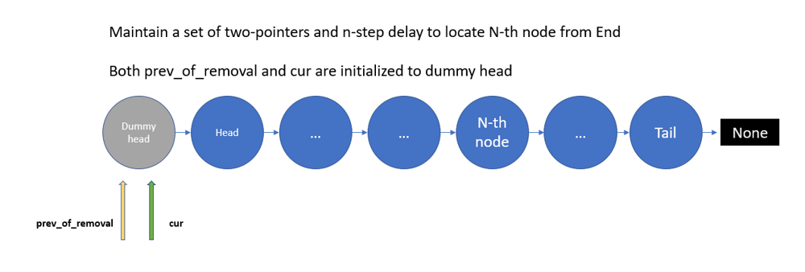
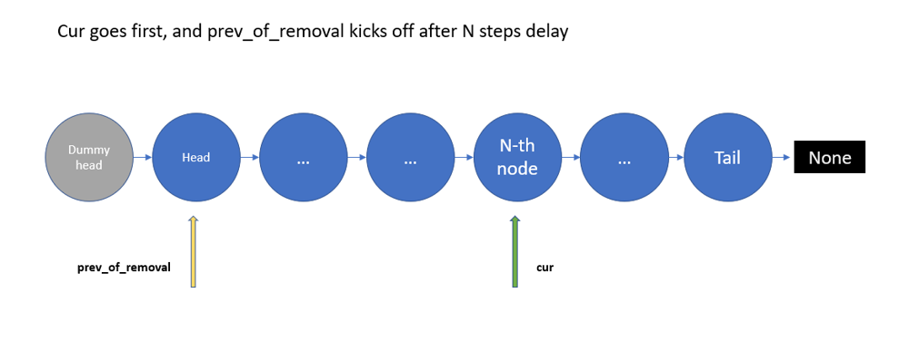
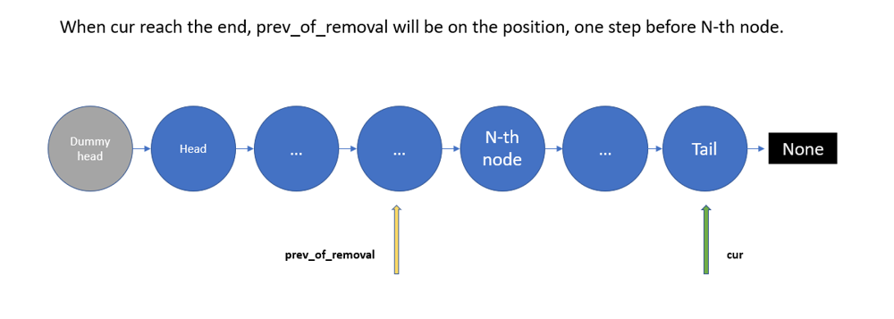
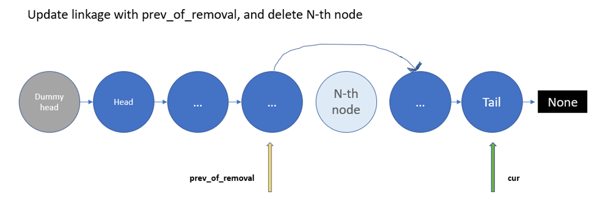

# Python/Go/JS/C++ O(n) by two-pointers [w/ Visualization]

**Author:** brianchiang_tw
**Votes:** 33
**Link:** [https://leetcode.com/problems/remove-nth-node-from-end-of-list/solutions/612328/](https://leetcode.com/problems/remove-nth-node-from-end-of-list/solutions/612328/)

---

O(n) one-pass by two-pointers and delay

---

**Hint**:

Think of **two-pointers** with **n-step delay**.

First pointer keeps going till the end.
Second pointer traverses to the previous node of the one being removed with n-step delay.

When first pointer reach the end, the second one will be on the right position.
Then update linkage of second pointer and remove the N-th node from the end.

---

**Visualization & Diagram**:



---



---



---



---

**Implementation** by two-pointers and delay in Python:

```
# Definition for singly-linked list.
# class ListNode:
#     def __init__(self, val=0, next=None):
#         self.val = val
#         self.next = next

class Solution:
    def removeNthFromEnd(self, head: ListNode, n: int) -> ListNode:
        
        # use dummy head will make the removal of head node easier
        dummy_head = ListNode(-1)
        dummy_head.next = head
        
        # cur keeps iteration till the end
        # prev_of_removal traverses to the previous node of the one of being removed
        cur, prev_of_removal = dummy_head, dummy_head
        
        
        while cur.next != None:
            
            # n-step delay for prev_of_removal
            if n <= 0:
                prev_of_removal = prev_of_removal.next
                
            cur = cur.next
            
            n -=1
        
        
        # Remove the N-th node from end of list
        n_th_node = prev_of_removal.next
        prev_of_removal.next = n_th_node.next
        
        del n_th_node
        
        return dummy_head.next
```

---

Javascript:

```
/**
 * Definition for singly-linked list.
 * function ListNode(val, next) {
 *     this.val = (val===undefined ? 0 : val)
 *     this.next = (next===undefined ? null : next)
 * }
 */
/**
 * @param {ListNode} head
 * @param {number} n
 * @return {ListNode}
 */
var removeNthFromEnd = function(head, n) {
    
    // use dummy head will make the removal of head node easier
    let dummyHead = new ListNode( -1, head);
    
    // cur keeps iteration till the end
    // prev_of_removal traverses to the previous node of the one of being removed    
    let cur = dummyHead;
    let prevOfRemoval = dummyHead;
    
    while( cur.next != null ){
        
        // n-step delay for prevOfRemoval
        if( n <= 0 ){
            prevOfRemoval = prevOfRemoval.next;
        }
        
        cur = cur.next;
        
        // update counter of n-step delay
        n -= 1;
    }
    
    
    nThNode = prevOfRemoval.next;
    prevOfRemoval.next = nThNode.next;
    
    return dummyHead.next;
    
};
```

---

**Implementation** by two-pointers and delay in Go:

```
/**
 * Definition for singly-linked list.
 * type ListNode struct {
 *     Val int
 *     Next *ListNode
 * }
 */

func removeNthFromEnd(head *ListNode, n int) *ListNode {
    
    dummyHead := &ListNode{-1, head}
    
    cur, prevOfRemoval := dummyHead, dummyHead
    
    for cur.Next != nil{
        
        // n step delay for prevOfRemoval
        if n <= 0 {
            prevOfRemoval = prevOfRemoval.Next
        }
        
        cur = cur.Next
        
        n -= 1
    }
    
    // Remove the N-th node from end of list
    nthNode := prevOfRemoval.Next
    prevOfRemoval.Next = nthNode.Next
    
    return dummyHead.Next
    
}
```

---

C++

```
class Solution {
public:
    ListNode* removeNthFromEnd(ListNode* head, int n) {
        
        // use dummy head will make the removal of head node easier
        ListNode* dummyHead = new ListNode(-1, head);
        
        // cur keeps iteration till the end
        // prevOfRemoval traverses to the previous node of the one of being removied
        ListNode* cur = dummyHead;
        ListNode* prevOfRemoval = dummyHead;
        
        while( cur->next != nullptr ){
            
            // n-step delay for prevOfRemoval
            if( n <= 0 ){
                prevOfRemoval = prevOfRemoval->next;
            }
            
            cur = cur->next;
            
            // update counter of n step delay
            n -= 1;
        }
        
        // Remove the n-th node from end of list
        ListNode* nThNode = prevOfRemoval->next;
        prevOfRemoval->next = nThNode->next;
        
        delete nThNode;
        
        return dummyHead->next;
        
        
        
    }
};
```