# 🔥🔥 Explicación y Resolución Del Ejercicio En Español Java | Python | PHP | C++ | JavaScript 🔥🔥

**Author:** hermescoder02
**Votes:** 6
**Link:** [https://leetcode.com/problems/remove-nth-node-from-end-of-list/solutions/4340460/](https://leetcode.com/problems/remove-nth-node-from-end-of-list/solutions/4340460/)

---

# Lectura

*Eliminar el nodo n del final de la lista(Java, Python, PHP, C++, Javascript)*

Dada una lista enlazada, elimine el nodo en la posici\xF3n n contando desde el final, y retorne la lista modificada.

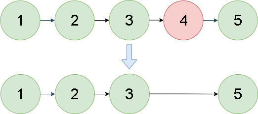


# Video

https://youtu.be/hDuFf_4gYY4?si=ZEAH52Ec9BRXogCB

Si te gust\xF3 el contenido \xA1te invito a suscribirte!:
\u2705https://www.youtube.com/@hermescoder?sub_confirmation=1

# Pasos para realizar el algoritmo:

**1.-** Contar la longitud de nodos de la lista. 

Se inicializa tama\xF1o a 0 y aux a el puntero head. Se itera a trav\xE9s de la lista enlazada mientras aux no sea nulo, incrementando en uno la variable tama\xF1o en cada paso.
        
**2.-** Se comprueban los casos bordes. 

\u2705**Si la longitud de la lista enlazada es 1**, se devuelve null, ya que solo hay un nodo que eliminar. 

\u2705**Si la longitud de la lista enlazada es igual a n**, se devuelve el nodo siguiente a la cabeza, ya que esto significa que se debe eliminar el primer nodo.

**3.-** Localizar el nodo a eliminar: Se asigna aux a la cabeza de la lista enlazada y se utiliza un bucle hasta llegar a la posici\xF3n del nodo a eliminar, es decir a el tama\xF1o  - n

**4.-** Eliminar el nodo de la lista. Se establece el puntero next del nodo que precede al que se va a eliminar para que apunte al nodo dos posiciones adelante, eliminando efectivamente el nodo deseado de la lista enlazada.

**5.-** Se devuelve la cabeza de la lista enlazada modificada.

# C\xF3digo 
```Java []
class Solution {
    public ListNode removeNthFromEnd(ListNode head, int n) {
 
        //paso#1
        int tama\xF1o = 0;
        ListNode aux = head;
 
        while (aux != null) {
            aux = aux.next;
            tama\xF1o++;
        }
 
        //paso#2
        if (tama\xF1o == 1) return null;
        if (tama\xF1o == n) return head.next;
 
        //paso#3
        aux = head;
        for (int i = 0; i < tama\xF1o - n - 1; i++) {
            aux = aux.next;
        }
 
        //paso#4
        aux.next = aux.next.next;
 
        //paso#5
        return head;
    }
 
}
```
```Python []
class Solution(object):
    def removeNthFromEnd(self, head, n):
        # Paso #1
        tamano = 0
        aux = head
 
        while aux is not None:
            aux = aux.next
            tamano += 1
 
        # Paso #2
        if tamano == 1:
            return None
        if tamano == n:
            return head.next
 
        # Paso #3
        aux = head
        for i in range(tamano - n - 1):
            aux = aux.next
 
        # Paso #4
        aux.next = aux.next.next
 
        # Paso #5
        return head
```
```PHP  []
class Solution {
 
    /**
     * @param ListNode $head
     * @param Integer $n
     * @return ListNode
     */
    function removeNthFromEnd($head, $n) {
        // Paso #1
        $tama\xF1o = 0;
        $aux = $head;
 
        while ($aux !== null) {
            $aux = $aux->next;
            $tama\xF1o++;
        }
 
        // Paso #2
        if ($tama\xF1o == 1) {
            return null;
        }
        if ($tama\xF1o == $n) {
            return $head->next;
        }
 
        // Paso #3
        $aux = $head;
        for ($i = 0; $i < $tama\xF1o - $n - 1; $i++) {
            $aux = $aux->next;
        }
 
        // Paso #4
        $aux->next = $aux->next->next;
 
        // Paso #5
        return $head;
 
    }
}
```
```C++   []
class Solution {
public:
    ListNode* removeNthFromEnd(ListNode* head, int n) {
 
        // Paso #1
        int size = 0;
        ListNode* aux = head;
 
        while (aux != nullptr) {
            aux = aux->next;
            size++;
        }
 
        // Paso #2
        if (size == 1) return nullptr;
        if (size == n) return head->next;
 
        // Paso #3
        aux = head;
        for (int i = 0; i < size - n - 1; i++) {
            aux = aux->next;
        }
 
        // Paso #4
        aux->next = aux->next->next;
 
        // Paso #5
        return head;
    }
};
```
```JavaScript   []
var removeNthFromEnd = function(head, n) {
    // Paso #1
        let tama\xF1o = 0;
        let aux = head;
 
        while (aux !== null) {
            aux = aux.next;
            tama\xF1o++;
        }
 
        // Paso #2
        if (tama\xF1o === 1) {
            return null;
        }
        if (tama\xF1o === n) {
            return head.next;
        }
 
        // Paso #3
        aux = head;
        for (let i = 0; i < tama\xF1o - n - 1; i++) {
            aux = aux.next;
        }
 
        // Paso #4
        aux.next = aux.next.next;
 
        // Paso #5
        return head;
};
```


# Imagenes de la Explicaci\xF3n


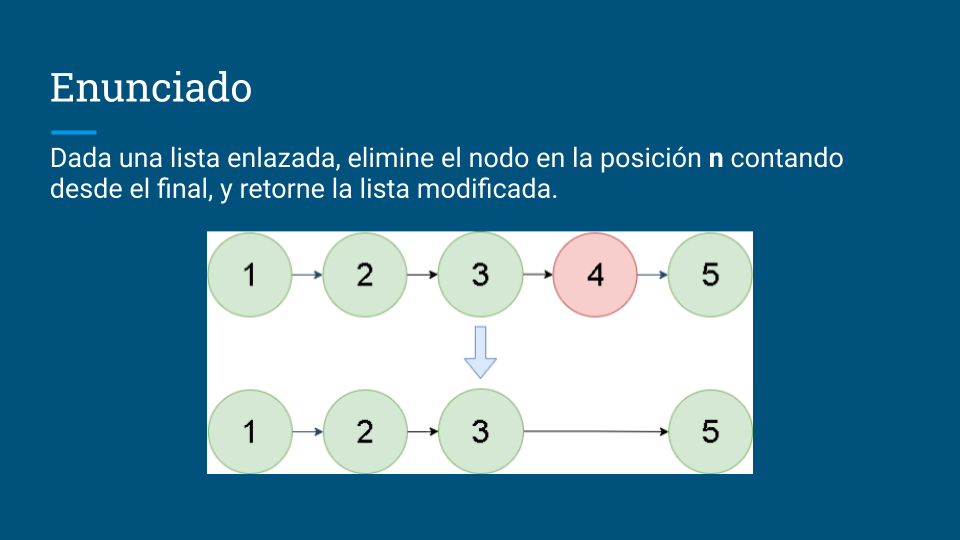


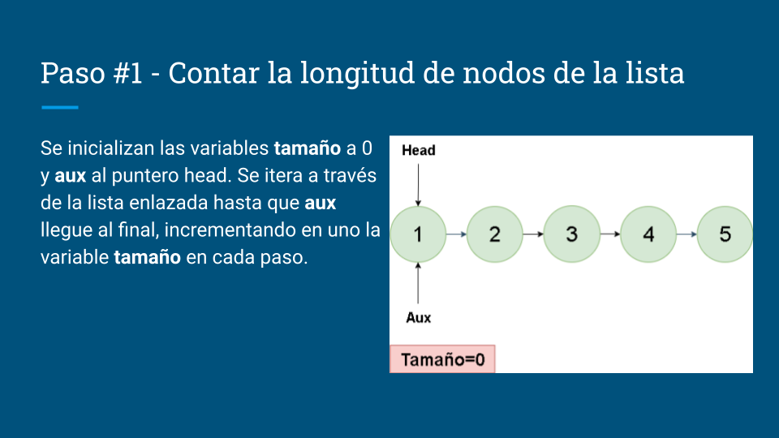


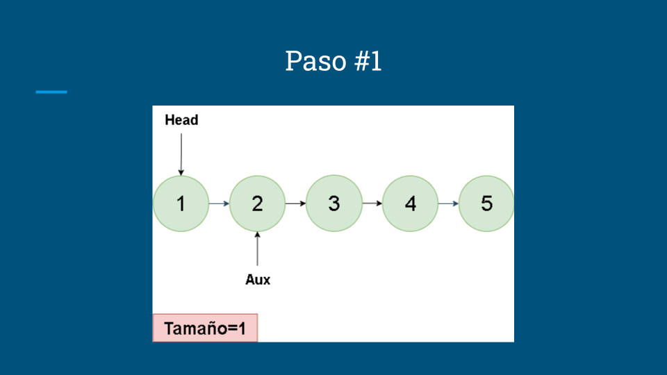

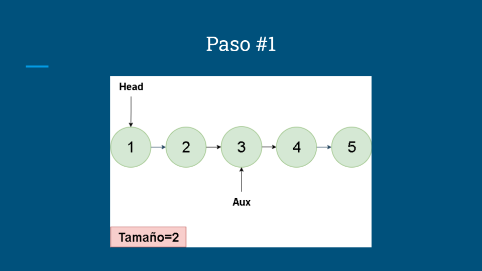

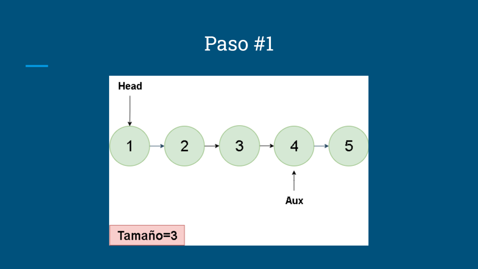


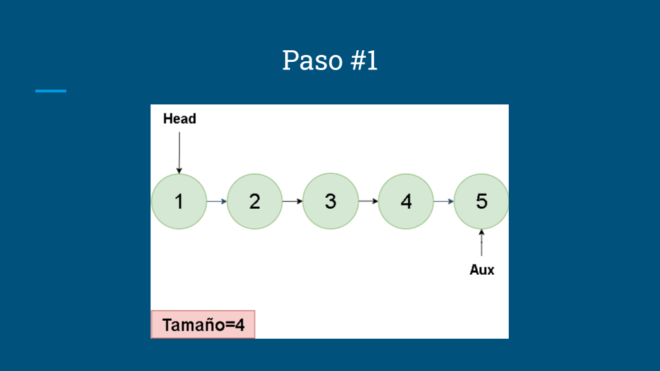

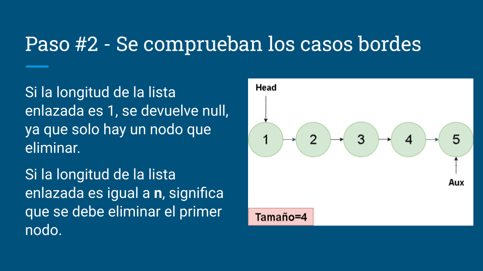

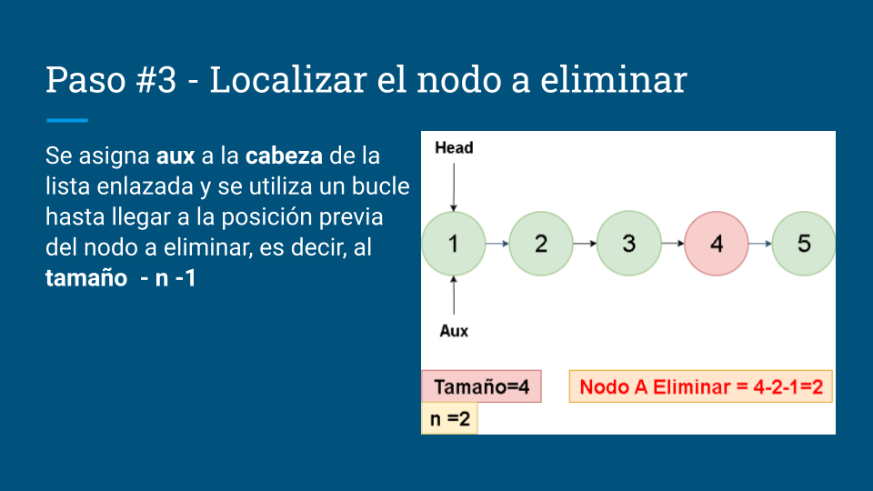

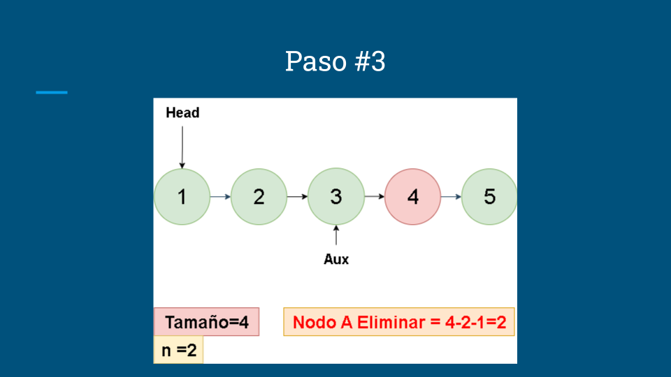


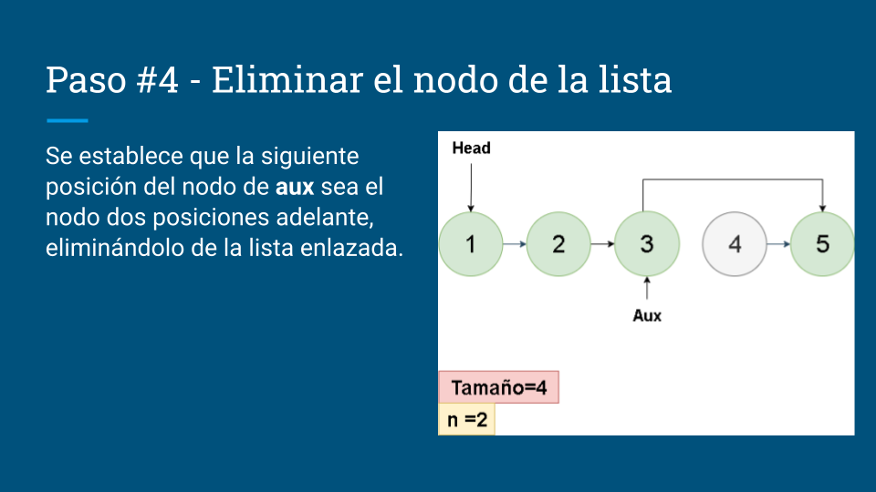

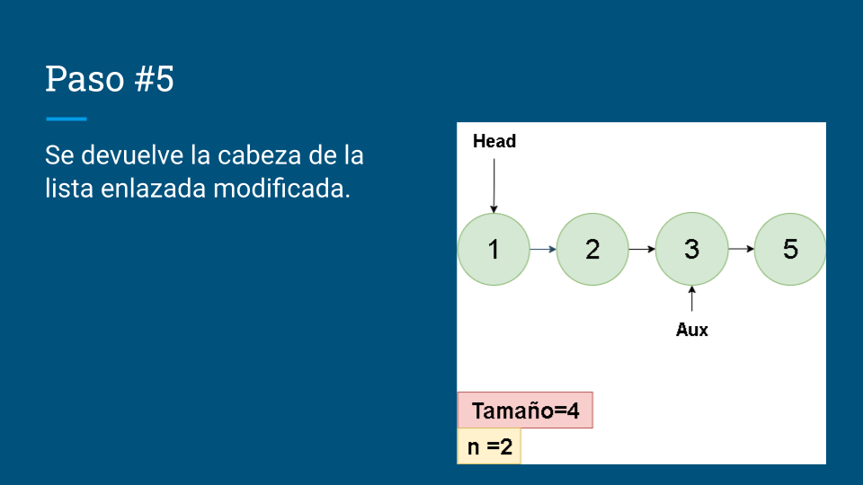


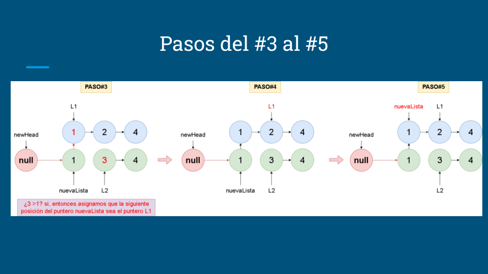

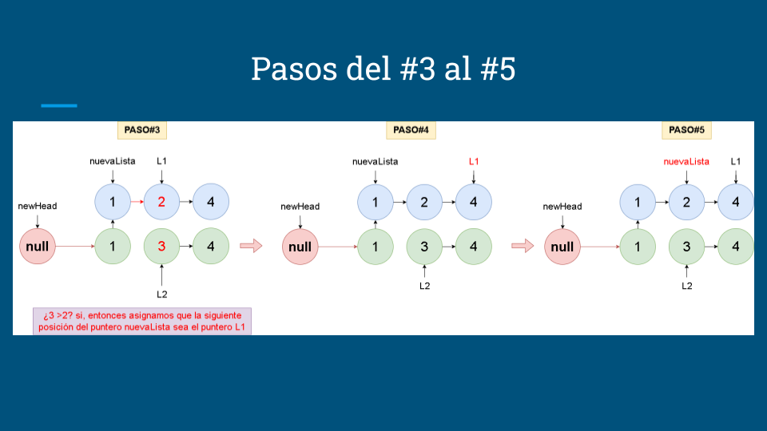


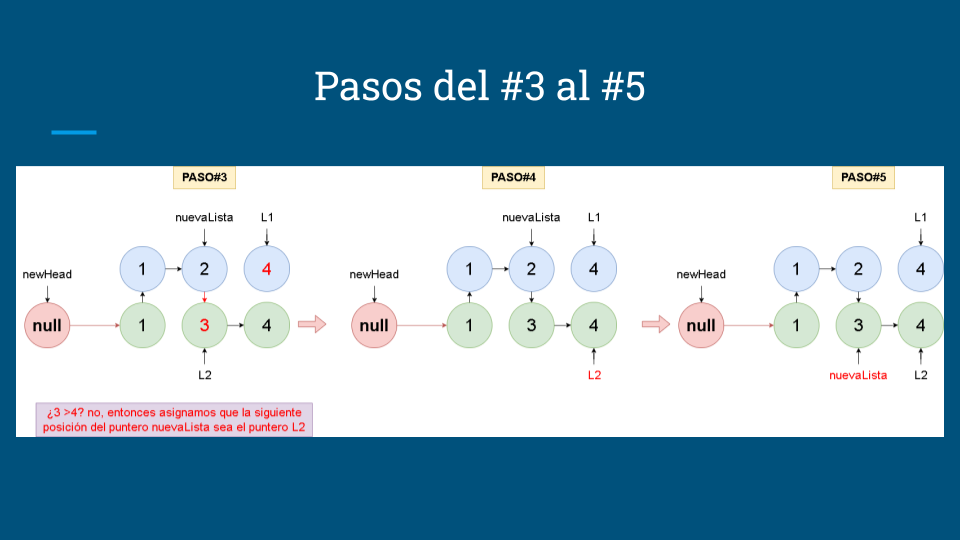

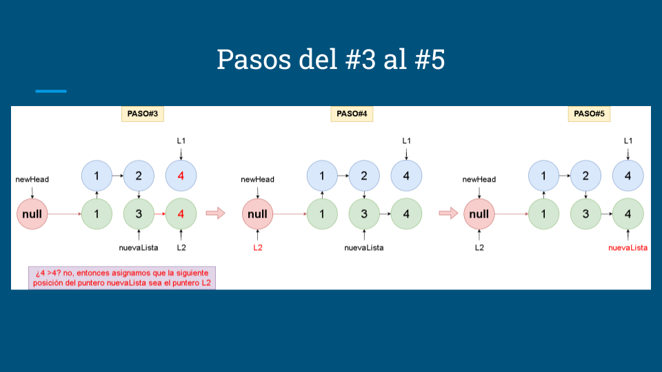


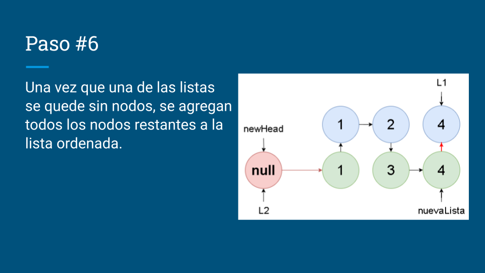

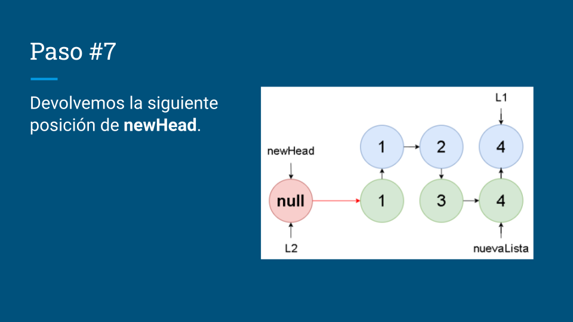
