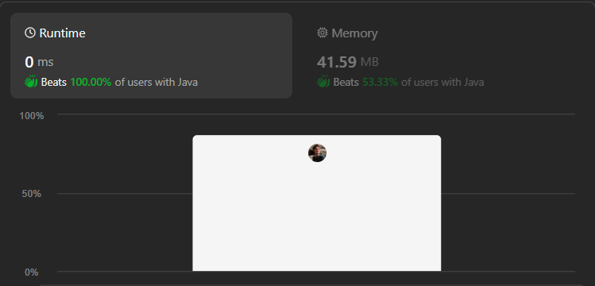

# Easy ,Beginner Friendly & Dry Run || Simple loops || Time O(N) Space O(1) || Gits ✅✅✅👈👈

**Author:** GiteshSK_12
**Votes:** 6
**Link:** [https://leetcode.com/problems/remove-nth-node-from-end-of-list/solutions/4692175/](https://leetcode.com/problems/remove-nth-node-from-end-of-list/solutions/4692175/)

---



# Intuition \uD83D\uDC48

In the given question, you are provided with the head of a linked list and a number n. You are required to remove the nth node from the end of the list.

# Approach \uD83D\uDC48

To solve this question, first, we need to determine the length of the linked list. After obtaining the length, we subtract n from it, which gives us the position of the nth node from the start that we need to remove from the linked list.

# Code Explanation \uD83D\uDC48

*   **Edge Case Handling**: The method first checks if the input `head` is `null` or if the list contains only one node (`head.next == null`). In either case, the method returns `null`, as removing a node from such a list would result in an empty list.
    
*   **Dummy Head Initialization**: A dummy node with a value of `0` is created and its `next` pointer is set to point to the `head` of the list. This dummy node acts as a placeholder to simplify edge cases, especially when the node to be removed is the head of the list.
    
*   **Counting Nodes**: The method iterates through the entire list starting from `head`, using a `while` loop to count the total number of nodes in the list. This count is stored in the variable `count`.
    
*   **Adjusting Count for Removal**: The variable `count` is then decremented by `n`. This adjustment translates the task from "remove the nth node from the end" to "find the (count\u2212n)th node from the beginning".
    
*   **Finding the Predecessor Node**: The method initializes a pointer `prev` to the dummy node and then advances it `count` times through the list. After this loop, `prev` points to the node immediately before the node that needs to be removed.
    
*   **Removing the Node**: The node to be removed is `prev.next`. To remove it, the method sets `prev.next` to `prev.next.next`, effectively bypassing the node to be removed and linking `prev` directly to the node after the one to be removed. This operation does not deallocate the removed node, but it effectively removes it from the list as seen by traversing the list from the dummy head.
    
*   **Returning the New Head**: Finally, the method returns `dummy.next`, which is the new head of the list. If the original head of the list was removed, `dummy.next` now points to the second node, which is the new head. If any other node was removed, the structure of the list is updated accordingly, with the original head still in place.

# Complexity \uD83D\uDC48
- Time complexity: O(n)

- Space complexity: O(1)

# Code \uD83D\uDC48
```C []
/**
 * Definition for singly-linked list.
 * struct ListNode {
 *     int val;
 *     struct ListNode *next;
 * };
 */
struct ListNode* removeNthFromEnd(struct ListNode* head, int n) {
    if(head == NULL || head->next == NULL)return NULL;

    struct ListNode* dummy = (struct ListNode*)malloc(sizeof(struct ListNode));
    dummy -> next = head;
    int count = 0;

    struct ListNode* iterate = head;
    while(iterate != NULL){
        count++;
        iterate = iterate->next;
    }      
    count-=n;
    struct ListNode* prev = dummy; 
    for (int i = 0; i < count; i++) {
        prev = prev->next;
    }
    prev->next = prev->next->next;
    return dummy->next;
}
```
```C++ []
/**
 * Definition for singly-linked list.
 * struct ListNode {
 *     int val;
 *     ListNode *next;
 *     ListNode() : val(0), next(nullptr) {}
 *     ListNode(int x) : val(x), next(nullptr) {}
 *     ListNode(int x, ListNode *next) : val(x), next(next) {}
 * };
 */
class Solution {
public:
    ListNode* removeNthFromEnd(ListNode* head, int n) {
        if(head == NULL || head->next == NULL)return NULL;

        ListNode* dummy = new ListNode(0);
        dummy->next = head;
        int count = 0;

        ListNode* iterate = head;
        while(iterate != NULL){
            count++;
            iterate = iterate->next;
        }      
        count-=n;
        ListNode* prev = dummy; 
        for (int i = 0; i < count; i++) {
            prev = prev->next;
        }
        prev->next = prev->next->next;
        return dummy->next;
    }
};
```
```Java []
/**
 * Definition for singly-linked list.
 * public class ListNode {
 *     int val;
 *     ListNode next;
 *     ListNode() {}
 *     ListNode(int val) { this.val = val; }
 *     ListNode(int val, ListNode next) { this.val = val; this.next = next; }
 * }
 */
class Solution {
    public ListNode removeNthFromEnd(ListNode head, int n) {
        if(head == null || head.next == null)return null;

        ListNode dummy = new ListNode(0);
        dummy.next = head;
        int count = 0;

        ListNode iterate = head;
        while(iterate != null){
            count++;
            iterate = iterate.next;
        }      
        count-=n;
        ListNode prev = dummy; 
        for (int i = 0; i < count; i++) {
            prev = prev.next;
        }
        prev.next = prev.next.next;
        return dummy.next;
    }
}
```
```javascript []
/**
 * Definition for singly-linked list.
 * function ListNode(val, next) {
 *     this.val = (val===undefined ? 0 : val)
 *     this.next = (next===undefined ? null : next)
 * }
 */
/**
 * @param {ListNode} head
 * @param {number} n
 * @return {ListNode}
 */
var removeNthFromEnd = function(head, n) {
    if(head == null || head.next == null)return null;

    dummy = new ListNode(0);
    dummy.next = head;
    let count = 0;

    iterate = head;
    while(iterate != null){
        count++;
        iterate = iterate.next;
    }      
    count-=n;
    prev = dummy; 
    for (let i = 0; i < count; i++) {
        prev = prev.next;
    }
    prev.next = prev.next.next;
    return dummy.next;
};
```
```C# []
/**
 * Definition for singly-linked list.
 * public class ListNode {
 *     public int val;
 *     public ListNode next;
 *     public ListNode(int val=0, ListNode next=null) {
 *         this.val = val;
 *         this.next = next;
 *     }
 * }
 */
public class Solution {
    public ListNode RemoveNthFromEnd(ListNode head, int n) {
        if(head == null || head.next == null)return null;

        ListNode dummy = new ListNode(0);
        dummy.next = head;
        int count = 0;

        ListNode iterate = head;
        while(iterate != null){
            count++;
            iterate = iterate.next;
        }      
        count-=n;
        ListNode prev = dummy; 
        for (int i = 0; i < count; i++) {
            prev = prev.next;
        }
        prev.next = prev.next.next;
        return dummy.next;
    }
}
```
```python []
# Definition for singly-linked list.
# class ListNode(object):
#     def __init__(self, val=0, next=None):
#         self.val = val
#         self.next = next
class Solution(object):
    def removeNthFromEnd(self, head, n):
        """
        :type head: ListNode
        :type n: int
        :rtype: ListNode
        """
        if head == None or head.next == None: return None

        dummy = ListNode(0)
        dummy.next = head
        count = 0

        iterate = head
        while iterate != None:
            count+=1
            iterate = iterate.next 

        count-=n
        prev = dummy
        for i in range(0 , count):
            prev = prev.next

        prev.next = prev.next.next
        return dummy.next
```
```ruby []
# Definition for singly-linked list.
# class ListNode
#     attr_accessor :val, :next
#     def initialize(val = 0, _next = nil)
#         @val = val
#         @next = _next
#     end
# end
# @param {ListNode} head
# @param {Integer} n
# @return {ListNode}
def remove_nth_from_end(head, n)
    if head == nil or head.next == nil 
        return nil
    end
    dummy = ListNode.new(0)
    dummy.next = head
    count = 0

    iterate = head
    while iterate != nil
        count+=1
        iterate = iterate.next 
    end
    count-=n
    prev = dummy
    for a in 1..count do
        prev = prev.next
    end

    prev.next = prev.next.next
    return dummy.next
endus aacha 
```

# Dry Run \uD83D\uDC48

1.  **Initialization**:
    
    *   The list is `[1,2,3,4,5]`.
    *   `n = 2`, meaning we want to remove the 2nd node from the end of the list, which is `4`.
2.  **Dummy Node**:
    
    *   A dummy node is created and its `next` is set to point to the head of the list. Now, the list looks like `[dummy,1,2,3,4,5]`.
3.  **Counting Nodes**:
    
    *   The method iterates through the list to count the nodes. `count` becomes `5` because there are 5 nodes in the list.
4.  **Adjusting Count for Removal**:
    
    *   The method calculates the position to stop before the node to be removed: `count = count - n`, which is `5 - 2 = 3`. This means we need to find the 3rd node from the beginning, which is `3`, to get to its predecessor.
5.  **Finding the Predecessor Node**:
    
    *   Starting from the dummy node, the method advances `prev` 3 times. After these iterations, `prev` points to the node `3`.
6.  **Removing the Node**:
    
    *   `prev.next` points to `4`, and `prev.next.next` points to `5`. The method sets `prev.next` to `prev.next.next`, which makes `prev.next` point to `5`. Now, the list looks like `[dummy,1,2,3,5]`, effectively removing the `4`.
7.  **Returning the New Head**:
    
    *   Finally, the method returns `dummy.next`, which is the head of the new list `[1,2,3,5]`.

# Here's a more detailed breakdown of the key steps: \uD83D\uDC48

*   **Before Removal**:
    
    *   List: `Dummy -> 1 -> 2 -> 3 -> 4 -> 5`
*   **After Counting (`count = 3` after adjustment)**:
    
    *   `prev` starts at `Dummy` and moves to `3` after 3 iterations.
*   **Node Removal**:
    
    *   Before: `Dummy -> 1 -> 2 -> 3 -> 4 -> 5`
    *   After: `Dummy -> 1 -> 2 -> 3 ------> 5`
*   **Result**:
    
    *   The final list returned is `[1,2,3,5]`, with the node containing `4` removed.

# Hey Guys if you like the explanation and solution the upvote me.\u2764\uFE0F\u2764\uFE0F\u2764\uFE0F
