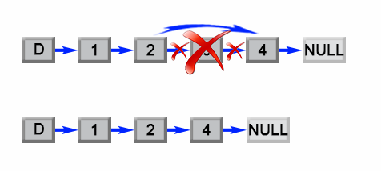
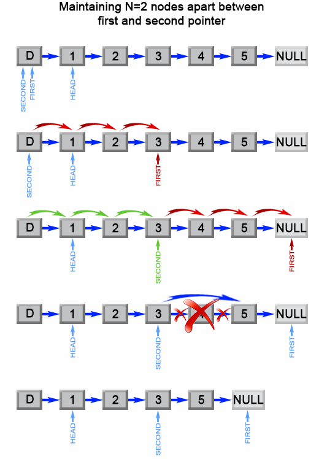

# Official Solution

**Link:** [https://leetcode.com/problems/remove-nth-node-from-end-of-list/solution/](https://leetcode.com/problems/remove-nth-node-from-end-of-list/solution/)

---

[TOC]

## Video Solution

---

    

        <iframe src="https://player.vimeo.com/video/664082490" width="640" height="360" frameborder="0" allow="autoplay; fullscreen" allowfullscreen></iframe>
    

&nbsp;

## Solution Article

## Summary

This article is for beginners. It introduces the following idea:
Linked List traversal and removal of nth element from the end.

---
### Approach 1: Two pass algorithm

**Intuition**

 We notice that the problem could be simply reduced to another one : Remove the $$(L - n + 1)$$ th node from the beginning in the list , where $$L$$ is the list length. This problem is easy to solve once we found list length $$L$$.

**Algorithm**

First we will add an auxiliary "dummy" node, which points to the list head. The "dummy" node is used to simplify some corner cases such as a list with only one node, or removing the head of the list. On the first pass, we find the list length $$L$$. Then we set a pointer to the dummy node and start to move it through the list till it comes to the $$(L - n)$$ th node. We relink `next` pointer of the $$(L - n)$$ th node to the $$(L - n + 2)$$ th node and we are done.

*Figure 1. Remove the L - n + 1 th element from a list.*

<iframe src="https://leetcode.com/playground/cJebwHDZ/shared" frameBorder="0" width="100%" height="429" name="cJebwHDZ"></iframe>

**Complexity Analysis**

* Time complexity : $$O(L)$$.

    The algorithm makes two traversal of the list, first to calculate list length $$L$$ and second to find the $$(L - n)$$ th node. There are $$2L-n$$ operations and time complexity is $$O(L)$$.

* Space complexity : $$O(1)$$.

    We only used constant extra space.
 
 

---
### Approach 2: One pass algorithm

**Algorithm**

The above algorithm could be optimized to one pass. Instead of one pointer, we could use two pointers. The first pointer advances the list by $$n+1$$ steps from the beginning, while the second pointer starts from the beginning of the list. Now, both pointers are exactly separated by $$n$$ nodes apart. We maintain this constant gap by advancing both pointers together until the first pointer arrives past the last node. The second pointer will be pointing at the $$n$$th node counting from the last.
We relink the next pointer of the node referenced by the second pointer to point to the node's next next node.

*Figure 2. Remove the nth element from end of a list.*

<iframe src="https://leetcode.com/playground/c49YQiYS/shared" frameBorder="0" width="100%" height="500" name="c49YQiYS"></iframe>

**Complexity Analysis**

* Time complexity : $$O(L)$$.

    The algorithm makes one traversal of the list of $$L$$ nodes. Therefore time complexity is $$O(L)$$.

* Space complexity : $$O(1)$$.

    We only used constant extra space.