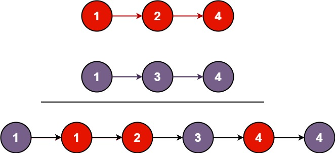

# [21. Merge Two Sorted Lists](https://leetcode.com/problems/merge-two-sorted-lists/)

| Category | Difficulty | Likes | Dislikes |
| :------: | :--------: | :---: | :------: |
| Algorithms | Easy | 24395 | 2394 |

**Tags:** [`linked-list`](https://leetcode.com/tag/linked-list), [`recursion`](https://leetcode.com/tag/recursion)

**Companies:** `google`, `amazon`, `microsoft`, `facebook`, `bloomberg`, `oracle`, `rippling`, `apple`, `salesforce`, `yandex`, `josh-technology`, `squarespace`, `zoho`, `hubspot`, `snowflake`, `tiktok`, `palo-alto-networks`, `yahoo`, `siemens`, `linkedin`, `goldman-sachs`, `arista-networks`, `huawei`, `nvidia`, `shopee`, `epam-systems`, `tcs`, `hpe`, `wix`

## Description

You are given the heads of two sorted linked lists `list1` and `list2`.

Merge the two lists into one **sorted** list. The list should be made by splicing together the nodes of the first two lists.

Return *the head of the merged linked list*.

 

**Example 1:**


```

Input: list1 = [1,2,4], list2 = [1,3,4]
Output: [1,1,2,3,4,4]

```

**Example 2:**

```

Input: list1 = [], list2 = []
Output: []

```

**Example 3:**

```

Input: list1 = [], list2 = [0]
Output: [0]

```

 

**Constraints:**

	- The number of nodes in both lists is in the range `[0, 50]`.

	- `-100 <= Node.val <= 100`

	- Both `list1` and `list2` are sorted in **non-decreasing** order.

---

**Links:** [Submissions](https://leetcode.com/problems/merge-two-sorted-lists/) | [Solutions](https://leetcode.com/problems/merge-two-sorted-lists/)
