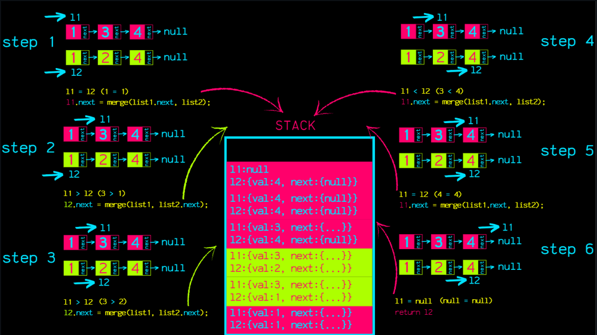
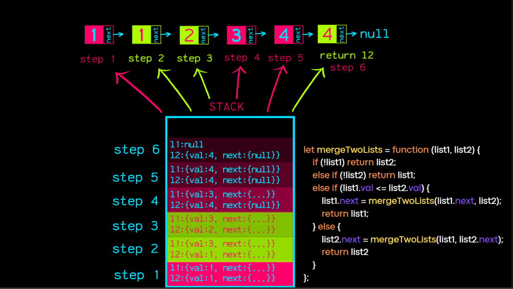

# JS | Recursion | With exlanation

**Author:** Karina_Olenina
**Votes:** 215
**Link:** [https://leetcode.com/problems/merge-two-sorted-lists/solutions/2705782/](https://leetcode.com/problems/merge-two-sorted-lists/solutions/2705782/)

---

To solve this problem, we can use **recursion**, calling it until one of the sheets is **null**, and while it is not null, we do an **equality check**, if list1 is less than or equal to list2, we call recursion with **list1.next** = mergeTwoLists (**list1.next**, list2), else if the value is greater than **list2.next** = mergeTwoLists(list1, **list2.next**). If one of the sheets is null, we simply return the opposite list **(we don't care if it's null or not**). Thus, when the recursion ends, the stack will begin to collapse in reverse order, which will allow us to get a new merged sorted list.

I hope the picture below helps you understand better.




**Time Complexity:** Since we're completely going through two lists. Thus, the time complexity is **O(m+n)**, where m and n are the lengths of the two lists to be combined.

```
var mergeTwoLists = function (l1, l2) {
    if (!l1) return l2;
    else if (!l2) return l1;
    else if (l1.val <= l2.val) {
        l1.next = mergeTwoLists(l1.next, l2);
        return l1;
    } else {
        l2.next = mergeTwoLists(l1, l2.next);
        return l2
    }
};
```

I hope I was able to explain clearly.
**Happy coding!** \uD83D\uDE43