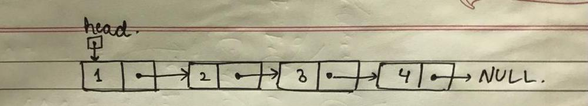
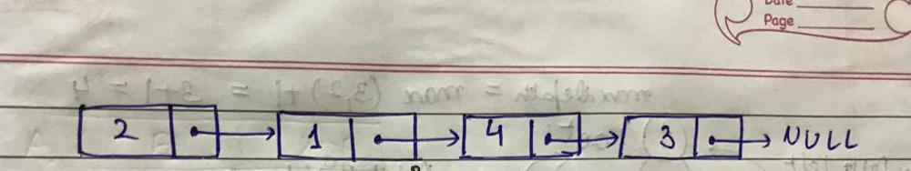
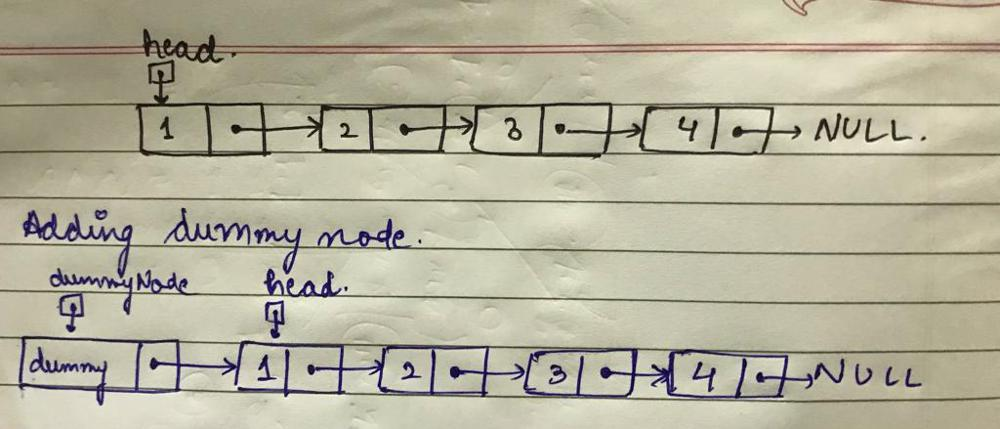
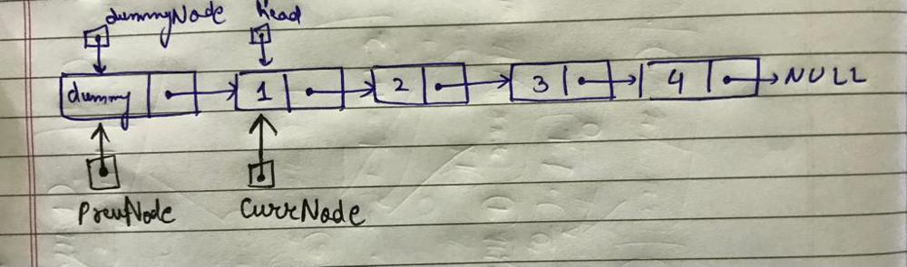
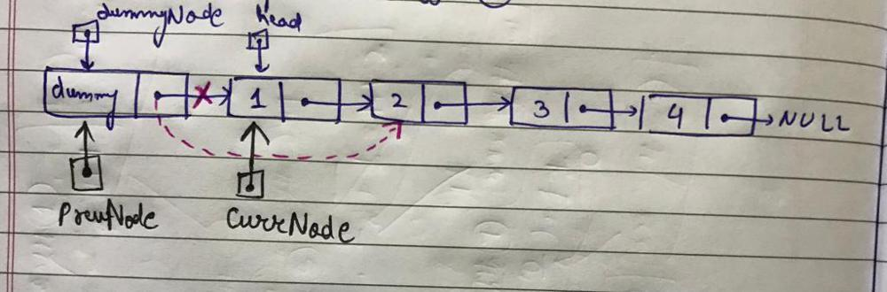
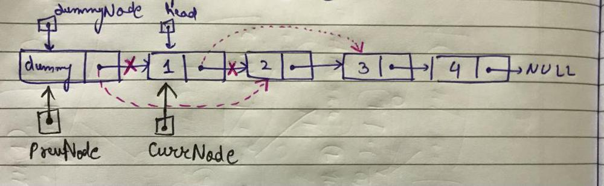
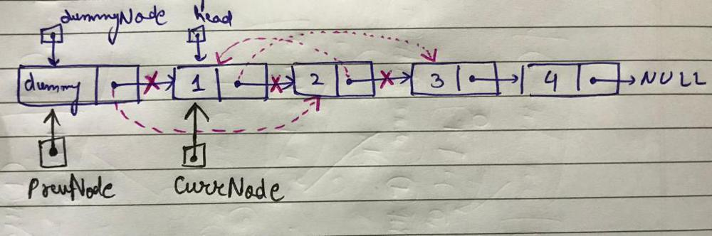
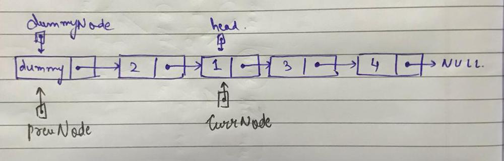
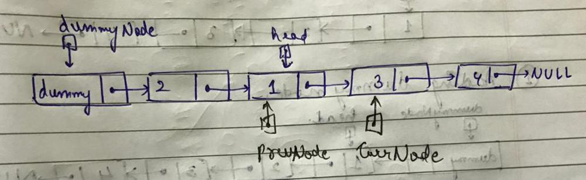

# 🚀SWAPPING NODES (Not just the values) || Visual Explanation || Well Explained || C++

**Author:** sukhseeratkaur0226
**Votes:** 1062
**Link:** [https://leetcode.com/problems/swap-nodes-in-pairs/solutions/1775033/](https://leetcode.com/problems/swap-nodes-in-pairs/solutions/1775033/)

---

As mentioned in the question we have to **exchange the nodes itself (and not just their values)**, and this solution follows this constraint.

I will be placing a `dummy node` before the head node so that the code we write can also be applicable to the head node also, and we don't have to specifically write different conditions for the head node.

#### Example:
***Given Linked List***



 ***Final Linked List***




Let's now understand the **approach**

1. As mentioned earlier, we will place a `dummyNode` before the head node.




2. Now, let the head be our `currNode`. That means the `node with value 1` is the currNode, and we have to swap it with the `node with value 2`. So for this, we will also have to keep track of the node previous to the currNode, let it be `prevNode`, as it's next pointer value will have to change after we swap the currNode and the node next to currNode.



3. Now the very first thing to do is change the `next pointer of prevNode to point to currNode->next`. Why?? Because in the answer we want the `node with value 2` after the dummyNode. Right? So we will have to connect `dummyNode` (prevNode) to the `node with value  2` (currNode->next). This means
```cpp
prevNode->next = currNode->next
```




4. Now, in our finl answer `node with value 1` should be at the place of `node with value 2`. So the next pointer of `node with value 1` should point to whatever the `node with value 2` is pointing to originally. That means we will have to change `currNode->next` to the `next of next of prevNode`, as currently prevNode is dummyNode, prevNode->next is node with value 2 and prevNode->next->next = next of node with value 2. This means
```cpp
currNode->next = prevNode->next->next
```




5. Now, as in the answer the `node with value 2` should point to `node with value 1`. That means
```cpp
prevNode->next->next = currNode
```




6. After this iteration, nodes 1 and 2 will get swapped and our linked list will look like this.




7. Now for the next iteration, we have to swap `nodes with values 3 and 4`. For that the `prevNode` should point to `node with value 1` and the `currNode` should point to `node with value 3`. This means
```cpp
prevNode = currNode
currNode = currNode->next
```




8. We should stop this procedure when either there is no nodes left to swap or there is only one node left which cannot be swapped with any node.

9. At the end, as we can see that our head of the list has been misplaced in the procedure of swapping, so we can return `dummyNode->next` to return the swapped linked list.


#### Code
```cpp
ListNode* swapPairs(ListNode* head) {
        if(!head || !head->next) return head; //If there are less than 2 nodes in the given nodes, then no need to do anything just return the list as it is.
		
        ListNode* dummyNode = new ListNode();
        
        ListNode* prevNode=dummyNode;
        ListNode* currNode=head;
        
        while(currNode && currNode->next){
            prevNode->next = currNode->next;
            currNode->next = prevNode->next->next;
            prevNode->next->next = currNode;
            
            prevNode = currNode;
            currNode = currNode->next;
        }
        
        return dummyNode->next;
    }

```

#### Complexity:
***TC*** **= O(n)**
***SC*** **= O(1)**

***Plz upvote if you liked the post***


