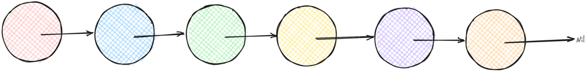
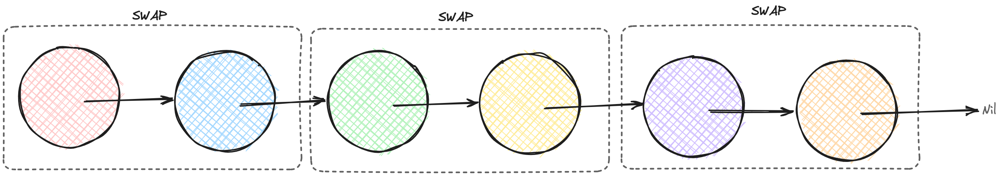
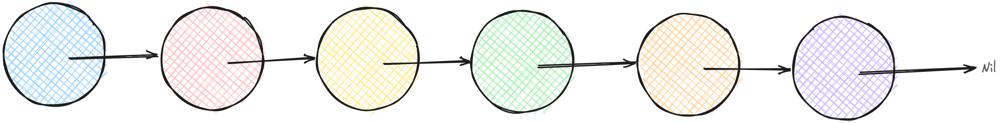
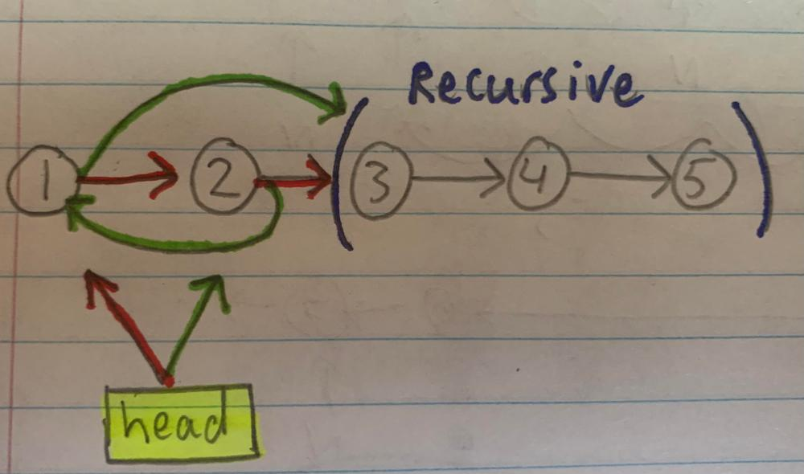
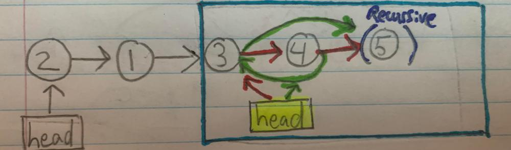
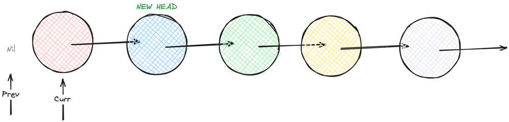
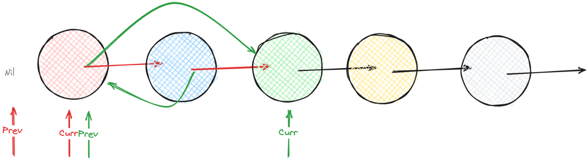

# [Go] Many Clean Solutions with images in Go (GoLang) (0ms 100%)

**Author:** krex0r
**Votes:** 23
**Link:** [https://leetcode.com/problems/swap-nodes-in-pairs/solutions/2481145/](https://leetcode.com/problems/swap-nodes-in-pairs/solutions/2481145/)

---

Hello Gophers!

Start:


Swap:



End:



## Solution 1: Recursive (Easy-Medium)

Cleaner, but worst space complexity.

Time Complexity: `O(n)`
Space Complexity: `O(n)` (recursion)

```go
func swapPairs(head *ListNode) *ListNode {
	if head == nil || head.Next == nil {
		return head
	}

	head, head.Next, head.Next.Next = head.Next, swapPairs(head.Next.Next), head

	return head
}

```

or

```go
func swapPairs(head *ListNode) *ListNode {
    if head != nil && head.Next != nil {
        head, head.Next, head.Next.Next = head.Next, swapPairs(head.Next.Next), head
    }
    return head
}
```





## Solution 2: Iterative (Medium-Hard)


Iteration (`for` loop) instead of recursivity (function calling itself).  
Uglier (imo), but better space complexity.


Time Complexity: `O(n)`
Space Complexity: `O(1)`

### Solution 2.1: with temp nodes (Medium)

```go
func swapPairs(head *ListNode) *ListNode {
	if head == nil || head.Next == nil {
		return head
	}

	var prev, curr, newHead *ListNode = nil, head, head.Next
	for curr != nil && curr.Next != nil {
		firstNode, secondNode := curr, curr.Next
		firstNode.Next, secondNode.Next = secondNode.Next, firstNode

		if prev != nil {
			prev.Next = secondNode
		}

		prev, curr = firstNode, firstNode.Next
	}

	return newHead
}
```

### Solution 2.2: Without temp nodes (Hard)

```go
func swapPairs(head *ListNode) *ListNode {
	if head == nil || head.Next == nil {
		return head
	}
	
	var prev, curr, newHead *ListNode = nil, head, head.Next
	prev, curr, curr.Next, curr.Next.Next = curr, curr.Next.Next, curr.Next.Next, curr
	for curr != nil && curr.Next != nil {
        prev, prev.Next, curr, curr.Next, curr.Next.Next = curr, curr.Next, curr.Next.Next, curr.Next.Next, curr
	}

	return newHead
}
```

How did I get to solution 2.2?

Start:
```go
func swapPairs(head *ListNode) *ListNode {
	if head == nil || head.Next == nil {
		return head
	}

	var prev, curr, newHead *ListNode = nil, head, head.Next
	for curr != nil && curr.Next != nil {
		firstNode, secondNode := curr, curr.Next
		firstNode.Next, secondNode.Next = secondNode.Next, firstNode

		if prev != nil {
			prev.Next = secondNode
		}

		prev, curr = firstNode, firstNode.Next
	}

	return newHead
}
```

Remove "temp nodes" `firstNode` and `secondNode`:

```go
func swapPairs(head *ListNode) *ListNode {
	if head == nil || head.Next == nil {
		return head
	}

	var prev, curr, newHead *ListNode = nil, head, head.Next
	for curr != nil && curr.Next != nil {
		prev, prev.Next, curr, curr.Next, curr.Next.Next = curr, curr.Next, curr.Next.Next, curr.Next.Next, curr
	}

	return newHead
}
```

But because `prev` can be nil:

```go
if prev != nil {
    prev.Next = secondNode
}
```

We need a "first step":

```go
func swapPairs(head *ListNode) *ListNode {
	if head == nil || head.Next == nil {
		return head
	}
	
    // Start
	var prev, curr, newHead *ListNode = nil, head, head.Next

    // Firtst Step (prev is nil)
	prev, curr, curr.Next, curr.Next.Next = curr, curr.Next.Next, curr.Next.Next, curr

    // All Next Steps
	for curr != nil && curr.Next != nil {
        prev, prev.Next, curr, curr.Next, curr.Next.Next = curr, curr.Next, curr.Next.Next, curr.Next.Next, curr
	}

	return newHead
}
```

It works \uD83E\uDD2F

Start:


First iteration:


TODO: Finish this

I hope it helped!