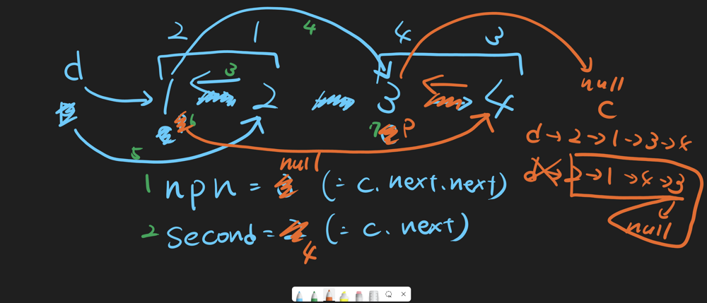

# 【Video】Keep the second node and next pair node

**Author:** niits
**Votes:** 152
**Link:** [https://leetcode.com/problems/swap-nodes-in-pairs/solutions/5689972/](https://leetcode.com/problems/swap-nodes-in-pairs/solutions/5689972/)

---

# Intuition
Keep the second node and next pair node

# Solution Video

https://youtu.be/uvYp4vyOfhA

### \u2B50\uFE0F\u2B50\uFE0F Don't forget to subscribe to my channel! \u2B50\uFE0F\u2B50\uFE0F

**\u25A0 Subscribe URL**
http://www.youtube.com/channel/UC9RMNwYTL3SXCP6ShLWVFww?sub_confirmation=1

Subscribers: 7,869
Thank you for your support!

---


# Approach

For the most case, LinkedList problem is to reorder nodes, so we should think about how we can reconnect nodes.

This is part of my video screen. Green numbers are steps of algorithm.



```
Input: head = [1,2,3,4]
Output: [2,1,4,3]
```

Before we start the algorithm, we will create dummy, previous and current pointer.

```
dummy pointer is pointing to head. dummy.next is an answer
previous pointer is created by dummy
current pointer is created by head
```

### Step 1 - keep next pair node
We swap node `1` and node `2`, node `3` and node `4`, we will disconnect a link between node `2` and node `3` because in the returned linkedList, node `2` and node `3` are not connected. 

**But if we remove the link, we will not be able to jump to node `3` or node `4` from node `1`(= second node in the end).**

That's why the first step is to keep node `3`. Let's say next pair node(=`npn`).

```
npn = 3
```

### Step 2 - keep the second node in a current pair
Next, let's focus on the first pair. node `2` will be the first node in the end, so we should reverse a link between node `1` and node `2` from node `2`, so keep second node in the first pair.

```
npn = 3
second = 2
```

### Step 3 - Reverse a link from the second node
As I told you, the second node will be the first node, that's why

```
npn = 3
second = 2

second.next = current node(= current pointer)
```

### Step 4 - Connect a link to next pair node from the second node
Now node `1` is the second node. We will update

```
npn = 3
second = 2

current pointer.next = npn
```
We can successfully connect next pair node from node `1`.

### Step 5 - Connect a link to the first node from previous pointer
Now we have
```
2 \u2192 1 \u2192 3 \u2192 4
    \u2191
    d
    p

d is dummy  pointer
p is previous pointer
```
**But dummy.next is still pointing to node `1` which is the second node.** That's why we will reconnect a link to node `2` instaad of node `1` from previous pointer(= dummy pointer).

```
npn = 3
second = 2

previous pointer.next = second
```
After that
```
d,p \u2192 2 \u2192 1 \u2192 3 \u2192 4
```
### Step 6,7 - Update previous and current pointer
We need to update previous and current pointer for the next process. previous pointer started from previous position of current pair, so we will update previous pointer with a position before next pair node which is node `1`. And current pointer is pointing to node `1` nowm so
```
previous pointer = current pointer
```
How about current pointer? It's simple, we have to move next pair node, so
```
npn = 3
second = 2

current node = npn
```

The above is one process for each pair. Let me speed up for the next pair node. now we have

```
d \u2192 2 \u2192 1 \u2192 3 \u2192 4
        \u2191   \u2191
        p   c
```
First of all, keep next pair node which is `null` and second node should be node `4`
```
d \u2192 2 \u2192 1 \u2192 3 \u2192 4
        \u2191   \u2191
        p   c

npn = null
second = 4
```
Reverse a link between node `3` and node `4`.
```
second.next = current

d \u2192 2 \u2192 1 \u2192 3 \u2190 4
        \u2191   \u2191
        p   c

npn = null
second = 4
```
Update current.next and previous.next 
```
current.next = npn
previous.next = second

d \u2192 2 \u2192 1 \u2192 4 \u2192 3 \u2192 null
        \u2191       \u2191
        p       c

npn = null
second = 4
```
Update previous and current pointer.
```
previous = current
current = npn

d \u2192 2 \u2192 1 \u2192 4 \u2192 3 \u2192 null
                \u2191    \u2191
                p    c
```
Now current pointer is `null`, so we stop iteration. We should return whole swapped linkedList but problem is current and previous pointer move forward right now. **That's why dummy pointer comes into play.**

We still have dummy pointer at beginning of linkedList and it is pointing to node `2`.

All we have to do is just

```
return 2 \u2192 1 \u2192 4 \u2192 3 \u2192 null (= dummy.next)
```

Easy!\uD83D\uDE04
Let's see solution codes!

---

https://youtu.be/bU_dXCOWHls


# Complexity
- Time complexity: $$O(n)$$
<!-- Add your time complexity here, e.g. $$O(n)$$ -->

- Space complexity: $$O(1)$$
<!-- Add your space complexity here, e.g. $$O(n)$$ -->

```python []
class Solution:
    def swapPairs(self, head: Optional[ListNode]) -> Optional[ListNode]:
        dummy = ListNode(0, head)
        prev, cur = dummy, head

        while cur and cur.next:
            npn = cur.next.next
            second = cur.next

            second.next = cur
            cur.next = npn
            prev.next = second

            prev = cur
            cur = npn
        
        return dummy.next
```
```javascript []
var swapPairs = function(head) {
    let dummy = new ListNode(0, head);
    let prev = dummy, cur = head;

    while (cur && cur.next) {
        let npn = cur.next.next;
        let second = cur.next;

        second.next = cur;
        cur.next = npn;
        prev.next = second;

        prev = cur;
        cur = npn;
    }

    return dummy.next;    
};
```
```java []
class Solution {
    public ListNode swapPairs(ListNode head) {
        ListNode dummy = new ListNode(0, head);
        ListNode prev = dummy, cur = head;

        while (cur != null && cur.next != null) {
            ListNode npn = cur.next.next;
            ListNode second = cur.next;

            second.next = cur;
            cur.next = npn;
            prev.next = second;

            prev = cur;
            cur = npn;
        }

        return dummy.next;        
    }
}
```
```C++ []
class Solution {
public:
    ListNode* swapPairs(ListNode* head) {
        ListNode dummy(0, head);
        ListNode *prev = &dummy, *cur = head;

        while (cur && cur->next) {
            ListNode *npn = cur->next->next;
            ListNode *second = cur->next;

            second->next = cur;
            cur->next = npn;
            prev->next = second;

            prev = cur;
            cur = npn;
        }

        return dummy.next;        
    }
};
```

# Step by Step Algorithm

### Step 1: Initialize a Dummy Node
```python
dummy = ListNode(0, head)
prev, cur = dummy, head
```
- **Explanation**: 
  - A dummy node `dummy` is created with a value of `0`, and its `next` pointer is set to `head`. This dummy node helps in handling edge cases, such as when the list starts with the first node to be swapped.
  - Two pointers, `prev` and `cur`, are initialized. `prev` is set to `dummy`, and `cur` is set to `head`, the starting node of the list.

### Step 2: Traverse and Swap Nodes in Pairs
```python
while cur and cur.next:
    npn = cur.next.next
    second = cur.next
```
- **Explanation**: 
  - The loop continues as long as `cur` (the current node) and `cur.next` (the next node) are not `None`.
  - `npn` (next pair's node) is set to the node after the pair that is currently being processed (`cur.next.next`).
  - `second` is set to `cur.next`, which is the second node of the current pair.

### Step 3: Perform the Swap
```python
second.next = cur
cur.next = npn
prev.next = second
```
- **Explanation**: 
  - The `second.next` is updated to point to `cur`, effectively reversing the pair.
  - `cur.next` is updated to point to `npn`, which connects the swapped pair to the rest of the list.
  - `prev.next` is updated to point to `second`, ensuring the previous node points to the newly swapped pair.

### Step 4: Move to the Next Pair
```python
prev = cur
cur = npn
```
- **Explanation**: 
  - `prev` is moved forward to `cur`, which was the second node in the original pair but is now the first node after swapping.
  - `cur` is moved forward to `npn`, the next node to be processed.

### Step 5: Return the Modified List
```python
return dummy.next
```
- **Explanation**: 
  - After all pairs have been processed, the function returns `dummy.next`, which points to the new head of the modified list. The dummy node itself is not part of the final list but was essential for handling the swaps smoothly.

---

Thank you for reading my post. Please upvote it and don't forget to subscribe to my channel!

### \u2B50\uFE0F Subscribe URL
http://www.youtube.com/channel/UC9RMNwYTL3SXCP6ShLWVFww?sub_confirmation=1

### \u2B50\uFE0F Twitter
https://twitter.com/CodingNinjaAZ

### \u2B50\uFE0F Related Video

#206 Reverse Linked List

https://youtu.be/9TsQmdRAxT8
