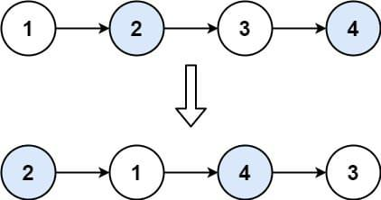

# 🔥🔥 Explicación y Resolución Del Ejercicio En Español Java | Python | PHP | C++ | JavaScript 🔥🔥

**Author:** hermescoder02
**Votes:** 6
**Link:** [https://leetcode.com/problems/swap-nodes-in-pairs/solutions/4094597/](https://leetcode.com/problems/swap-nodes-in-pairs/solutions/4094597/)

---

# Lectura

*Intercambiar nodos en pares (Java, Python, PHP, C++, Javascript)*

Dada una lista enlazada, intercambie cada dos nodos adyacentes y devuelva su cabeza. 



Debe resolver el problema sin modificar los valores en los nodos de la lista (es decir, solo se pueden cambiar los nodos).

# Explicaci\xF3n del ejercicio Paso por paso

https://youtu.be/TTiWZOWJbhc

Si te gust\xF3 el contenido \xA1visita mi canal de youtube!: 
\u2705https://www.youtube.com/@hermescoder

Si deseas profundizar m\xE1s en este tema \xA1visita mi blog!: 
\u2705https://hermescoder.com/swap-nodes-in-pairs-leetcode-espanol.html

# C\xF3digo 

```Java []
/**
 * Definition for singly-linked list.
 * public class ListNode {
 *     int val;
 *     ListNode next;
 *     ListNode() {}
 *     ListNode(int val) { this.val = val; }
 *     ListNode(int val, ListNode next) { 
 *      this.val = val; this.next = next; 
 *     }
 * }
 */
public class Solution {

    public static ListNode swapPairs(ListNode head) {
        // paso #1
        if (head == null || head.next == null) {
            return head;
        }

        // paso #2
        ListNode home = head.next;

        // paso #3
        ListNode end = head;

        while (head != null && head.next != null) {
            // Pasos para voltear los pares de nodos
            ListNode aux = head.next; // paso #4
            end.next = aux; // paso #5
            head.next = aux.next; // paso #6
            aux.next = head; // paso #7

            // Pasos para actualizar los punteros
            end = head; // paso #8
            head = head.next; // paso #9
        }

        // retornamos el puntero home
        return home;
    }
}
```
```Python []
# Definition for singly-linked list.
# class ListNode(object):
#     def __init__(self, val=0, next=None):
#         self.val = val
#         self.next = next
class Solution(object):
    def swapPairs(self, head):
        # paso #1
        if head is None or head.next is None:
            return head

        # paso #2
        home = head.next

        # paso #3
        end = head

        while head and head.next:
            # Pasos para voltear los pares de nodos
            aux = head.next           # paso #4
            end.next = aux            # paso #5
            head.next = aux.next     # paso #6
            aux.next = head           # paso #7

            # Pasos para actualizar los punteros
            end = head                 # paso #8
            head = head.next          # paso #9

        # retornamos el puntero home
        return home
```
```PHP []
/**
 * Definition for a singly-linked list.
 * class ListNode {
 *     public $val = 0;
 *     public $next = null;
 *     function __construct($val = 0, $next = null) {
 *         $this->val = $val;
 *         $this->next = $next;
 *     }
 * }
 */
class Solution {
 
    /**
     * @param ListNode $head
     * @return ListNode
     */
    function swapPairs($head) {
        //paso #1
        if(!$head->next || !$head) return $head;
 
        //paso #2
        $home=$head->next;
 
        //paso #3
        $end=$head;
 
        while ($head->next){
 
            //Pasos para voltear los pares de nodos
            $aux=$head->next;           //paso #4
            $end->next=$aux;            //paso #5
            $head->next=$aux->next;     //paso #6
            $aux->next=$head;           //paso #7
 
            //Pasos para actualizar los punteros
            $end=$head;                 //paso #8
            $head=$head->next;          //paso #9
        }
 
        //retornamos el puntero home
        return $home;
    }
} 
```
```C++ []
/**
 * Definition for singly-linked list.
 * struct ListNode {
 *     int val;
 *     ListNode *next;
 *     ListNode() : val(0), next(nullptr) {}
 *     ListNode(int x) : val(x), next(nullptr) {}
 *     ListNode(int x, ListNode *next) : val(x), next(next) {}
 * };
 */
class Solution {
public:
      ListNode* swapPairs(ListNode* head) {
    // paso #1
    if (!head || !head->next) return head;

    // paso #2
    ListNode* home = head->next;

    // paso #3
    ListNode* end = head;

    while (head && head->next) {
      // Pasos para voltear los pares de nodos
      ListNode* aux = head->next; // paso #4
      end->next = aux; // paso #5
      head->next = aux->next; // paso #6
      aux->next = head; // paso #7

      // Pasos para actualizar los punteros
      end = head; // paso #8
      head = head->next; // paso #9
    }

    // retornamos el puntero home
    return home;
  }
};
```
```JavaScript []
/**
 * Definition for singly-linked list.
 * function ListNode(val, next) {
 *     this.val = (val===undefined ? 0 : val)
 *     this.next = (next===undefined ? null : next)
 * }
 */
/**
 * @param {ListNode} head
 * @return {ListNode}
 */
var swapPairs = function(head) {
        // paso #1
    if (!head || !head.next) return head;

    // paso #2
    const home = head.next;

    // paso #3
    let end = head;

    while (head && head.next) {
      // Pasos para voltear los pares de nodos
      const aux = head.next; // paso #4
      end.next = aux; // paso #5
      head.next = aux.next; // paso #6
      aux.next = head; // paso #7

      // Pasos para actualizar los punteros
      end = head; // paso #8
      head = head.next; // paso #9
    }

    // retornamos el puntero home
    return home;
};
```


