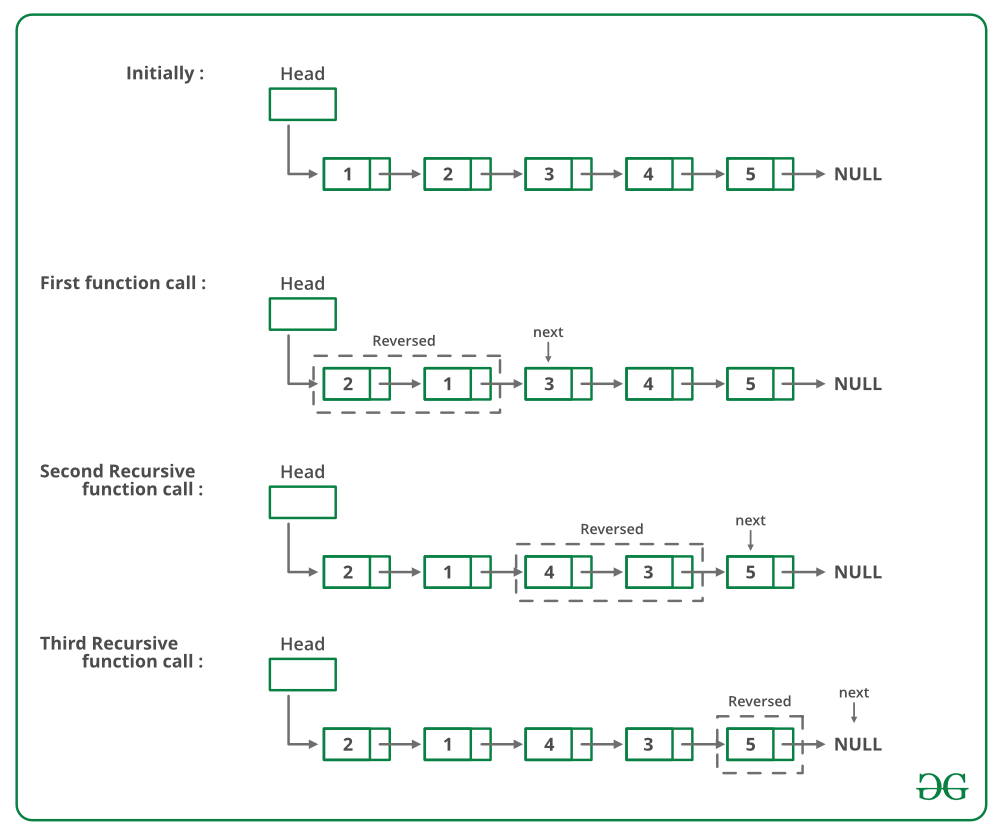

# ✅ Detailed Explanation🚀Easy Solution✅ Beats100%🚀Beginner-Friendly Solution and Approach 💫

**Author:** kanix-1801
**Votes:** 5
**Link:** [https://leetcode.com/problems/swap-nodes-in-pairs/solutions/5375709/](https://leetcode.com/problems/swap-nodes-in-pairs/solutions/5375709/)

---

# Intuition


***The intuition is to traverse the list, swapping each pair of adjacent nodes to create a new reordered list.***
<!-- Describe your first thoughts on how to solve this problem. -->

# Approach
# ***all steps :***
```
Initial: head -> 1 -> 2 -> 3 -> 4

First Iteration:
Step 1:   slow -> 1 -> 2 -> 3 -> 4
          fast -> 1 -> 2 -> 3 -> 4
          NewHead -> null
          prev -> null
          
Step 2:   slow -> 1 -> 3 -> 4
          temp -> 2 -> 1
          
          NewHead -> 2
          prev -> 1
          slow -> 3
          fast -> 3
          
Updated:  2 -> 1 -> 3 -> 4

Second Iteration:
Step 1:   slow -> 3 -> 4
          fast -> 3 -> 4
          NewHead -> 2
          prev -> 1
          
Step 2:   slow -> 3 -> null
          temp -> 4 -> 3
          prev -> 4

Updated:  2 -> 1 -> 4 -> 3

Final:    NewHead -> 2 -> 1 -> 4 -> 3

```
# detailed explanation :
- Initial List `head -> 1 -> 2 -> 3 -> 4`
## First Iteration
  1. Pointers Before Swapping:
  `slow -> 1 ,
fast -> 1 ,
NewHead -> null ,
prev -> null
`
  ***slow and fast are initialized to start at the head. NewHead and prev are initialized to null.***
  2. After Swapping the First Pair:
  `temp -> 2 (slow.next) ,
slow.next -> 3 (fast) ,
temp.next -> 1 (slow)
`
***temp is created to store slow.next, which is the node to be swapped. slow.next is updated to fast (third node). temp.next is set to slow, completing the swap.***

  **Updated List:** `2 -> 1 -> 3 -> 4`

  3. Updating Pointers:
  `NewHead -> 2 ,
prev -> 1 ,
slow -> 3 ,
fast -> 3 `
***NewHead is set to temp as it's the new head of the list. prev is set to slow to keep track of the last node in the swapped pair. slow and fast are moved to the next pair of nodes to be swapped.***

 
## Second Iteration:
   1. Pointers Before Swapping:
   `slow -> 3 ,
fast -> 3 ,
NewHead -> 2 ,
prev -> 1
`
***The pointers are now positioned for the next pair to be swapped.***
   2. After Swapping the Second Pair:
    `temp -> 4 (slow.next) ,
slow.next -> null (fast) ,
temp.next -> 3 (slow) ,
prev.next -> 4
`
temp is created to store slow.next. ***slow.next is updated to fast*** (which is now null). temp.next is set to slow, completing the swap. prev.next is updated to temp to link the previously swapped nodes to the current swapped pair.
  ***Updated List:*** `2 -> 1 -> 4 -> 3
`
  3. **Updating Pointers:**
  `prev -> 3 ,
slow -> null ,
fast -> null ,
`
***prev is updated to slow. slow and fast are moved to null as there are no more nodes to swap.***
- **Final List :** `NewHead -> 2 -> 1 -> 4 -> 3
`

# Complexity
- Time complexity:$$O(n)$$
where \uD835\uDC5B is the number of nodes in the list. Each node is visited once.
<!-- Add your time complexity here, e.g. $$O(n)$$ -->

- Space complexity: $$O(1)$$
since only a constant amount of extra space is used.
<!-- Add your space complexity here, e.g. $$O(n)$$ -->

# Code
```java []
class Solution {
    public ListNode swapPairs(ListNode head) {
        if(head == null || head.next == null){
            return head;
        }
        ListNode slow = head;
        ListNode fast = head;
        ListNode NewHead = null;
        ListNode prev = null;
        while(fast != null && fast.next != null){
            ListNode temp = slow.next;
            fast = fast.next.next;
            slow.next = fast;
            temp.next = slow;
            if(prev != null){prev.next = temp;}
            prev = slow;
            slow = fast;
            if(NewHead == null){NewHead = temp;}
        }
        return NewHead;
    }
}
```
```c++ []
class Solution {
public:
    ListNode* swapPairs(ListNode* head) {
        if (head == NULL || head->next == NULL) {
            return head;
        }
        ListNode* slow = head;
        ListNode* fast = head;
        ListNode* NewHead = NULL;
        ListNode* prev = NULL;
        
        while (fast != NULL && fast->next != NULL) {
            ListNode* temp = slow->next;
            fast = fast->next->next;
            slow->next = fast;
            temp->next = slow;
            if (prev != NULL) {
                prev->next = temp;
            }
            prev = slow;
            slow = fast;
            if (NewHead == NULL) {
                NewHead = temp;
            }
        }
        return NewHead;
    }
};
```
```JavaScript []
function ListNode(val, next) {
    this.val = (val === undefined ? 0 : val);
    this.next = (next === undefined ? null : next);
}

/**
 * @param {ListNode} head
 * @return {ListNode}
 */
var swapPairs = function(head) {
    if (!head || !head.next) {
        return head;
    }
    
    let NewHead = null; // Initialize NewHead to null
    
    let prev = null;
    let curr = head;
    
    while (curr && curr.next) {
        let nextPair = curr.next.next;
        let temp = curr.next;
        
        // Swap
        curr.next = nextPair;
        temp.next = curr;
        
        if (prev) {
            prev.next = temp;
        } else {
            NewHead = temp; // Set NewHead to the first swapped pair
        }
        
        // Move to the next pair
        prev = curr;
        curr = nextPair;
    }
    
    return NewHead;
};

```
```Python3 []
# Definition for singly-linked list.
class ListNode:
    def __init__(self, val=0, next=None):
        self.val = val
        self.next = next

class Solution:
    def swapPairs(self, head: Optional[ListNode]) -> Optional[ListNode]:
        if not head or not head.next:
            return head
        
        NewHead = None  # Initialize NewHead to None
        
        prev = None
        curr = head
        
        while curr and curr.next:
            nextPair = curr.next.next
            temp = curr.next
            
            # Swap
            curr.next = nextPair
            temp.next = curr
            
            if prev:
                prev.next = temp
            else:
                NewHead = temp  # Set NewHead to the first swapped pair
            
            # Move to the next pair
            prev = curr
            curr = nextPair
        
        return NewHead


```
```TypeScript []
function swapPairs(head: ListNode | null): ListNode | null {
    if (!head || !head.next) {
        return head;
    }
    
    let NewHead: ListNode | null = null; // Initialize NewHead to null
    
    let prev: ListNode | null = null;
    let curr: ListNode | null = head;
    
    while (curr && curr.next) {
        let nextPair: ListNode | null = curr.next.next;
        let temp: ListNode | null = curr.next;
        
        // Swap
        curr.next = nextPair;
        if (temp) {
            temp.next = curr;
        }
        
        if (prev) {
            prev.next = temp;
        } else {
            NewHead = temp; // Set NewHead to the first swapped pair
        }
        
        // Move to the next pair
        prev = curr;
        curr = nextPair;
    }
    
    return NewHead;
}

// Example usage:
let head: ListNode | null = new ListNode(1);
head.next = new ListNode(2);
head.next.next = new ListNode(3);
head.next.next.next = new ListNode(4);

function printList(head: ListNode | null): void {
    let current: ListNode | null = head;
    let result: string = '';
    while (current) {
        result += current.val + ' -> ';
        current = current.next;
    }
    result += 'null';
    console.log(result);
}

console.log('Original list:');
printList(head);

head = swapPairs(head);

console.log('Swapped list:');
printList(head);
```
