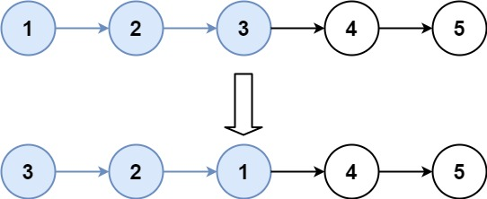

# [25. Reverse Nodes in k-Group](https://leetcode.com/problems/reverse-nodes-in-k-group/)

| Category | Difficulty | Likes | Dislikes |
| :------: | :--------: | :---: | :------: |
| Algorithms | Hard | 15307 | 789 |

**Tags:** [`linked-list`](https://leetcode.com/tag/linked-list), [`recursion`](https://leetcode.com/tag/recursion)

**Companies:** `amazon`, `microsoft`, `google`, `facebook`, `mathworks`, `uber`, `goldman-sachs`, `cisco`, `bloomberg`, `salesforce`, `apple`, `tiktok`, `cadence`, `arista-networks`, `snowflake`, `adobe`, `walmart-labs`, `tesla`, `visa`, `josh-technology`

## Description

Given the `head` of a linked list, reverse the nodes of the list `k` at a time, and return *the modified list*.

`k` is a positive integer and is less than or equal to the length of the linked list. If the number of nodes is not a multiple of `k` then left-out nodes, in the end, should remain as it is.

You may not alter the values in the list's nodes, only nodes themselves may be changed.

 

**Example 1:**


```

Input: head = [1,2,3,4,5], k = 2
Output: [2,1,4,3,5]

```

**Example 2:**


```

Input: head = [1,2,3,4,5], k = 3
Output: [3,2,1,4,5]

```

 

**Constraints:**

	- The number of nodes in the list is `n`.

	- `1 <= k <= n <= 5000`

	- `0 <= Node.val <= 1000`

 

**Follow-up:** Can you solve the problem in `O(1)` extra memory space?

---

**Links:** [Submissions](https://leetcode.com/problems/reverse-nodes-in-k-group/) | [Solutions](https://leetcode.com/problems/reverse-nodes-in-k-group/)
