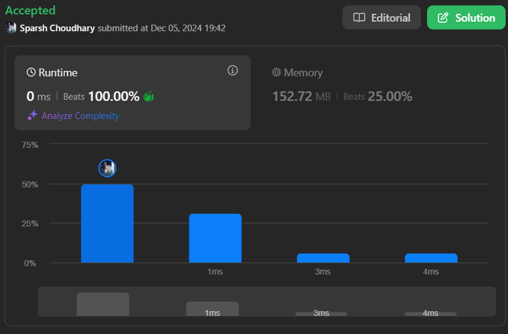

# 🔥BEATS 💯 % 🎯 |✨SUPER EASY BEGINNERS 👏

**Author:** CodeWithSparsh
**Votes:** 4
**Link:** [https://leetcode.com/problems/rotate-list/solutions/6116494/](https://leetcode.com/problems/rotate-list/solutions/6116494/)

---



---


# Intuition
To rotate a linked list to the right by \\( k \\) positions, notice that rotating by the list's length \\( n \\) has no effect. This means we only need to rotate by \\( k \\mod n \\) steps. For an efficient solution, we can turn the linked list into a circular list, break it at the right point, and reconnect it.

---

# Approach
1. **Determine the Length:**  
   Traverse the list to find its length \\( n \\) and also get a reference to the tail node.

2. **Calculate Effective Rotations:**  
   Since rotating \\( n \\) times brings the list back to its original state, compute \\( k = k \\mod n \\).

3. **Find the Breaking Point:**  
   Find the node where the list should be split. This is at position \\( n - k \\) from the beginning.

4. **Perform the Rotation:**  
   Break the list at the breaking point, set the next node as the new head, and connect the old tail to the original head.

---

# Complexity
- **Time complexity:**  
  $$O(n)$$ \u2014 We traverse the list to calculate its length and adjust pointers.

- **Space complexity:**  
  $$O(1)$$ \u2014 Only a constant amount of extra space is used.

---


```dart []
/**
 * Definition for singly-linked list.
 * class ListNode {
 *   int val;
 *   ListNode? next;
 *   ListNode([this.val = 0, this.next]);
 * }
 */
class Solution {
  ListNode? rotateRight(ListNode? head, int k) {
    if (head == null || head.next == null || k == 0) return head;

    // Step 1: Find the length of the list and the tail node
    int length = 1; // At least one node exists
    ListNode? tail = head;
    while (tail?.next != null) {
      length++;
      tail = tail?.next;
    }

    // Step 2: Handle cases where k >= length
    k = k % length; // Only consider effective rotations
    if (k == 0) return head; // No rotation needed

    // Step 3: Find the breaking point
    int breakPoint = length - k; // Position to break the list
    ListNode? current = head;
    for (int i = 1; i < breakPoint; i++) {
      current = current?.next;
    }

    // Step 4: Rotate the list
    ListNode? newHead = current?.next; // New head of the rotated list
    current?.next = null; // Break the list at the breaking point
    tail?.next = head; // Connect the tail to the original head

    return newHead;
  }
}
```


```python []
class Solution:
    def rotateRight(self, head, k):
        if not head or not head.next or k == 0:
            return head

        # Step 1: Find the length of the list and the tail node
        length = 1
        tail = head
        while tail.next:
            length += 1
            tail = tail.next

        # Step 2: Handle cases where k >= length
        k = k % length
        if k == 0:
            return head

        # Step 3: Find the breaking point
        breakPoint = length - k
        current = head
        for _ in range(breakPoint - 1):
            current = current.next

        # Step 4: Rotate the list
        new_head = current.next
        current.next = None
        tail.next = head

        return new_head
```


```javascript []
var rotateRight = function(head, k) {
    if (!head || !head.next || k === 0) return head;

    // Step 1: Find the length of the list and the tail node
    let length = 1;
    let tail = head;
    while (tail.next) {
        length++;
        tail = tail.next;
    }

    // Step 2: Handle cases where k >= length
    k = k % length;
    if (k === 0) return head;

    // Step 3: Find the breaking point
    let breakPoint = length - k;
    let current = head;
    for (let i = 1; i < breakPoint; i++) {
        current = current.next;
    }

    // Step 4: Rotate the list
    let newHead = current.next;
    current.next = null;
    tail.next = head;

    return newHead;
};
```


```java []
class Solution {
    public ListNode rotateRight(ListNode head, int k) {
        if (head == null || head.next == null || k == 0) return head;

        // Step 1: Find the length of the list and the tail node
        int length = 1;
        ListNode tail = head;
        while (tail.next != null) {
            length++;
            tail = tail.next;
        }

        // Step 2: Handle cases where k >= length
        k = k % length;
        if (k == 0) return head;

        // Step 3: Find the breaking point
        int breakPoint = length - k;
        ListNode current = head;
        for (int i = 1; i < breakPoint; i++) {
            current = current.next;
        }

        // Step 4: Rotate the list
        ListNode newHead = current.next;
        current.next = null;
        tail.next = head;

        return newHead;
    }
}
```


```cpp []
class Solution {
public:
    ListNode* rotateRight(ListNode* head, int k) {
        if (!head || !head->next || k == 0) return head;

        // Step 1: Find the length of the list and the tail node
        int length = 1;
        ListNode* tail = head;
        while (tail->next) {
            length++;
            tail = tail->next;
        }

        // Step 2: Handle cases where k >= length
        k = k % length;
        if (k == 0) return head;

        // Step 3: Find the breaking point
        int breakPoint = length - k;
        ListNode* current = head;
        for (int i = 1; i < breakPoint; i++) {
            current = current->next;
        }

        // Step 4: Rotate the list
        ListNode* newHead = current->next;
        current->next = nullptr;
        tail->next = head;

        return newHead;
    }
};
```


```go []
func rotateRight(head *ListNode, k int) *ListNode {
    if head == nil || head.Next == nil || k == 0 {
        return head
    }

    // Step 1: Find the length of the list and the tail node
    length := 1
    tail := head
    for tail.Next != nil {
        length++
        tail = tail.Next
    }

    // Step 2: Handle cases where k >= length
    k = k % length
    if k == 0 {
        return head
    }

    // Step 3: Find the breaking point
    breakPoint := length - k
    current := head
    for i := 1; i < breakPoint; i++ {
        current = current.Next
    }

    // Step 4: Rotate the list
    newHead := current.Next
    current.Next = nil
    tail.Next = head

    return newHead
}
```
---

 {:style='width:250px'}